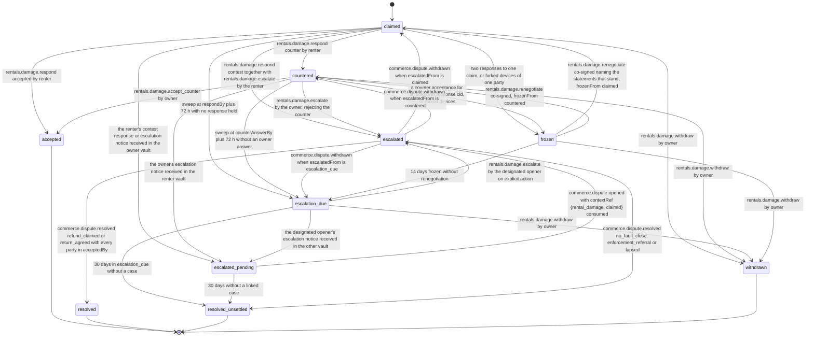

# PS-041-03 — Workflow state machine: Rental damage claims

**Status:** SPECIFIED (Stage 3). **Module:** [F05.S02.M03 Rental damage claims](SPEC.md) · **Scope:** MVP · **Code:** `packages/rentals/src/rental_lifecycle/damage` · **Contracts:** [CTR-ID-001](../../../planning/contracts/CTR-ID-001.md), [CTR-EVT-001](../../../planning/contracts/CTR-EVT-001.md), [CTR-ERR-001](../../../planning/contracts/CTR-ERR-001.md), [CTR-CAP-001](../../../planning/contracts/CTR-CAP-001.md), [CTR-IDM-001](../../../planning/contracts/CTR-IDM-001.md), [CTR-MNY-001](../../../planning/contracts/CTR-MNY-001.md), [CTR-COM-001](../../../planning/contracts/CTR-COM-001.md), [CTR-PRV-001](../../../planning/contracts/CTR-PRV-001.md), [CTR-FED-001](../../../planning/contracts/CTR-FED-001.md)

> Generated from `module.spec.yaml` by `tools/specgen`. Edit the YAML, then run `pnpm spec:render`.

## Requirements

- **PS-041-03.R01** Claims move claimed, optionally countered, then accepted, escalated to resolved or resolved_unsettled, or withdrawn, with escalation_due, escalated_pending and frozen as holding states; accepted, resolved, resolved_unsettled and withdrawn are terminal.
- **PS-041-03.R02** Silence never settles money - unanswered claims and unanswered counters move to escalation_due with a prefilled draft of the F09 case, held in this vault, that only the designated party opens by explicit action; no case is ever opened automatically.
- **PS-041-03.R03** Each terminal transition emits rentals.damage.resolved once with the outcome; escalation produces the case request through the designated party's explicit action before the state changes.
- **PS-041-03.R04** F09 resolutions are mapped explicitly - refund_claimed or return_agreed accepted by both parties set agreedAmount from advisoryRefund (always read as the amount the renter pays the owner whichever party opened the case, 0 when absent, capped at totalClaimed) and record the outcome both parties accepted; no_fault_close, enforcement_referral and lapsed end in resolved_unsettled with no agreedAmount; commerce.dispute.withdrawn returns the claim to the state it was escalated from.
- **PS-041-03.R05** Exactly one vault opens a case per claim - the owner after the renter's silence or when rejecting a counter, the renter on contest or after the owner's silence on a counter - and the other vault waits in escalated_pending and links the case from commerce.dispute.opened.
- **PS-041-03.R06** A frozen claim leaves frozen only by a co-signed renegotiation back to the state it was frozen from, a withdrawal by the owner, or after 14 days into escalation_due with the party that did not fork as designated opener.

## Specification

### DamageClaim lifecycle

Initial **claimed**; terminal **accepted**, **resolved**, **resolved_unsettled**, **withdrawn**.

| Transition | Trigger | Guard / effect |
|---|---|---|
| claimed -> accepted | rentals.damage.respond accepted by renter | agreedAmount equals totalClaimed; emits rentals.damage.resolved with outcome accepted |
| claimed -> countered | rentals.damage.respond counter by renter | one counter below totalClaimed; signed counterAnswerBy |
| claimed -> escalated | rentals.damage.respond contest together with rentals.damage.escalate by the renter | the contesting renter opens the case {rental_damage, claimId}; damage_escalation notice to the owner |
| claimed -> escalated_pending | the renter's contest response or escalation notice received in the owner vault | waiting to link the case |
| claimed -> escalation_due | sweep at respondBy plus 72 h with no response held | owner vault: prefilled draft case held locally, nothing sent to F09; renter vault: waiting; never accepted |
| claimed -> withdrawn | rentals.damage.withdraw by owner | emits rentals.damage.resolved with outcome withdrawn |
| claimed -> frozen | two responses to one claim, or forked devices of one party | frozenFrom claimed |
| countered -> accepted | rentals.damage.accept_counter by owner | agreedAmount equals counterAmount; emits rentals.damage.resolved with outcome counter_accepted |
| countered -> escalated | rentals.damage.escalate by the owner, rejecting the counter | the owner opens the case; damage_escalation notice to the renter |
| countered -> escalated_pending | the owner's escalation notice received in the renter vault | waiting to link the case |
| countered -> escalation_due | sweep at counterAnswerBy plus 72 h without an owner answer | renter vault: prefilled draft case held locally, nothing sent to F09; owner vault: waiting |
| countered -> withdrawn | rentals.damage.withdraw by owner | emits rentals.damage.resolved with outcome withdrawn |
| countered -> frozen | a counter acceptance for an unknown response cid, or forked devices | frozenFrom countered |
| escalation_due -> escalated | rentals.damage.escalate by the designated opener on explicit action | case opened from the draft; damage_escalation notice to the other party |
| escalation_due -> escalated_pending | the designated opener's escalation notice received in the other vault | waiting to link the case |
| escalation_due -> withdrawn | rentals.damage.withdraw by owner | emits rentals.damage.resolved with outcome withdrawn |
| escalation_due -> resolved_unsettled | 30 days in escalation_due without a case | outcome dispute_unresolved (lapsed); no agreedAmount; emits rentals.damage.resolved |
| escalated_pending -> escalated | commerce.dispute.opened with contextRef {rental_damage, claimId} consumed | case id linked |
| escalated_pending -> resolved_unsettled | 30 days without a linked case | outcome dispute_unresolved; no agreedAmount; emits rentals.damage.resolved |
| escalated -> resolved | commerce.dispute.resolved refund_claimed or return_agreed with every party in acceptedBy | agreedAmount = advisoryRefund or 0 when absent, capped at totalClaimed; outcome refund_claimed or return_agreed; emits rentals.damage.resolved |
| escalated -> resolved_unsettled | commerce.dispute.resolved no_fault_close, enforcement_referral or lapsed | no agreedAmount; outcome dispute_unresolved; emits rentals.damage.resolved |
| escalated -> claimed | commerce.dispute.withdrawn when escalatedFrom is claimed | prior state restored; a passed respondBy moves it to escalation_due on the next sweep |
| escalated -> countered | commerce.dispute.withdrawn when escalatedFrom is countered | prior state restored |
| escalated -> escalation_due | commerce.dispute.withdrawn when escalatedFrom is escalation_due | prior state restored |
| frozen -> claimed | rentals.damage.renegotiate co-signed naming the statements that stand, frozenFrom claimed | deadlines from the claim that stands |
| frozen -> countered | rentals.damage.renegotiate co-signed, frozenFrom countered | deadlines from the counter that stands |
| frozen -> escalation_due | 14 days frozen without renegotiation | the party that did not fork is the designated opener |
| frozen -> withdrawn | rentals.damage.withdraw by owner | emits rentals.damage.resolved with outcome withdrawn |

### Timeouts and scheduled transitions

- Claims carry respondBy = createdAt + 7 d + 72 h and counters carry counterAnswerBy = createdAt + 7 d + 72 h; a response created by the deadline is accepted when received within 72 h of its createdAt; at the deadline plus 72 h without an answer the claim moves to escalation_due, never to acceptance. escalation_due and escalated_pending end resolved_unsettled after 30 days without a case; frozen moves to escalation_due after 14 days. Vault sweeps run at app start, on every command and every 60 s while the PWA is open, and every read applies the deadlines on the fly.

## Verification

| Test | Level | Covers | Scenario | Expected |
|---|---|---|---|---|
| TEST-PS-041-09.T03 | property | PS-041-02.R02, PS-041-03.R01, PS-041-09.R02 | random handoff and return checklists with each provenance | worsened set and provenance equal the reference model; claims without worsened items refused; basis mismatch refused on receipt |
| TEST-PS-041-09.T04 | integration | PS-041-03.R02, PS-041-03.R03 | renter silent past respondBy plus 72 h; owner silent on a counter past counterAnswerBy plus 72 h | escalation_due with a prefilled draft case for the owner and for the renter respectively; no case opened; never accepted; events once |
| TEST-PS-041-09.T05 | property | PS-041-03.R01, PS-041-03.R06 | random statement and event sequences including forks | only declared transitions succeed; terminal states never change; frozen leaves only through renegotiation, withdrawal or escalation_due |
| TEST-PS-041-09.T12 | integration | PS-041-03.R01, PS-041-01.R02 | not_returned claim at day 13 and day 15 overdue; not_returned claim at day 15 while an uncontested renter return report is held | RENTALS_DAMAGE_WINDOW at day 13; allowed at day 15 with overdue history as basis; RENTALS_DAMAGE_WINDOW while the report is uncontested |
| TEST-PS-041-09.T19 | integration | PS-041-03.R04 | for an escalated claim deliver each F09 outcome - refund_claimed with advisoryRefund EUR 30.00 accepted by both, return_agreed accepted by both without advisoryRefund, no_fault_close, enforcement_referral, lapsed - plus refund_claimed with advisoryRefund EUR 30.00 accepted by both in a case the renter opened, and separately commerce.dispute.withdrawn | resolved with EUR 30.00 for both refund_claimed cases; resolved with 0 for return_agreed; resolved_unsettled without agreedAmount for the other three; prior state restored on withdrawal |
| TEST-PS-041-09.T20 | integration | PS-041-03.R05 | renter contests; renter silent; owner silent on a counter | exactly one case per claim opened by the designated party; the other vault waits in escalated_pending and links the case from commerce.dispute.opened |

## Dependencies

Module depends on: F05.S02.M01, F05.S02.M02, F05.S01.M01, F05.S01.M02, F09.S01.M01, F09.S01.M03, F09.S02.M02, F08.S01.M01, F08.S01.M03, F15.S02.M03, F10.S02.M03, F07.S01.M01, F07.S02.M02, F11.S01.M01, F11.S01.M03, F10.S01.M02, F10.S01.M03, F10.S01.M04, F10.S02.M02, CTR-ID-001, CTR-EVT-001, CTR-ERR-001, CTR-CAP-001, CTR-IDM-001, CTR-MNY-001, CTR-COM-001, CTR-PRV-001, CTR-FED-001. Predecessor: [domain_schema.md](domain_schema.md).
