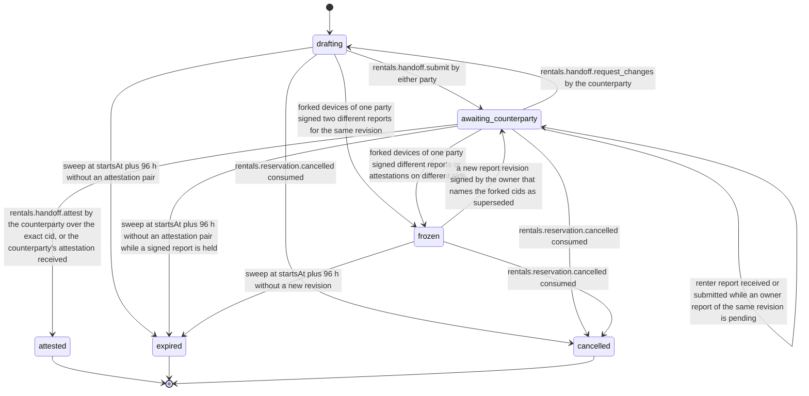

# PS-042-03 — Workflow state machine: Rental handoff

**Status:** SPECIFIED (Stage 3). **Module:** [F05.S02.M01 Rental handoff](SPEC.md) · **Scope:** MVP · **Code:** `packages/rentals/src/rental_lifecycle/handoff` · **Contracts:** [CTR-ID-001](../../../planning/contracts/CTR-ID-001.md), [CTR-EVT-001](../../../planning/contracts/CTR-EVT-001.md), [CTR-ERR-001](../../../planning/contracts/CTR-ERR-001.md), [CTR-CAP-001](../../../planning/contracts/CTR-CAP-001.md), [CTR-IDM-001](../../../planning/contracts/CTR-IDM-001.md), [CTR-PRV-001](../../../planning/contracts/CTR-PRV-001.md), [CTR-FED-001](../../../planning/contracts/CTR-FED-001.md)

> Generated from `module.spec.yaml` by `tools/specgen`. Edit the YAML, then run `pnpm spec:render`.

## Requirements

- **PS-042-03.R01** Handoffs move drafting, awaiting_counterparty, attested, with frozen as a holding state; expired and cancelled are terminal exits.
- **PS-042-03.R02** The author's report signature counts as the author's attestation; the counterparty's attestation of the same cid completes the handoff.
- **PS-042-03.R03** Attested starts the rental period for this module's purposes; the due time still comes from the reservation endsAt and is never shifted by a late pickup.
- **PS-042-03.R04** A handoff expires only at startsAt plus 96 hours (pickup window plus the 72 hour receipt bound), so no valid late statement can arrive after expiry; only when no signed report by either party is held then does it ask F05.S01.M01 to cancel with no_handoff, and while a signed report is held the reservation is never cancelled automatically.
- **PS-042-03.R05** Concurrent reports by the owner and the renter resolve owner-canonical (the renter's report becomes a changes request), while contradictory statements from forked devices of one party freeze the handoff until a new owner-signed revision or a cancellation.

## Specification

### RentalHandoff lifecycle

Initial **drafting**; terminal **attested**, **expired**, **cancelled**.

| Transition | Trigger | Guard / effect |
|---|---|---|
| drafting -> awaiting_counterparty | rentals.handoff.submit by either party | report statement signed with a new cid; previous attestations cleared; signedReportHeld true |
| awaiting_counterparty -> drafting | rentals.handoff.request_changes by the counterparty | changeRounds incremented, below 5 |
| awaiting_counterparty -> awaiting_counterparty | renter report received or submitted while an owner report of the same revision is pending | owner-canonical; the renter's report is stored as a changes request against the owner's cid |
| awaiting_counterparty -> attested | rentals.handoff.attest by the counterparty over the exact cid, or the counterparty's attestation received | every photo held and verified; emits rentals.handoff.attested |
| drafting -> expired | sweep at startsAt plus 96 h without an attestation pair | expiryReason no_report when no report signed by either party is held, and then calls F05.S01.M01 rentals.reservation.cancel with reason no_handoff; expiryReason unattested when a signed report is held (for example after a changes request), and then no cancellation is requested |
| awaiting_counterparty -> expired | sweep at startsAt plus 96 h without an attestation pair while a signed report is held | expiryReason unattested; no cancellation is requested, the reservation stays handoff_pending until an explicit signed cancellation |
| drafting -> cancelled | rentals.reservation.cancelled consumed | drafts kept as history |
| awaiting_counterparty -> cancelled | rentals.reservation.cancelled consumed | reports kept as history |
| drafting -> frozen | forked devices of one party signed two different reports for the same revision | both reports kept as evidence |
| awaiting_counterparty -> frozen | forked devices of one party signed different reports or attestations on different cids | both kept as evidence |
| frozen -> awaiting_counterparty | a new report revision signed by the owner that names the forked cids as superseded | attestations cleared; window rules still apply |
| frozen -> cancelled | rentals.reservation.cancelled consumed | evidence kept |
| frozen -> expired | sweep at startsAt plus 96 h without a new revision | expiryReason unattested; no cancellation is requested |

### Timeouts and scheduled transitions

- The pickup window is startsAt − 2 h to startsAt + 24 h on the local clock for local commands; inbound statements are judged by signed createdAt and accepted within 72 h of it. The handoff record expires at startsAt + 96 h; reason no_report requests the no_handoff cancellation, reason unattested leaves the reservation handoff_pending. A sweep runs at app start, on every command and every 60 s while the PWA is open; every read applies expiry on the fly.

## Verification

| Test | Level | Covers | Scenario | Expected |
|---|---|---|---|---|
| TEST-PS-042-09.T03 | property | PS-042-03.R01, PS-042-09.R02 | random statement and event sequences including new revisions after attestations and forked-device reports | only declared transitions succeed; terminal states never change; any new revision clears attestations on older cids; frozen leaves only through a new owner revision, cancellation or expiry |
| TEST-PS-042-09.T04 | integration | PS-042-03.R02, PS-042-01.R03 | attest revision 2 after revision 3 exists; request changes then re-attest | RENTALS_REPORT_STALE; new revision clears attestations; attested only on the exact cid |
| TEST-PS-042-09.T05 | integration | PS-042-03.R03, PS-042-04.R03 | both parties sign offline at the meeting and sync later | attested when both signatures held; reservation endsAt unchanged; event emitted once per vault |
| TEST-PS-042-09.T09 | integration | PS-042-06.R02, PS-042-03.R05 | renter's forked devices sign two reports for revision 1; owner and renter submit revision 1 concurrently; photo strip fails | handoff frozen until a new owner revision; the concurrent case keeps the owner's report and turns the renter's into a changes request; report not signed on strip failure |
| TEST-PS-042-09.T11 | integration | PS-042-03.R01, PS-042-03.R04 | reservation cancelled mid-report; nobody signs a report by +96 h; owner signs a report that is never attested by +96 h; the renter requests changes to a signed owner report and nobody signs again by +96 h | handoff cancelled with drafts kept; expired with no_report and reservation cancelled no_handoff; expired with unattested and no cancellation requested in the last two cases |
| TEST-PS-042-09.T17 | integration | PS-042-02.R04, PS-042-03.R04 | two vaults - attestation signed at +23 h delivered at +25 h; both parties sign at +1 h and the signatures arrive at +30 h; a statement signed at +20 h delivered at +100 h | first two attested in both vaults with no expiry or cancellation in either; the third refused with RENTALS_HANDOFF_WINDOW |

## Dependencies

Module depends on: F05.S01.M01, F05.S01.M02, F08.S01.M01, F08.S01.M03, F15.S02.M03, F10.S02.M03, F07.S01.M01, F07.S02.M02, F11.S01.M01, F11.S01.M03, F10.S01.M02, F10.S01.M03, F10.S01.M04, F10.S02.M02, CTR-ID-001, CTR-EVT-001, CTR-ERR-001, CTR-CAP-001, CTR-IDM-001, CTR-PRV-001, CTR-FED-001. Predecessor: [domain_schema.md](domain_schema.md).
