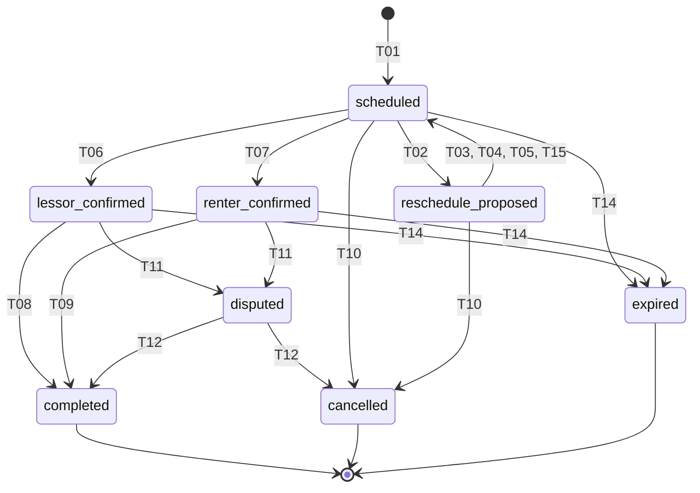

# PS-042-03 — workflow state machine

**Status:** SPECIFIED — Stage 3 draft, pending review. **Requirement ID:** PS-042-03. **Owner:** [05_Rentals/02_rental_lifecycle/mod_handoff](SPEC.md). **Implementing module:** 05_Rentals/02_rental_lifecycle/mod_handoff. **Consumers:** provisional, per [dependency matrix](../../../DEPENDENCY_MATRIX.md) and sibling [mod_return](../mod_return/SPEC.md) (`HandoffCompleted`, `HandoffCancelled`); subscriber map confirmed in Prompt 3.

## Purpose and scope
Defines the lifecycle of a handoff: states, transitions, guards, timers, consent rules and compensation boundaries. A transition is committed only together with its `handoff_transition` row and revision bump ([failure_recovery_idempotency.md](failure_recovery_idempotency.md)).

## Requirements
- PS-042-03.R01 — Business outcome: a handoff moves from scheduled to completed only through two attestations, one per party, or through a moderator resolution. No state is reached by silence alone except expiry, which is terminal and visible to both parties.
- PS-042-03.R02 — Cases covered: normal confirm sequence; reschedule accepted, declined, withdrawn, timed out; dispute and resolution; cancel before any confirmation; cancel attempted after one confirmation (refused); agreement cancelled mid-handoff; expiry with one or zero confirmations; duplicate and out-of-order commands; concurrent confirmations from both parties.
- PS-042-03.R03 — Timer accuracy: the scheduler evaluates timers at least every 60 seconds. Timer-driven transitions are idempotent and guarded by a revision check.
- PS-042-03.R04 — Consent: a material change (window) needs the counterparty's accept. A confirmation, once recorded, cannot be revoked; a party who disagrees uses dispute (T11).
- PS-042-03.R05 — Compensation boundary: this module changes only its own state. It emits events and does not move deposits, money or inventory. Downstream compensation is owned by the consuming module and is not assumed to be atomic.

## States
| State | Entry event | Allowed transitions | Guard summary | Terminal |
|---|---|---|---|---|
| `scheduled` | T01 create; T03, T04, T05, T15 | T02, T06, T07, T10, T13, T14 | window valid; no other active handoff | no |
| `reschedule_proposed` | T02 propose | T03, T04, T05, T10, T13, T14, T15 | proposal window valid; `reschedule_count` ≤ 3 | no |
| `lessor_confirmed` | T06 lessor confirm | T08, T11, T13, T14 | lessor attested; renter not | no |
| `renter_confirmed` | T07 renter confirm | T09, T11, T13, T14 | renter attested; lessor not | no |
| `disputed` | T11 dispute | T12 | dispute reason set; not auto-expired | no |
| `completed` | T08 or T09 confirm; T12 resolve (completed) | none | both attestations present, or moderator resolution | yes |
| `cancelled` | T10, T12 (cancelled), T13 | none | cancel reason recorded | yes |
| `expired` | T14 window timer | none | now > window_end_utc + 72 h | yes |

## Transitions
| ID | Command or trigger | From | To | Actor | Guard | Reason code |
|---|---|---|---|---|---|---|
| T01 | `handoff.create` | (none) | scheduled | lessor or renter | agreement active; no other active handoff; window valid | none |
| T02 | `handoff.propose_reschedule` | scheduled | reschedule_proposed | lessor or renter | `reschedule_count` < 3; new window valid | none |
| T03 | `handoff.respond_reschedule` action=accept | reschedule_proposed | scheduled | counterparty of proposer | `expected_revision` match | `accepted` |
| T04 | `handoff.respond_reschedule` action=decline | reschedule_proposed | scheduled | counterparty of proposer | `expected_revision` match | `declined` |
| T05 | `handoff.respond_reschedule` action=withdraw | reschedule_proposed | scheduled | proposer | `expected_revision` match | `withdrawn` |
| T06 | `handoff.confirm` (lessor) | scheduled | lessor_confirmed | lessor | now ≥ window_start − 60 min and ≤ window_end + 72 h ([A-handoff-05](#assumptions-and-open-decisions)) | none |
| T07 | `handoff.confirm` (renter) | scheduled | renter_confirmed | renter | same window guard | none |
| T08 | `handoff.confirm` (renter) | lessor_confirmed | completed | renter | window guard; renter not yet attested | `both_parties_confirmed` |
| T09 | `handoff.confirm` (lessor) | renter_confirmed | completed | lessor | window guard; lessor not yet attested | `both_parties_confirmed` |
| T10 | `handoff.cancel` | scheduled or reschedule_proposed | cancelled | either party | no confirmation recorded yet | `cancel_requested` |
| T11 | `handoff.dispute` | lessor_confirmed or renter_confirmed | disputed | either party | `dispute_reason_code` set | (reason in field) |
| T12 | `handoff.resolve_dispute` | disputed | completed or cancelled | moderator with `handoff.resolve` | evidence reference recorded | `dispute_resolved_completed` or `dispute_resolved_cancelled` |
| T13 | `agreement_cancelled` event | scheduled, reschedule_proposed, lessor_confirmed, renter_confirmed | cancelled | system | agreement state cancelled | `agreement_cancelled` |
| T14 | scheduler timer | scheduled, reschedule_proposed, lessor_confirmed, renter_confirmed | expired | system | now > window_end_utc + 72 h | `window_expired_unconfirmed` |
| T15 | scheduler timer | reschedule_proposed | scheduled | system | now > reschedule_proposed_at + 48 h | `declined` (timed out) |

## Timers and deadlines
- Expiry deadline = effective `window_end_utc` + 72 hours. A pending reschedule proposal does not extend it. When a proposal is accepted, the deadline is recomputed from the new window.
- Early confirmation opens 60 minutes before `window_start_utc`.
- A reschedule proposal auto-declines 48 hours after `reschedule_proposed_at` (T15), or earlier if the proposed window starts first.
- Disputes do not expire. The module raises an operator alert 7 days after `dispute_opened` if still open; it does not change state.

## Rules that are not negotiable
- Self-service cancel is refused after any confirmation (`HANDOFF_INVALID_STATE`). The non-confirming party uses dispute ([A-handoff-20](#assumptions-and-open-decisions)).
- Only a moderator resolves disputes ([A-handoff-07](#assumptions-and-open-decisions)). Parties cannot resolve their own dispute.
- Terminal states accept no further transitions. A new handoff requires a new agreement-level create (T01), subject to T01 guards.
- Every transition writes exactly one `handoff_transition` row with `sequence` = previous + 1.

## Assumptions and open decisions
- **Assumption A-handoff-05:** Timer values are 60 minutes early confirmation, 72 hours expiry grace and 48 hours reschedule auto-decline. Values are configurable per deployment within ±50%.
- **Assumption A-handoff-06:** A handoff allows at most 3 reschedule proposals. Each proposal increments `reschedule_count` when created.
- **Assumption A-handoff-07:** Dispute resolution is moderator-only. The module does not auto-resolve disputes. Escalation alert after 7 days.
- **Assumption A-handoff-20:** After one confirmation, cancellation is not self-service. The other party disputes instead. This keeps one-sided cancellation from erasing a recorded statement.
- Open decisions in this file: D04 (partial execution; compensation is recorded, not atomic), D05 (region only in T01 payload).
