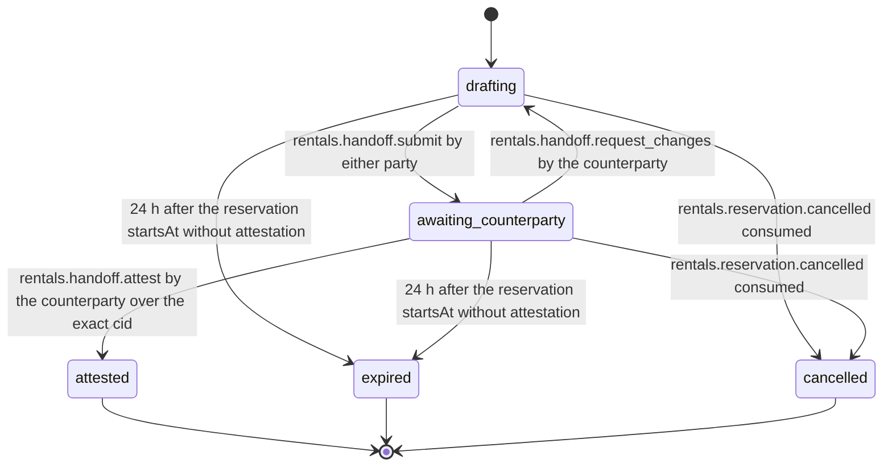

# PS-042-03 — Workflow state machine: Rental handoff

**Status:** SPECIFIED (Stage 3). **Module:** [F05.S02.M01 Rental handoff](SPEC.md) · **Scope:** MVP · **Code:** `packages/rentals/src/rental_lifecycle/handoff` · **Contracts:** [CTR-ID-001](../../../planning/contracts/CTR-ID-001.md), [CTR-EVT-001](../../../planning/contracts/CTR-EVT-001.md), [CTR-ERR-001](../../../planning/contracts/CTR-ERR-001.md), [CTR-CAP-001](../../../planning/contracts/CTR-CAP-001.md), [CTR-IDM-001](../../../planning/contracts/CTR-IDM-001.md), [CTR-PRV-001](../../../planning/contracts/CTR-PRV-001.md), [CTR-FED-001](../../../planning/contracts/CTR-FED-001.md)

> Generated from `module.spec.yaml` by `tools/specgen`. Edit the YAML, then run `pnpm spec:render`.

## Requirements

- **PS-042-03.R01** Handoffs move drafting, awaiting_counterparty, attested; expired and cancelled are terminal exits.
- **PS-042-03.R02** The author's report signature counts as the author's attestation; the counterparty's attestation of the same cid completes the handoff.
- **PS-042-03.R03** Attested starts the rental period for this module's purposes; the due time still comes from the reservation endsAt and is never shifted by a late pickup.

## Specification

### RentalHandoff lifecycle

Initial **drafting**; terminal **attested**, **expired**, **cancelled**.

| Transition | Trigger | Guard / effect |
|---|---|---|
| drafting -> awaiting_counterparty | rentals.handoff.submit by either party | report statement signed with a new cid; previous attestations cleared |
| awaiting_counterparty -> drafting | rentals.handoff.request_changes by the counterparty | changeRounds incremented, below 5 |
| awaiting_counterparty -> attested | rentals.handoff.attest by the counterparty over the exact cid | emits rentals.handoff.attested |
| drafting -> expired | 24 h after the reservation startsAt without attestation | reservation cancelled by F05.S01.M01 with no_handoff |
| awaiting_counterparty -> expired | 24 h after the reservation startsAt without attestation | same |
| drafting -> cancelled | rentals.reservation.cancelled consumed | drafts kept as history |
| awaiting_counterparty -> cancelled | rentals.reservation.cancelled consumed | reports kept as history |

### Timeouts and scheduled transitions

- Expiry is evaluated on the local clock 24 h after the reservation startsAt by a sweep at app start, on every command and every 60 s while the PWA is open; every read applies expiry on the fly.

## Verification

| Test | Level | Covers | Scenario | Expected |
|---|---|---|---|---|
| TEST-PS-042-09.T03 | property | PS-042-03.R01 | random statement and event sequences | only declared transitions succeed; terminal states never change |
| TEST-PS-042-09.T04 | integration | PS-042-03.R02, PS-042-01.R03 | attest revision 2 after revision 3 exists; request changes then re-attest | RENTALS_REPORT_STALE; new revision clears attestations; attested only on the exact cid |
| TEST-PS-042-09.T05 | integration | PS-042-03.R03, PS-042-04.R03 | both parties sign offline at the meeting and sync later | attested when both signatures held; reservation endsAt unchanged; event emitted once per vault |
| TEST-PS-042-09.T11 | integration | PS-042-03.R01, PS-042-04.R03 | reservation cancelled mid-report; 24 h after start without attestation | handoff cancelled with drafts kept; handoff expired and reservation cancelled no_handoff |

## Dependencies

Module depends on: F05.S01.M01, F05.S01.M02, F08.S01.M03, F07.S01.M01, F11.S01.M03, CTR-ID-001, CTR-EVT-001, CTR-ERR-001, CTR-CAP-001, CTR-IDM-001, CTR-PRV-001, CTR-FED-001. Predecessor: [domain_schema.md](domain_schema.md).
