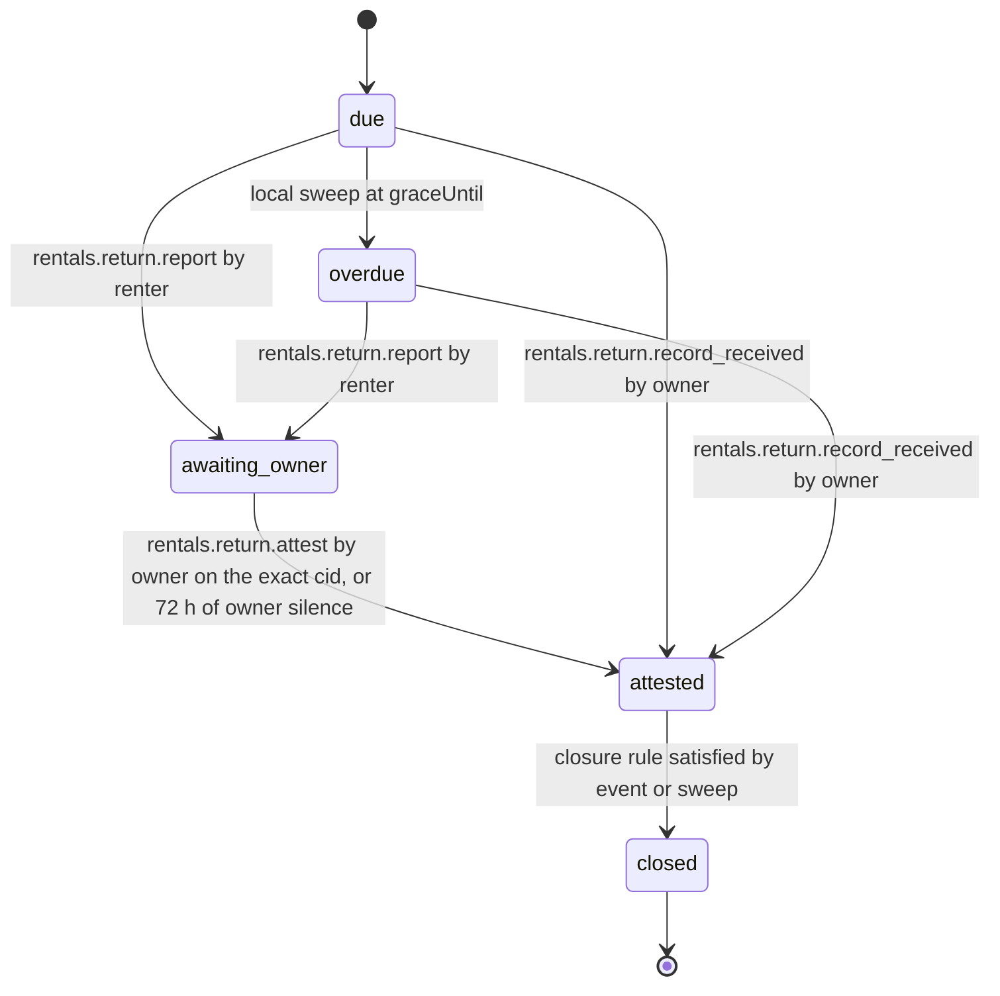

# PS-043-03 — Workflow state machine: Rental return

**Status:** SPECIFIED (Stage 3). **Module:** [F05.S02.M02 Rental return](SPEC.md) · **Scope:** MVP · **Code:** `packages/rentals/src/rental_lifecycle/return` · **Contracts:** [CTR-ID-001](../../../planning/contracts/CTR-ID-001.md), [CTR-EVT-001](../../../planning/contracts/CTR-EVT-001.md), [CTR-ERR-001](../../../planning/contracts/CTR-ERR-001.md), [CTR-CAP-001](../../../planning/contracts/CTR-CAP-001.md), [CTR-IDM-001](../../../planning/contracts/CTR-IDM-001.md), [CTR-MNY-001](../../../planning/contracts/CTR-MNY-001.md), [CTR-COM-001](../../../planning/contracts/CTR-COM-001.md), [CTR-PRV-001](../../../planning/contracts/CTR-PRV-001.md), [CTR-FED-001](../../../planning/contracts/CTR-FED-001.md)

> Generated from `module.spec.yaml` by `tools/specgen`. Edit the YAML, then run `pnpm spec:render`.

## Requirements

- **PS-043-03.R01** Returns move due, optionally overdue, awaiting_owner, attested, closed; closed is terminal.
- **PS-043-03.R02** Overdue and late fee follow only from the confirmed end time, grace and elapsed time; the owner can lower the fee but nothing raises it.
- **PS-043-03.R03** Owner silence is recorded as renter_only_silent_owner after 72 hours, and closure still needs the damage window, open claims and deposit checks to pass.

## Specification

### RentalReturn lifecycle

Initial **due**; terminal **closed**.

| Transition | Trigger | Guard / effect |
|---|---|---|
| due -> overdue | local sweep at graceUntil | no return recorded; emits rentals.rental.overdue |
| due -> awaiting_owner | rentals.return.report by renter | report signed, late fee computed |
| overdue -> awaiting_owner | rentals.return.report by renter | report signed, late fee computed on elapsed time |
| awaiting_owner -> attested | rentals.return.attest by owner on the exact cid, or 72 h of owner silence | attestedBy both or renter_only_silent_owner; emits rentals.return.attested |
| due -> attested | rentals.return.record_received by owner | attestedBy owner_only; emits rentals.return.attested |
| overdue -> attested | rentals.return.record_received by owner | attestedBy owner_only; late fee to the receipt time; emits rentals.return.attested |
| attested -> closed | closure rule satisfied by event or sweep | emits rentals.rental.closed |

### Timeouts and scheduled transitions

- Overdue is detected at graceUntil by a vault sweep (app start, every command, every 60 s while the PWA is open) and by every read; owner silence is 72 h after the renter report; the damage window is 7 days after attestation; closure is evaluated on every related event and by the sweep.

## Verification

| Test | Level | Covers | Scenario | Expected |
|---|---|---|---|---|
| TEST-PS-043-09.T03 | property | PS-043-02.R02, PS-043-03.R02 | random return times, rates, caps and adjustments against reference model | fee equals model, never above cap, adjustments only decrease |
| TEST-PS-043-09.T04 | property | PS-043-03.R01 | random statement and event sequences | only declared transitions succeed; closed never changes |
| TEST-PS-043-09.T05 | integration | PS-043-03.R03, PS-043-06.R01 | owner silent for 72 hours; owner records receipt only; owner attests exact cid | attestedBy renter_only_silent_owner, owner_only, both respectively; events once per vault |

## Dependencies

Module depends on: F05.S02.M01, F05.S01.M01, F05.S01.M02, F09.S01.M01, F08.S01.M03, F07.S01.M01, F11.S01.M03, CTR-ID-001, CTR-EVT-001, CTR-ERR-001, CTR-CAP-001, CTR-IDM-001, CTR-MNY-001, CTR-COM-001, CTR-PRV-001, CTR-FED-001. Predecessor: [domain_schema.md](domain_schema.md).
