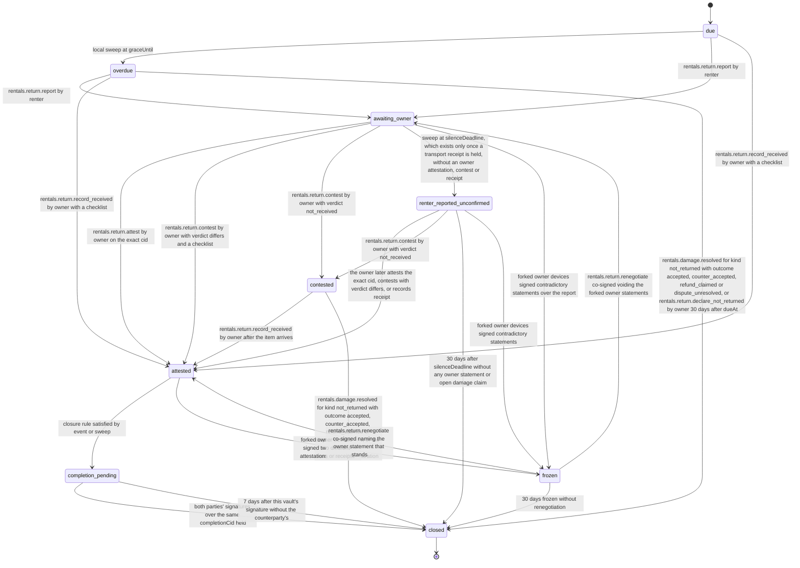

# PS-043-03 — Workflow state machine: Rental return

**Status:** SPECIFIED (Stage 3). **Module:** [F05.S02.M02 Rental return](SPEC.md) · **Scope:** MVP · **Code:** `packages/rentals/src/rental_lifecycle/return` · **Contracts:** [CTR-ID-001](../../../planning/contracts/CTR-ID-001.md), [CTR-EVT-001](../../../planning/contracts/CTR-EVT-001.md), [CTR-ERR-001](../../../planning/contracts/CTR-ERR-001.md), [CTR-CAP-001](../../../planning/contracts/CTR-CAP-001.md), [CTR-IDM-001](../../../planning/contracts/CTR-IDM-001.md), [CTR-MNY-001](../../../planning/contracts/CTR-MNY-001.md), [CTR-COM-001](../../../planning/contracts/CTR-COM-001.md), [CTR-PRV-001](../../../planning/contracts/CTR-PRV-001.md), [CTR-FED-001](../../../planning/contracts/CTR-FED-001.md)

> Generated from `module.spec.yaml` by `tools/specgen`. Edit the YAML, then run `pnpm spec:render`.

## Requirements

- **PS-043-03.R01** Returns move due, optionally overdue, awaiting_owner, attested, completion_pending and closed, with renter_reported_unconfirmed, contested and frozen as holding states; closed is terminal and is also reached for items never returned.
- **PS-043-03.R02** Overdue and late fee follow only from the confirmed end time, grace and elapsed time up to the evidence-bounded effective return time; the owner can lower the fee but nothing raises it.
- **PS-043-03.R03** Owner silence is measured from the later of the report's signed createdAt and the relay-signed transport receipt for the owner's mailbox; after 72 hours it is recorded as renter_reported_unconfirmed, which stops late-fee accrual but never emits rentals.return.attested, and closure still needs the damage window, open claims and deposit checks.
- **PS-043-03.R04** A report that never left the renter's device (sync state prepared) starts no silence clock and is labelled 'not yet delivered'.
- **PS-043-03.R05** An item never returned reaches closed with reason not_returned when a not_returned damage claim ends with outcome accepted, counter_accepted, refund_claimed or dispute_unresolved (withdrawn and return_agreed leave the return open), or when the owner signs a not_returned_declaration 30 days after the due time.
- **PS-043-03.R06** Closure offers a completion over the deterministic completionCid for both parties' signatures and emits rentals.rental.closed with completionCid when both signatures are held; after 7 days without the counterparty's signature a return attested by both closes with its bilaterally signed reportCid as completionCid (completionKind return_attestation), and any other return closes one-sided without completionCid.
- **PS-043-03.R07** The rental closes with reason deposit_unsettled when the deposit is neither absent nor terminal but its owner decision is overdue, so reviews can open while the deposit record stays open in F05.S01.M02.

## Specification

### RentalReturn lifecycle

Initial **due**; terminal **closed**.

| Transition | Trigger | Guard / effect |
|---|---|---|
| due -> overdue | local sweep at graceUntil | no return recorded; emits rentals.rental.overdue |
| due -> awaiting_owner | rentals.return.report by renter | report signed; late-fee preview from the claim; label 'not yet delivered' until a transport receipt is held |
| overdue -> awaiting_owner | rentals.return.report by renter | report signed; late fee previewed on elapsed time |
| awaiting_owner -> attested | rentals.return.attest by owner on the exact cid | attestedBy both; late-fee Deal opened when lateFee > 0; emits rentals.return.attested |
| awaiting_owner -> attested | rentals.return.contest by owner with verdict differs and a checklist | attestedBy owner_differs; conflictingReportCid set; emits rentals.return.attested |
| awaiting_owner -> contested | rentals.return.contest by owner with verdict not_received | late fee marked contested; the not_returned path stays open |
| awaiting_owner -> renter_reported_unconfirmed | sweep at silenceDeadline, which exists only once a transport receipt is held, without an owner attestation, contest or receipt | label 'owner did not respond within 72 h of relay receipt at <relay>'; late fee stops at effectiveReturnedAt; no rentals.return.attested |
| awaiting_owner -> frozen | forked owner devices signed contradictory statements over the report | frozenFrom awaiting_owner |
| renter_reported_unconfirmed -> attested | the owner later attests the exact cid, contests with verdict differs, or records receipt | attestedBy both, owner_differs or owner_only; emits rentals.return.attested |
| renter_reported_unconfirmed -> contested | rentals.return.contest by owner with verdict not_received | not_returned path open |
| renter_reported_unconfirmed -> closed | 30 days after silenceDeadline without any owner statement or open damage claim | closeReason owner_silent; one-sided, no completionCid; emits rentals.rental.closed |
| renter_reported_unconfirmed -> frozen | forked owner devices signed contradictory statements | frozenFrom renter_reported_unconfirmed |
| due -> attested | rentals.return.record_received by owner with a checklist | attestedBy owner_only; emits rentals.return.attested |
| overdue -> attested | rentals.return.record_received by owner with a checklist | attestedBy owner_only; late fee to the effective time; emits rentals.return.attested |
| overdue -> closed | rentals.damage.resolved for kind not_returned with outcome accepted, counter_accepted, refund_claimed or dispute_unresolved, or rentals.return.declare_not_returned by owner 30 days after dueAt | closeReason not_returned; no completionCid; emits rentals.rental.closed |
| contested -> attested | rentals.return.record_received by owner after the item arrives | attestedBy owner_only; emits rentals.return.attested |
| contested -> closed | rentals.damage.resolved for kind not_returned with outcome accepted, counter_accepted, refund_claimed or dispute_unresolved, or the owner's not_returned_declaration | closeReason not_returned; emits rentals.rental.closed |
| attested -> completion_pending | closure rule satisfied by event or sweep | this vault signs classrup.rentals.rental_completion/v1 over the completionCid and sends it |
| attested -> frozen | forked owner devices signed two different attestations or receipts | frozenFrom attested |
| completion_pending -> closed | both parties' signatures over the same completionCid held | closeReason completed or deposit_unsettled; completionCid set with completionKind rental_completion; emits rentals.rental.closed |
| completion_pending -> closed | 7 days after this vault's signature without the counterparty's | closeReason completed or deposit_unsettled; when attestedBy is both, completionCid = reportCid with completionKind return_attestation; otherwise oneSided with no completionCid; emits rentals.rental.closed |
| frozen -> attested | rentals.return.renegotiate co-signed naming the owner statement that stands | prior attestation mode restored; emits rentals.return.attested when it was not yet emitted |
| frozen -> awaiting_owner | rentals.return.renegotiate co-signed voiding the forked owner statements | the owner answers again; silence clock restarts from the renegotiation |
| frozen -> closed | 30 days frozen without renegotiation | closeReason unresolved; one-sided; emits rentals.rental.closed |

### Timeouts and scheduled transitions

- Overdue is detected at graceUntil by a vault sweep (app start, every command, every 60 s while the PWA is open) and by every read. Owner silence ends at silenceDeadline = max(report createdAt, relay transport receipt) + 72 h and never starts while the report is only prepared. The damage window is 7 days after the signed attestation time and closure waits a further 72 h delivery tolerance. renter_reported_unconfirmed and frozen close one-sided after 30 days; completion_pending closes one-sided 7 days after this vault's signature. Closure is evaluated on every related event and by the sweep.

## Verification

| Test | Level | Covers | Scenario | Expected |
|---|---|---|---|---|
| TEST-PS-043-09.T03 | property | PS-043-02.R02, PS-043-03.R02, PS-043-09.R02 | random return times, evidence times, rates, caps and adjustments against reference model | fee equals model, never above cap, adjustments only decrease; effective time within the 72 h rule |
| TEST-PS-043-09.T04 | property | PS-043-03.R01 | random statement and event sequences | only declared transitions succeed; closed never changes; attested never follows from silence |
| TEST-PS-043-09.T05 | integration | PS-043-03.R03, PS-043-06.R01 | owner silent for 72 hours after relay receipt; owner records receipt only; owner attests exact cid | renter_reported_unconfirmed labelled with the relay and no rentals.return.attested; owner_only; both respectively; events once per vault |
| TEST-PS-043-09.T07 | integration | PS-043-04.R03, PS-043-01.R02, PS-043-03.R07 | closure with an open damage claim, a funded deposit whose decision becomes overdue, the damage window, the window plus 72 h, an owner waiver, and a deposit that expired unfunded | closed only when attested and (window plus 72 h over or waived) and no open claim and the deposit absent, terminal or decision overdue; reason deposit_unsettled when overdue; not_funded counts as settled; the waiver only re-evaluates closure and emits nothing itself |
| TEST-PS-043-09.T17 | integration | PS-043-03.R04 | the renter's report stays prepared for 4 days | return stays awaiting_owner labelled not yet delivered; no silence clock, no attestation and no rentals.return.attested in either vault |
| TEST-PS-043-09.T18 | integration | PS-043-03.R05 | item never returned - not_returned damage claim accepted; owner declaration at day 29 and day 31; a not_returned claim withdrawn; a not_returned claim resolved return_agreed; a renter report contested not_received followed by a declaration at day 31; a declaration while an uncontested renter report is held | closed with reason not_returned and no completionCid; PRECONDITION_FAILED on day 29, allowed on day 31; the withdrawn and return_agreed claims leave the return overdue; the contested case closes not_returned; the last returns PRECONDITION_FAILED |
| TEST-PS-043-09.T19 | integration | PS-043-03.R06 | both parties sign the completion; the owner never co-signs a return attested by both; the renter never co-signs an owner_only return; an owner_only return co-signed by the renter | closed with completionCid, completionKind rental_completion, contextId and parties; after 7 days closed with completionCid = reportCid and completionKind return_attestation; after 7 days oneSided without completionCid; bilateral completion in owner_only mode |
| TEST-PS-043-09.T26 | integration | PS-043-03.R01, PS-043-03.R03 | owner contests with verdict not_received; owner contests with verdict differs | contested with the not_returned path open and no attestation; attested with owner_differs and conflictingReportCid set |
| TEST-PS-043-09.T27 | integration | PS-043-03.R01, PS-043-06.R01 | forked owner devices sign two different attestations, then the parties co-sign a renegotiation naming the one that stands; a second frozen return voided by renegotiation; a third left frozen for 30 days | first returns to attested with rentals.return.attested emitted once per vault; second returns to awaiting_owner with the silence clock restarted; third closes with reason unresolved, oneSided and no completionCid |

## Dependencies

Module depends on: F05.S02.M01, F05.S01.M01, F05.S01.M02, F09.S01.M01, F08.S01.M01, F08.S01.M03, F15.S02.M03, F10.S02.M03, F07.S01.M01, F07.S02.M02, F11.S01.M01, F11.S01.M03, F10.S01.M02, F10.S01.M03, F10.S01.M04, F10.S02.M02, CTR-ID-001, CTR-EVT-001, CTR-ERR-001, CTR-CAP-001, CTR-IDM-001, CTR-MNY-001, CTR-COM-001, CTR-PRV-001, CTR-FED-001. Predecessor: [domain_schema.md](domain_schema.md).
