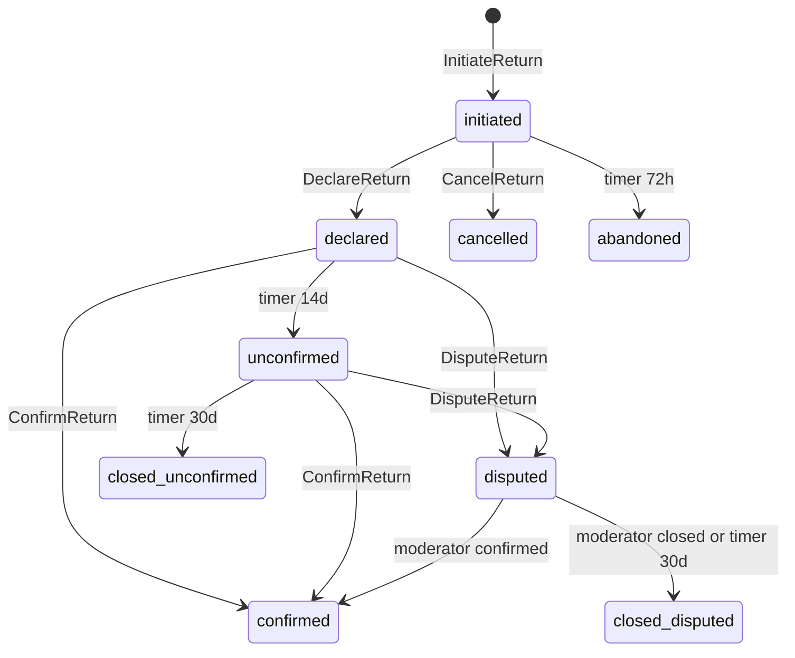

# PS-043-03 — workflow state machine

**Status:** SPECIFIED — Stage 3 draft, pending review. **Requirement ID:** PS-043-03. **Owner:** [05_Rentals/02_rental_lifecycle/mod_return](SPEC.md). **Implementing module:** 05_Rentals/02_rental_lifecycle/mod_return. **Consumers:** events listed in [commands_queries_events.md](commands_queries_events.md).

## Purpose and scope
Defines the lifecycle of one `rental_return` record: states, allowed transitions, guards, timers and terminal states. Entity fields are in [domain_schema.md](domain_schema.md); command signatures are in [commands_queries_events.md](commands_queries_events.md).

**Exclusions:** the rental agreement's own lifecycle (mod_handoff); item condition and damage outcome (mod_damage); deposit decisions (mod_deposits); payments. This machine never implies that money or the item has changed hands beyond the parties' own attestations.

## Requirements
- PS-043-03.R01: Business outcome: each rental has at most one active return, which ends in exactly one terminal state. Actors: renter, owner, moderator (dispute resolution only), scheduler. Exclusions as above.
- PS-043-03.R02: Case coverage. Normal: initiated, declared, confirmed. Invalid: any command not in the transition table. Expired: initiated abandoned after 72 h; declared without owner response leads to unconfirmed then closed_unconfirmed. Duplicate: repeated commands return RETURN_INVALID_TRANSITION after the first succeeded. Concurrent: owner confirm racing scheduler timer; resolved by revision check. Offline: queued commands replay under the same idempotency key. Adversarial: attempts to move a terminal return, or to skip declaration.
- PS-043-03.R03: Accessibility: every state has a human-readable label key (`rental_return.state.<state>`) and a plain-language next-step key; no state is conveyed by colour alone. Timers are shown as dates, not countdowns that require timing precision.
- PS-043-03.R04: Transitions are atomic. Each transition checks guard, updates `state`, increments `revision`, sets timestamps, writes one transition row and one outbox row in one transaction.
- PS-043-03.R05: Timers are evaluated only by the scheduler (PS-043-06). A timer transition re-reads the row under lock and re-checks its guard before writing.
- PS-043-03.R06: Terminal states have no outgoing transitions. A terminal return is never reopened; a new return may be initiated on the rental if it is still within the initiation window.

## State table
| State | Entry event | Terminal | Allowed transitions (guard) |
|---|---|---|---|
| initiated | InitiateReturn (renter) | no | declared (DeclareReturn by renter; returned_at valid); cancelled (CancelReturn by renter); abandoned (timer: now > initiated_at + 72 h) |
| declared | DeclareReturn | no | confirmed (ConfirmReturn by owner; now <= declared_at + 14 d); disputed (DisputeReturn by owner; now <= declared_at + 14 d); unconfirmed (timer: now > declared_at + 14 d) |
| unconfirmed | timer from declared | no | confirmed (ConfirmReturn by owner; now <= declared_at + 30 d); disputed (DisputeReturn by owner; now <= declared_at + 30 d); closed_unconfirmed (timer: now > declared_at + 30 d) |
| disputed | DisputeReturn | no | confirmed (ResolveReturnDispute by moderator, resolution = confirmed); closed_disputed (ResolveReturnDispute by moderator, resolution = closed; or timer: now > dispute_opened_at + 30 d) |
| confirmed | ConfirmReturn or ResolveReturnDispute(confirmed) | yes | none |
| cancelled | CancelReturn | yes | none |
| abandoned | timer from initiated | yes | none |
| closed_unconfirmed | timer from unconfirmed | yes | none |
| closed_disputed | ResolveReturnDispute(closed) or dispute timer | yes | none |

## Transition table (every pair is tested)
| From | To | Command or timer | Actor role | Sets |
|---|---|---|---|---|
| (none) | initiated | InitiateReturn | renter | initiated_at, due_at, handoff_at, return_point_ref |
| initiated | declared | DeclareReturn | renter | returned_at, declared_at, timing, lateness_minutes, condition_declared, renter_note |
| initiated | cancelled | CancelReturn | renter | terminal_at |
| initiated | abandoned | scheduler timer | system | terminal_at, reason_code = window_elapsed |
| declared | confirmed | ConfirmReturn | owner | owner_responded_at, owner_note, terminal_at |
| declared | disputed | DisputeReturn | owner | owner_responded_at, dispute_reason_code, dispute_opened_at, owner_note |
| declared | unconfirmed | scheduler timer | system | reason_code = owner_silent |
| unconfirmed | confirmed | ConfirmReturn | owner | owner_responded_at, owner_note, terminal_at |
| unconfirmed | disputed | DisputeReturn | owner | owner_responded_at, dispute_reason_code, dispute_opened_at, owner_note |
| unconfirmed | closed_unconfirmed | scheduler timer | system | terminal_at, reason_code = owner_silent_final |
| disputed | confirmed | ResolveReturnDispute | moderator | resolution_ref, terminal_at |
| disputed | closed_disputed | ResolveReturnDispute or timer | moderator or system | resolution_ref (if moderator), terminal_at |

Any (from, to) pair not in this table is rejected with RETURN_INVALID_TRANSITION and writes nothing.

## Timers
| Timer | Starts | Duration | Target | Default |
|---|---|---|---|---|
| abandon | initiated_at | 72 h | abandoned | A-return-09 |
| owner_response | declared_at | 14 d | unconfirmed | A-return-12 |
| owner_final | declared_at | 30 d | closed_unconfirmed | A-return-12 |
| dispute_final | dispute_opened_at | 30 d | closed_disputed | A-return-13 |

The owner's late confirmation from `unconfirmed` is allowed inside the 30-day window. The scheduler runs every 5 minutes (PS-043-06).

## Guards in detail
- Renter-only guards: actor_participant_id = renter_participant_id; rental handoff_state = handed_off at command time.
- Owner-only guards: actor_participant_id = owner_participant_id; command received within the window in the table above.
- Moderator guards: capability rental.return.resolve (PS-043-05); moderation_decision_ref exists and is in a final state (A-return-08).
- Block guard: an F07 block on either party denies new commands but does not force a transition; timers still run.

## Concurrency rules
- Every command includes `expected_revision`. The server locks the row (`SELECT ... FOR UPDATE`) and rejects with RETURN_REVISION_CONFLICT when it differs.
- A timer and a command that race: whoever takes the row lock first wins. The loser re-reads and returns RETURN_INVALID_TRANSITION (command) or skips the row (timer).
- Two InitiateReturn calls on the same rental: the partial unique index admits one; the other gets RETURN_ALREADY_OPEN.

## State diagram

## Open decisions
- A-return-08: Moderation decision references come from a moderation case service not yet specified in CONTRACTS.md; this module needs a `decision_ref` lookup returning final state and resolution.
- A-return-09: Abandonment window is 72 hours from initiation.
- A-return-12: Owner response window is 14 days from declaration; owner may still confirm or dispute until 30 days.
- A-return-13: Unresolved disputes close automatically after 30 days as closed_disputed; no funds or deposits move automatically.
- A-return-14: Mutual dispute resolution by renter and owner acting together is deferred; only moderators resolve disputes in MVP.
