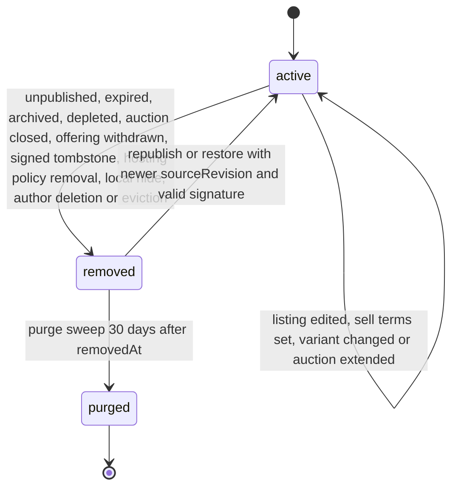

# PS-045-03 — Workflow state machine: Search index

**Status:** SPECIFIED (Stage 3). **Module:** [F06.S01.M01 Search index](SPEC.md) · **Scope:** MVP · **Code:** `packages/discovery/src/search/index` · **Contracts:** [CTR-ID-001](../../../planning/contracts/CTR-ID-001.md), [CTR-EVT-001](../../../planning/contracts/CTR-EVT-001.md), [CTR-ERR-001](../../../planning/contracts/CTR-ERR-001.md), [CTR-CAP-001](../../../planning/contracts/CTR-CAP-001.md), [CTR-IDM-001](../../../planning/contracts/CTR-IDM-001.md), [CTR-PRV-001](../../../planning/contracts/CTR-PRV-001.md), [CTR-SCH-001](../../../planning/contracts/CTR-SCH-001.md), [CTR-FED-001](../../../planning/contracts/CTR-FED-001.md), [CTR-OBS-001](../../../planning/contracts/CTR-OBS-001.md), [CTR-IOX-001](../../../planning/contracts/CTR-IOX-001.md), [CTR-FLG-001](../../../planning/contracts/CTR-FLG-001.md)

> Generated from `module.spec.yaml` by `tools/specgen`. Edit the YAML, then run `pnpm spec:render`.

## Requirements

- **PS-045-03.R01** A document is active only while its signed projection is valid, unexpired and not tombstoned; any removal trigger moves it to removed within the indexing latency budget.
- **PS-045-03.R02** A removed document becomes active again only through a newer verified republish or restore; it never reuses stale text.
- **PS-045-03.R03** Purging is irreversible and happens 30 days after removal by the sweep.

## Specification

### SearchDocument lifecycle

Initial **active**; terminal **purged**.

| Transition | Trigger | Guard / effect |
|---|---|---|
| active -> active | listing edited, sell terms set, variant changed or auction extended | verify new projection, bump revision, update FTS row, emit discovery.index.updated with op upsert |
| active -> removed | unpublished, expired, archived, depleted, auction closed, offering withdrawn, signed tombstone, hosting policy removal, local hide, author deletion or eviction | delete FTS row, null title and body, emit discovery.index.updated with op remove |
| removed -> active | republish or restore with newer sourceRevision and valid signature | re-insert FTS row, emit discovery.index.updated with op upsert |
| removed -> purged | purge sweep 30 days after removedAt | delete the row; the tombstone record is kept 180 days by the kernel per CTR-FED-001 FED-4 |

### Timeouts and scheduled transitions

- Expiry sweep every 60 s removes active documents past their effective expiry (reason expired).
- Purge sweep every 6 h deletes removed documents with removedAt older than 30 days.

## Verification

| Test | Level | Covers | Scenario | Expected |
|---|---|---|---|---|
| TEST-PS-045-09.T04 | integration | PS-045-03.R01, PS-045-03.R02 | publish, unpublish, republish a listing | active, removed (FTS row gone), active with fresh text and a newer revision |
| TEST-PS-045-09.T05 | integration | PS-045-01.R03, PS-045-03.R03 | removed document older than 30 days | purge sweep deletes it; younger rows kept |

## Dependencies

Module depends on: F06.S02.M01, CTR-ID-001, CTR-EVT-001, CTR-ERR-001, CTR-CAP-001, CTR-IDM-001, CTR-PRV-001, CTR-SCH-001, CTR-FED-001, CTR-OBS-001, CTR-IOX-001, CTR-FLG-001. Predecessor: [domain_schema.md](domain_schema.md).
