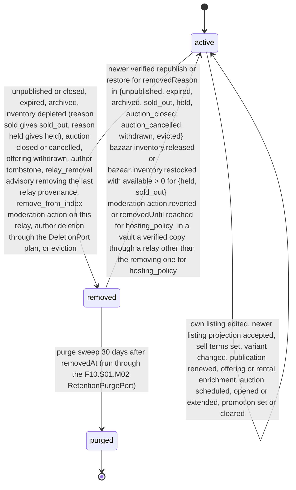

# PS-045-03 — Workflow state machine: Search index

**Status:** SPECIFIED (Stage 3). **Module:** [F06.S01.M01 Search index](SPEC.md) · **Scope:** MVP · **Code:** `packages/discovery/src/search/index` · **Contracts:** [CTR-ID-001](../../../planning/contracts/CTR-ID-001.md), [CTR-EVT-001](../../../planning/contracts/CTR-EVT-001.md), [CTR-ERR-001](../../../planning/contracts/CTR-ERR-001.md), [CTR-CAP-001](../../../planning/contracts/CTR-CAP-001.md), [CTR-IDM-001](../../../planning/contracts/CTR-IDM-001.md), [CTR-PRV-001](../../../planning/contracts/CTR-PRV-001.md), [CTR-SCH-001](../../../planning/contracts/CTR-SCH-001.md), [CTR-FED-001](../../../planning/contracts/CTR-FED-001.md), [CTR-OBS-001](../../../planning/contracts/CTR-OBS-001.md), [CTR-IOX-001](../../../planning/contracts/CTR-IOX-001.md), [CTR-FLG-001](../../../planning/contracts/CTR-FLG-001.md), [CTR-COM-001](../../../planning/contracts/CTR-COM-001.md)

> Generated from `module.spec.yaml` by `tools/specgen`. Edit the YAML, then run `pnpm spec:render`.

## Requirements

- **PS-045-03.R01** A document is active only while its signed projection is valid, unexpired and not tombstoned; any removal trigger moves it to removed within the indexing latency budget.
- **PS-045-03.R02** A removed document becomes active again only when its removal reason allows it - unpublished, expired, archived, sold_out, held, auction_closed, auction_cancelled, withdrawn and evicted on a newer verified republish or restore (held and sold_out also on inventory release or restock), hosting_policy only on moderation.action.reverted or the action's expiry (or in a vault through a relay that did not remove it), and tombstoned or deleted never within the 180-day tombstone window for the same record key; it never reuses stale text.
- **PS-045-03.R03** Purging is irreversible and happens 30 days after removal by the sweep; the refusal stub then lives 180 days.
- **PS-045-03.R04** Withdrawals are applied by the kind, issuerKind and advisory flag of federation.tombstone.applied - an author tombstone (kind tombstone, issuerKind author) removes the document from every index, while a relay_removal advisory (kind relay_removal, issuerKind origin_relay, advisory true) removes it only from the issuing relay's own index and, in a vault, only drops that relay's provenance.

## Specification

### SearchDocument lifecycle

Initial **active**; terminal **purged**.

| Transition | Trigger | Guard / effect |
|---|---|---|
| active -> active | own listing edited, newer listing projection accepted, sell terms set, variant changed, publication renewed, offering or rental enrichment, auction scheduled, opened or extended, promotion set or cleared | verify the projection when text or terms change, set endsAt and auctionPhase from host-signed auction statements, bump revision, update FTS row, emit discovery.index.updated with op upsert |
| active -> removed | unpublished or closed, expired, archived, inventory depleted (reason sold gives sold_out, reason held gives held), auction closed or cancelled, offering withdrawn, author tombstone, relay_removal advisory removing the last relay provenance, remove_from_index moderation action on this relay, author deletion through the DeletionPort plan, or eviction | delete FTS row, null title and body, set removedReason, emit discovery.index.updated with op remove |
| removed -> active | newer verified republish or restore for removedReason in {unpublished, expired, archived, sold_out, held, auction_closed, auction_cancelled, withdrawn, evicted}; bazaar.inventory.released or bazaar.inventory.restocked with available > 0 for {held, sold_out}; moderation.action.reverted or removedUntil reached for hosting_policy; in a vault a verified copy through a relay other than the removing one for hosting_policy | reload the retained signed projection, re-insert FTS row, emit discovery.index.updated with op upsert; tombstoned and deleted never reactivate within 180 days |
| removed -> purged | purge sweep 30 days after removedAt (run through the F10.S01.M02 RetentionPurgePort) | delete the row and write a discovery_doc_stub (source key, highest sourceRevision, removedReason, projectionCid) kept 180 days; the tombstone record itself is kept by F11.S01.M02 per CTR-FED-001 FED-4 |

### Timeouts and scheduled transitions

- Expiry sweep every 60 s removes active documents past their effective expiry min(expiresAt, firstSeenAt + 120 d) (reason expired).
- Relay promotion sweep every 60 s clears promotedUntil and promotionClaimId when promotedUntil <= now and emits op upsert.
- Relay moderation expiry sweep every 60 s reactivates hosting_policy removals whose removedUntil <= now.
- Purge sweep every 6 h, registered as a RetentionPurgePort with F10.S01.M02, deletes removed documents with removedAt older than 30 days and writes their stubs.
- Stub sweep daily deletes discovery_doc_stub rows whose until (180 days) has passed.

## Verification

| Test | Level | Covers | Scenario | Expected |
|---|---|---|---|---|
| TEST-PS-045-09.T04 | integration | PS-045-03.R01, PS-045-03.R02 | publish, unpublish, republish a listing | active, removed (FTS row gone), active with fresh text and a newer revision |
| TEST-PS-045-09.T05 | integration | PS-045-01.R03, PS-045-03.R03 | removed document older than 30 days | purge sweep deletes it and writes a stub kept 180 days; younger rows kept |
| TEST-PS-045-09.T10 | integration | PS-045-04.R02, PS-045-07.R02, PS-045-03.R04 | author-signed tombstone then later republish of the same cid | document removed with reason tombstoned, republish refused with DISCOVERY_SOURCE_REMOVED |
| TEST-PS-045-09.T19 | integration | PS-045-04.R02, PS-045-03.R01 | auction scheduled, opened, extended, then cancelled; a second auction closed | auctionId link resolves the document, endsAt follows the host-signed times, removed with auction_cancelled and auction_closed |
| TEST-PS-045-09.T20 | integration | PS-045-03.R02, PS-045-04.R02 | relay moderation actions warn, remove_from_index with targetRef, remove_from_index without targetRef, then author edit, then moderation.action.reverted, and an action whose expiresAt passes | warn ignored; target removed; all subjectKey documents removed; edit does not reactivate (DISCOVERY_SOURCE_REMOVED); revert and expiry reactivate |
| TEST-PS-045-09.T21 | integration | PS-045-03.R04, PS-045-07.R02 | relay A issues a relay_removal advisory (kind relay_removal, issuerKind origin_relay, advisory true) for a listing the vault fetched from relays A and B, and for the user's own listing | relay A dropped from provenance, document stays active from B; own listing untouched; no refusal for B copies |
| TEST-PS-045-09.T22 | integration | PS-045-03.R02 | bazaar.inventory.depleted reason held, then bazaar.inventory.released; depleted reason sold, then bazaar.inventory.restocked with available 2 | removed held then active; removed sold_out then active |
| TEST-PS-045-09.T24 | integration | PS-045-03.R02, PS-045-03.R03 | hosting_policy and tombstoned documents purged after 30 days, then the same signed projection resubmitted | refused from the stub with DISCOVERY_SOURCE_REMOVED until revert or 180 days |
| TEST-PS-045-09.T35 | integration | PS-045-03.R04, PS-045-04.R02 | relay index receives federation.tombstone.applied with kind relay_removal, issuerKind origin_relay and advisory true for relayId of this relay and of another relay; a vault receives the same advisory; own bazaar.listing.closed { listingId, ownerId, closeReason } before and after bazaar.listing.unpublished | this relay's advisory removes the document with hosting_policy and the other relay's changes nothing; the vault drops only that provenance; closed removes a still active own document with reason unpublished and is a no-op after unpublish; a payload without closedWithRef is accepted |

## Dependencies

Module depends on: F06.S02.M01, F01.S01.M03, F11.S01.M01, F11.S01.M02, F11.S01.M03, F09.S01.M01, F12.S03.M03, F15.S04.M03, F10.S01.M02, F10.S01.M04, F10.S02.M02, CTR-ID-001, CTR-EVT-001, CTR-ERR-001, CTR-CAP-001, CTR-IDM-001, CTR-PRV-001, CTR-SCH-001, CTR-FED-001, CTR-OBS-001, CTR-IOX-001, CTR-FLG-001, CTR-COM-001. Predecessor: [domain_schema.md](domain_schema.md).
