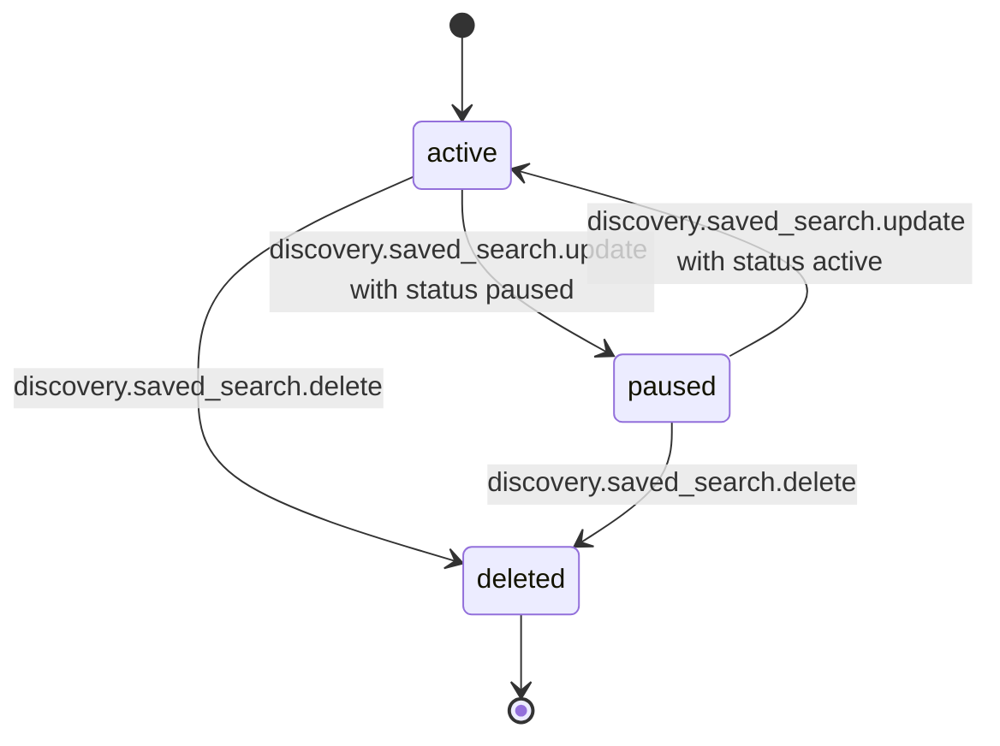

# PS-046-03 — Workflow state machine: Search query

**Status:** SPECIFIED (Stage 3). **Module:** [F06.S01.M02 Search query](SPEC.md) · **Scope:** MVP · **Code:** `packages/discovery/src/search/query` · **Contracts:** [CTR-ID-001](../../../planning/contracts/CTR-ID-001.md), [CTR-EVT-001](../../../planning/contracts/CTR-EVT-001.md), [CTR-ERR-001](../../../planning/contracts/CTR-ERR-001.md), [CTR-CAP-001](../../../planning/contracts/CTR-CAP-001.md), [CTR-IDM-001](../../../planning/contracts/CTR-IDM-001.md), [CTR-PRV-001](../../../planning/contracts/CTR-PRV-001.md), [CTR-SCH-001](../../../planning/contracts/CTR-SCH-001.md), [CTR-OBS-001](../../../planning/contracts/CTR-OBS-001.md), [CTR-FLG-001](../../../planning/contracts/CTR-FLG-001.md)

> Generated from `module.spec.yaml` by `tools/specgen`. Edit the YAML, then run `pnpm spec:render`.

## Requirements

- **PS-046-03.R01** A saved search is active, paused or deleted; only active searches are evaluated.
- **PS-046-03.R02** Deleting is final and removes matched-id bookkeeping immediately.
- **PS-046-03.R03** Pausing and resuming preserve dedupe history.

## Specification

### SavedSearch lifecycle

Initial **active**; terminal **deleted**.

| Transition | Trigger | Guard / effect |
|---|---|---|
| active -> paused | discovery.saved_search.update with status paused | stop evaluation |
| paused -> active | discovery.saved_search.update with status active | resume evaluation from now, no backlog alerts |
| active -> deleted | discovery.saved_search.delete | remove record and matchedDocIds |
| paused -> deleted | discovery.saved_search.delete | remove record and matchedDocIds |

### Timeouts and scheduled transitions

- Daily digest runs once per 24 h at the user's local 08:00 while the app is open or on the next unlock and emits one matched event with up to 20 document ids per search.
- Query snapshots expire 15 minutes after creation.

## Verification

| Test | Level | Covers | Scenario | Expected |
|---|---|---|---|---|
| TEST-PS-046-09.T04 | unit | PS-046-02.R03, PS-046-03.R01 | cursor tampered, aged 16 minutes, or from another query | EXPIRED or VALIDATION_FAILED with no data returned |
| TEST-PS-046-09.T05 | property | PS-046-03.R01, PS-046-03.R02, PS-046-03.R03 | random sequences of update, pause, resume, delete | only declared transitions succeed; deleted has no further transitions |

## Dependencies

Module depends on: F06.S01.M01, F06.S01.M03, F06.S02.M03, F06.S03.M01, F06.S03.M02, F07.S02.M02, CTR-ID-001, CTR-EVT-001, CTR-ERR-001, CTR-CAP-001, CTR-IDM-001, CTR-PRV-001, CTR-SCH-001, CTR-OBS-001, CTR-FLG-001. Predecessor: [domain_schema.md](domain_schema.md).
