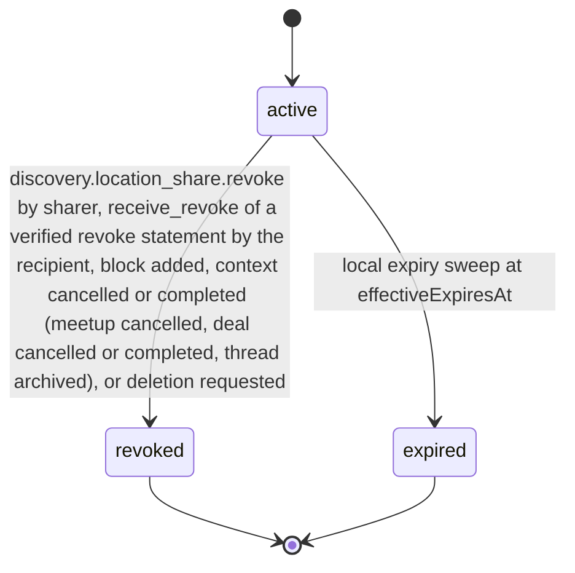

# PS-048-03 — Workflow state machine: User location settings

**Status:** SPECIFIED (Stage 3). **Module:** [F06.S02.M02 User location settings](SPEC.md) · **Scope:** MVP · **Code:** `packages/discovery/src/geoprivacy/location` · **Contracts:** [CTR-ID-001](../../../planning/contracts/CTR-ID-001.md), [CTR-EVT-001](../../../planning/contracts/CTR-EVT-001.md), [CTR-ERR-001](../../../planning/contracts/CTR-ERR-001.md), [CTR-CAP-001](../../../planning/contracts/CTR-CAP-001.md), [CTR-IDM-001](../../../planning/contracts/CTR-IDM-001.md), [CTR-PRV-001](../../../planning/contracts/CTR-PRV-001.md), [CTR-FED-001](../../../planning/contracts/CTR-FED-001.md), [CTR-SCH-001](../../../planning/contracts/CTR-SCH-001.md), [CTR-IOX-001](../../../planning/contracts/CTR-IOX-001.md), [CTR-UX-001](../../../planning/contracts/CTR-UX-001.md)

> Generated from `module.spec.yaml` by `tools/specgen`. Edit the YAML, then run `pnpm spec:render`.

## Requirements

- **PS-048-03.R01** A share is active until the first of revocation, expiry, block, context cancellation or completion, or a deletion request, and every end is permanent.
- **PS-048-03.R02** Ending a share deletes its per-share key and ciphertext in the same transaction and writes an 8-day ended marker.
- **PS-048-03.R03** A new share for the same recipient and context requires the previous one to be ended first.

## Specification

### LocationShare lifecycle

Initial **active**; terminal **revoked**, **expired**.

| Transition | Trigger | Guard / effect |
|---|---|---|
| active -> revoked | discovery.location_share.revoke by sharer, receive_revoke of a verified revoke statement by the recipient, block added, context cancelled or completed (meetup cancelled, deal cancelled or completed, thread archived), or deletion requested | delete the per-share key and ciphertext, write an ended marker for 8 days, emit discovery.location_share.revoked, queue the revoke statement to the counterparty when the sharer ended it |
| active -> expired | local expiry sweep at effectiveExpiresAt | delete the per-share key and ciphertext, write an ended marker for 8 days, emit discovery.location_share.revoked with reason expired |

### Timeouts and scheduled transitions

- Expiry sweep every 30 s while the app is open and at every unlock; records past effectiveExpiresAt are ended before any read returns them.
- Ended share records are deleted 24 h after ending (RET-EPHEMERAL); ended and pending-revoke markers, which hold only shareId, statementCid and sharerDid, are deleted after 8 days so they outlive any relay mailbox copy.

## Verification

| Test | Level | Covers | Scenario | Expected |
|---|---|---|---|---|
| TEST-PS-048-09.T03 | unit | PS-048-01.R02, PS-048-02.R02, PS-048-03.R01 | grant share ttl 2 h, then ttl 25 h, 20 min, and a blocked recipient | first succeeds; others return DISCOVERY_SHARE_TTL_INVALID or BLOCKED_PARTY |
| TEST-PS-048-09.T04 | property | PS-048-01.R03, PS-048-03.R01, PS-048-03.R02, PS-048-03.R03 | random sequences of grant, revoke, block, expiry on one share | only declared transitions succeed; ciphertext and per-share key are absent in every ended state |

## Dependencies

Module depends on: F06.S02.M01, F07.S01.M01, F07.S02.M01, F07.S02.M02, F11.S01.M01, F11.S01.M02, F11.S01.M03, F11.S02.M01, F10.S01.M01, F10.S01.M02, F10.S01.M03, F10.S01.M04, F10.S02.M02, F12.S03.M03, CTR-ID-001, CTR-EVT-001, CTR-ERR-001, CTR-CAP-001, CTR-IDM-001, CTR-PRV-001, CTR-FED-001, CTR-SCH-001, CTR-IOX-001, CTR-UX-001. Predecessor: [domain_schema.md](domain_schema.md).
