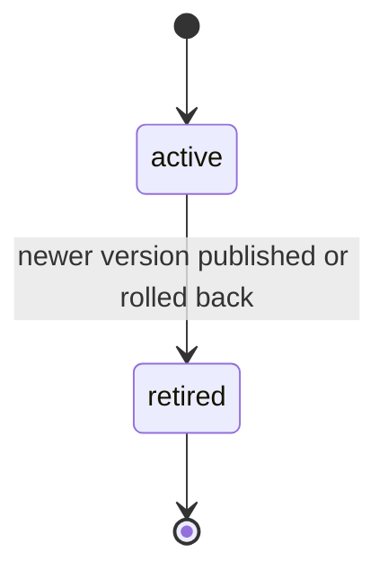

# PS-051-03 — Workflow state machine: Relevance ranking

**Status:** SPECIFIED (Stage 3). **Module:** [F06.S03.M01 Relevance ranking](SPEC.md) · **Scope:** MVP · **Code:** `packages/discovery/src/ranking/relevance` · **Contracts:** [CTR-ID-001](../../../planning/contracts/CTR-ID-001.md), [CTR-EVT-001](../../../planning/contracts/CTR-EVT-001.md), [CTR-ERR-001](../../../planning/contracts/CTR-ERR-001.md), [CTR-CAP-001](../../../planning/contracts/CTR-CAP-001.md), [CTR-IDM-001](../../../planning/contracts/CTR-IDM-001.md), [CTR-FED-001](../../../planning/contracts/CTR-FED-001.md), [CTR-SCH-001](../../../planning/contracts/CTR-SCH-001.md), [CTR-OBS-001](../../../planning/contracts/CTR-OBS-001.md), [CTR-FLG-001](../../../planning/contracts/CTR-FLG-001.md)

> Generated from `module.spec.yaml` by `tools/specgen`. Edit the YAML, then run `pnpm spec:render`.

## Requirements

- **PS-051-03.R01** A new version becomes active atomically and the previous active version becomes retired in the same transaction.
- **PS-051-03.R02** A retired version is never reactivated; a rollback creates a new active version with a new number.
- **PS-051-03.R03** There is never a moment with zero or two active versions.

## Specification

### RankingConfig lifecycle

Initial **active**; terminal **retired**.

| Transition | Trigger | Guard / effect |
|---|---|---|
| active -> retired | newer version published or rolled back | set retiredAt, new version inserted active in the same transaction, emit discovery.ranking_config.published for the new version |

### Timeouts and scheduled transitions

_None._

## Verification

| Test | Level | Covers | Scenario | Expected |
|---|---|---|---|---|
| TEST-PS-051-09.T04 | property | PS-051-03.R01, PS-051-03.R02, PS-051-03.R03 | random concurrent publish and rollback attempts | at every point exactly one active version; retired never reactivated |

## Dependencies

Module depends on: F06.S02.M01, F06.S01.M01, CTR-ID-001, CTR-EVT-001, CTR-ERR-001, CTR-CAP-001, CTR-IDM-001, CTR-FED-001, CTR-SCH-001, CTR-OBS-001, CTR-FLG-001. Predecessor: [domain_schema.md](domain_schema.md).
