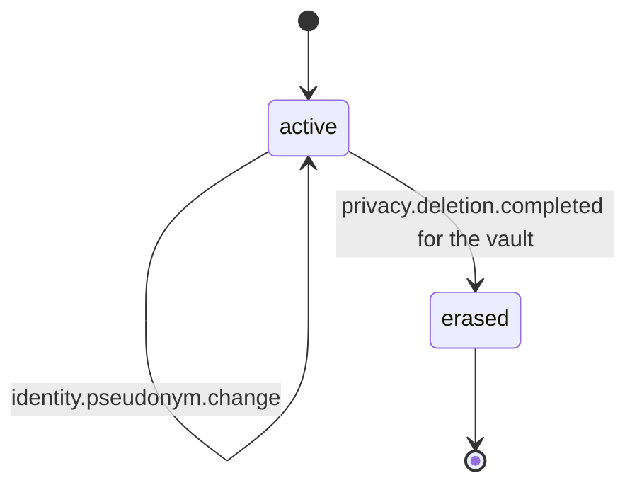
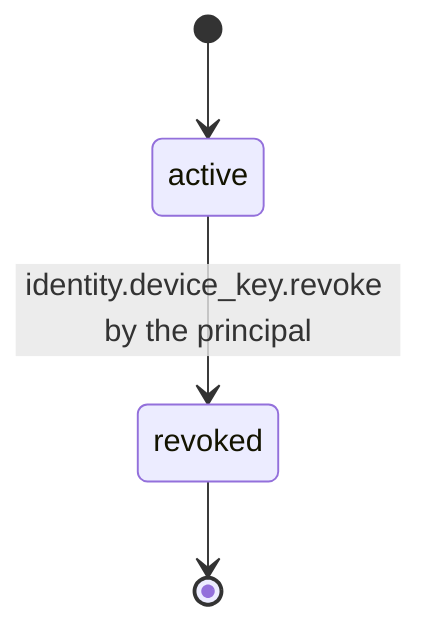
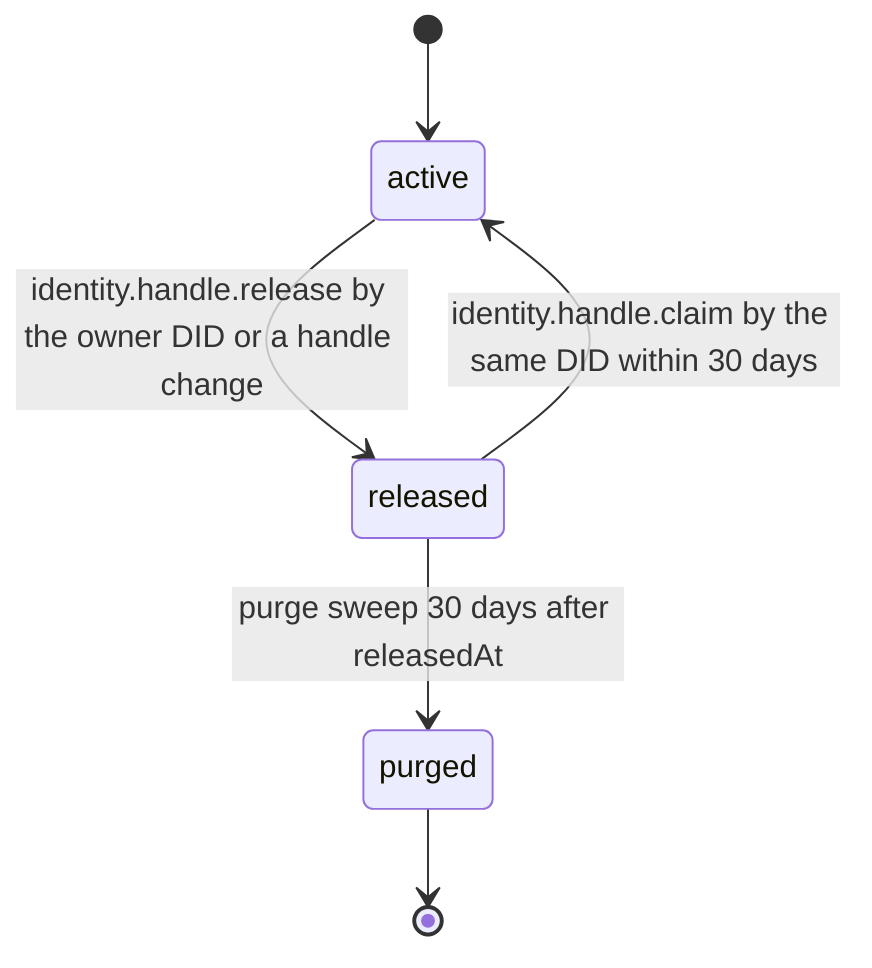

# PS-052-03 — Workflow state machine: Pseudonymous accounts

**Status:** SPECIFIED (Stage 3). **Module:** [F07.S01.M01 Pseudonymous accounts](SPEC.md) · **Scope:** MVP · **Code:** `packages/identity/src/accounts/pseudonyms` · **Contracts:** [CTR-ID-001](../../../planning/contracts/CTR-ID-001.md), [CTR-EVT-001](../../../planning/contracts/CTR-EVT-001.md), [CTR-ERR-001](../../../planning/contracts/CTR-ERR-001.md), [CTR-CAP-001](../../../planning/contracts/CTR-CAP-001.md), [CTR-IDM-001](../../../planning/contracts/CTR-IDM-001.md), [CTR-FED-001](../../../planning/contracts/CTR-FED-001.md), [CTR-SCH-001](../../../planning/contracts/CTR-SCH-001.md), [CTR-PRV-001](../../../planning/contracts/CTR-PRV-001.md), [CTR-OBS-001](../../../planning/contracts/CTR-OBS-001.md), [CTR-IOX-001](../../../planning/contracts/CTR-IOX-001.md), [CTR-UX-001](../../../planning/contracts/CTR-UX-001.md), [CTR-FLG-001](../../../planning/contracts/CTR-FLG-001.md)

> Generated from `module.spec.yaml` by `tools/specgen`. Edit the YAML, then run `pnpm spec:render`.

## Requirements

- **PS-052-03.R01** Accounts are active until the vault is erased; a pseudonym change keeps the account active and bumps its revision.
- **PS-052-03.R02** Device keys move from active to revoked once; revoked keys never return.
- **PS-052-03.R03** A relay handle moves active to released to purged, and during the released window only the same DID can reclaim it.

## Specification

### Account lifecycle

Initial **active**; terminal **erased**.

| Transition | Trigger | Guard / effect |
|---|---|---|
| active -> active | identity.pseudonym.change | validate, update pseudonym and skeleton, emit identity.pseudonym.changed |
| active -> erased | privacy.deletion.completed for the vault | delete keys and records, no further events |

### DeviceKey lifecycle

Initial **active**; terminal **revoked**.

| Transition | Trigger | Guard / effect |
|---|---|---|
| active -> revoked | identity.device_key.revoke by the principal | sign and queue the revocation statement, emit identity.device_key.revoked |

### HandleRegistration lifecycle

Initial **active**; terminal **purged**.

| Transition | Trigger | Guard / effect |
|---|---|---|
| active -> released | identity.handle.release by the owner DID or a handle change | set releasedAt, keep skeleton reserved 30 days |
| released -> active | identity.handle.claim by the same DID within 30 days | restore registration |
| released -> purged | purge sweep 30 days after releasedAt | delete the row |

### Timeouts and scheduled transitions

- Relay purge sweep every 6 h removes released registrations older than 30 days.
- A pending device link offer expires 10 minutes after it is shown.

## Verification

| Test | Level | Covers | Scenario | Expected |
|---|---|---|---|---|
| TEST-PS-052-09.T05 | integration | PS-052-01.R03, PS-052-02.R03, PS-052-03.R03 | two DIDs claim confusable handles on one relay; release then reclaim within and after 30 days | second claim IDENTITY_PSEUDONYM_TAKEN or CONFUSABLE; only former DID can reclaim within 30 days; purge after |
| TEST-PS-052-09.T06 | integration | PS-052-02.R03, PS-052-03.R01 | change pseudonym twice within 30 days in vault and on registry | vault asks confirmation; registry returns IDENTITY_PSEUDONYM_COOLDOWN |
| TEST-PS-052-09.T07 | unit | PS-052-02.R02, PS-052-02.R03, PS-052-03.R02 | add device with valid, stale (11 min), wrong-signer link; add 11th device | success then IDENTITY_LINK_INVALID and IDENTITY_DEVICE_LIMIT; revoked key cannot be re-added |
| TEST-PS-052-09.T08 | integration | PS-052-03.R02, PS-052-02.R03 | revoke last device with and without verified recovery kit | IDENTITY_LAST_DEVICE_KEY without kit; allowed with kit |

## Dependencies

Module depends on: CTR-ID-001, CTR-EVT-001, CTR-ERR-001, CTR-CAP-001, CTR-IDM-001, CTR-FED-001, CTR-SCH-001, CTR-PRV-001, CTR-OBS-001, CTR-IOX-001, CTR-UX-001, CTR-FLG-001. Predecessor: [domain_schema.md](domain_schema.md).
