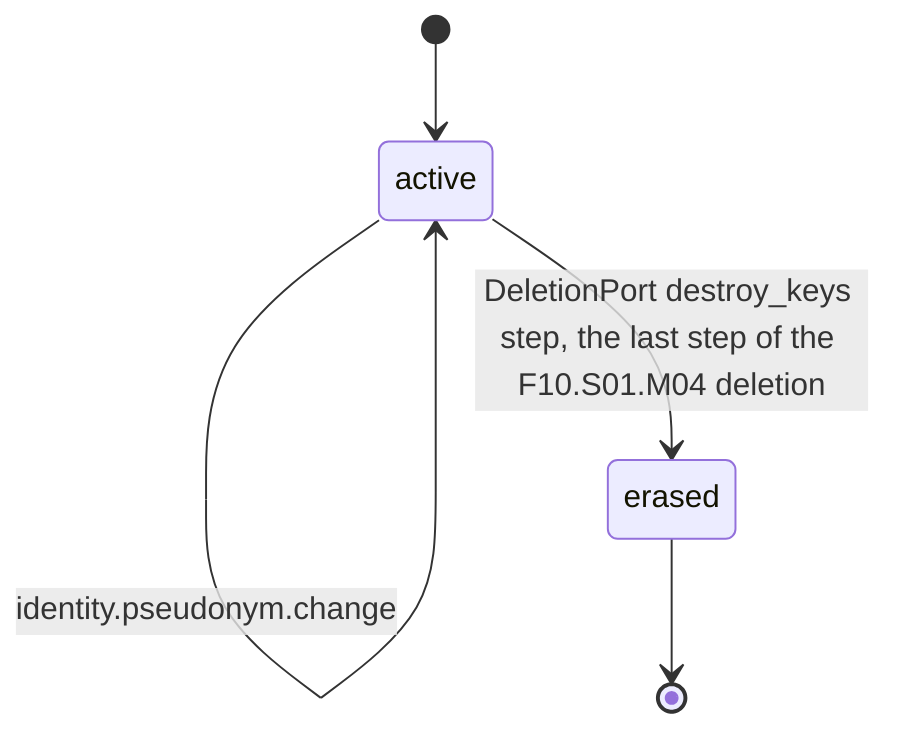
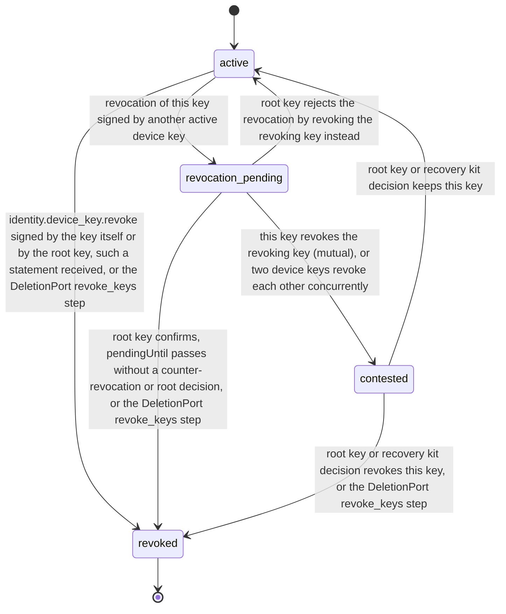
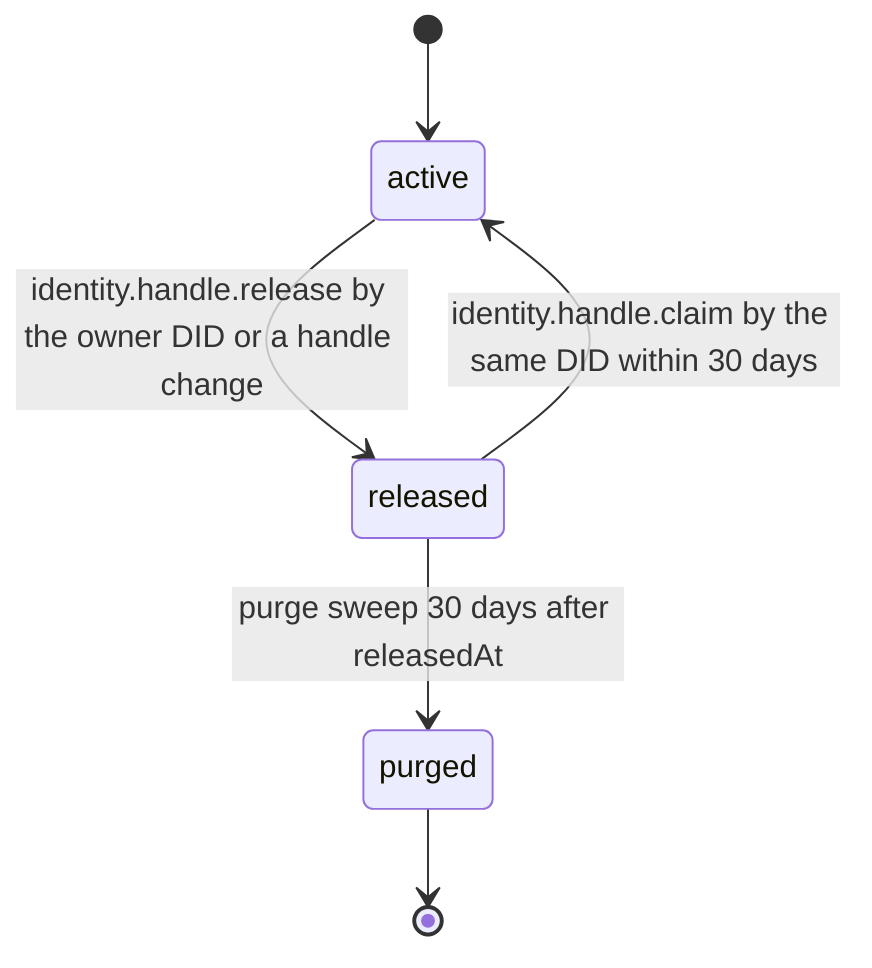

# PS-052-03 — Workflow state machine: Pseudonymous accounts

**Status:** SPECIFIED (Stage 3). **Module:** [F07.S01.M01 Pseudonymous accounts](SPEC.md) · **Scope:** MVP · **Code:** `packages/identity/src/accounts/pseudonyms` · **Contracts:** [CTR-ID-001](../../../planning/contracts/CTR-ID-001.md), [CTR-EVT-001](../../../planning/contracts/CTR-EVT-001.md), [CTR-ERR-001](../../../planning/contracts/CTR-ERR-001.md), [CTR-CAP-001](../../../planning/contracts/CTR-CAP-001.md), [CTR-IDM-001](../../../planning/contracts/CTR-IDM-001.md), [CTR-FED-001](../../../planning/contracts/CTR-FED-001.md), [CTR-SCH-001](../../../planning/contracts/CTR-SCH-001.md), [CTR-PRV-001](../../../planning/contracts/CTR-PRV-001.md), [CTR-OBS-001](../../../planning/contracts/CTR-OBS-001.md), [CTR-IOX-001](../../../planning/contracts/CTR-IOX-001.md), [CTR-UX-001](../../../planning/contracts/CTR-UX-001.md), [CTR-FLG-001](../../../planning/contracts/CTR-FLG-001.md)

> Generated from `module.spec.yaml` by `tools/specgen`. Edit the YAML, then run `pnpm spec:render`.

## Requirements

- **PS-052-03.R01** Accounts are active until the vault is erased; a pseudonym change keeps the account active and bumps its revision.
- **PS-052-03.R02** Device keys move to revoked once and never return; a revocation signed by another device key waits 7 days as revocation_pending for the root key to confirm or for a counter-revocation, and mutual revocations freeze both keys as contested until the root key or the recovery kit decides.
- **PS-052-03.R03** A relay handle moves active to released to purged, and during the released window only the same DID can reclaim it.

## Specification

### Account lifecycle

Initial **active**; terminal **erased**.

| Transition | Trigger | Guard / effect |
|---|---|---|
| active -> active | identity.pseudonym.change | validate, update pseudonym and skeleton, emit identity.pseudonym.changed |
| active -> erased | DeletionPort destroy_keys step, the last step of the F10.S01.M04 deletion | destroy every keystore entry including the root key, delete DeviceKey rows and keep only the erased Account stub; privacy.deletion.completed later removes leftovers and never touches keys |

### DeviceKey lifecycle

Initial **active**; terminal **revoked**.

| Transition | Trigger | Guard / effect |
|---|---|---|
| active -> revoked | identity.device_key.revoke signed by the key itself or by the root key, such a statement received, or the DeletionPort revoke_keys step | sign or record classrup.security.keyrevocation/v1 (reason account_deleted with finalCids in revoke_keys), emit identity.device_key.revoked |
| active -> revocation_pending | revocation of this key signed by another active device key | set pendingUntil = now + 7 days, show it on every own device, no event yet |
| revocation_pending -> revoked | root key confirms, pendingUntil passes without a counter-revocation or root decision, or the DeletionPort revoke_keys step | emit identity.device_key.revoked |
| revocation_pending -> active | root key rejects the revocation by revoking the revoking key instead | pending entry closed |
| revocation_pending -> contested | this key revokes the revoking key (mutual), or two device keys revoke each other concurrently | freeze both keys for key management; routine statements still verify with a contested warning |
| contested -> revoked | root key or recovery kit decision revokes this key, or the DeletionPort revoke_keys step | emit identity.device_key.revoked |
| contested -> active | root key or recovery kit decision keeps this key | the other key's revocation stands |

### HandleRegistration lifecycle

Initial **active**; terminal **purged**.

| Transition | Trigger | Guard / effect |
|---|---|---|
| active -> released | identity.handle.release by the owner DID or a handle change | set releasedAt, keep skeleton reserved 30 days |
| released -> active | identity.handle.claim by the same DID within 30 days | restore registration, bump revision |
| released -> purged | purge sweep 30 days after releasedAt | delete the row |

### Timeouts and scheduled transitions

- Relay purge sweep every 6 h removes released registrations older than 30 days.
- A pending device link offer expires 10 minutes after it is shown.
- A revocation_pending key becomes revoked 7 days (604 800 000 ms) after it was recorded unless the root key decided or a counter-revocation made it contested.

## Verification

| Test | Level | Covers | Scenario | Expected |
|---|---|---|---|---|
| TEST-PS-052-09.T05 | integration | PS-052-01.R03, PS-052-02.R03, PS-052-03.R03 | two DIDs claim confusable handles on one relay; release then reclaim within and after 30 days | second claim IDENTITY_PSEUDONYM_TAKEN or CONFUSABLE; only the former DID can reclaim within 30 days; row purged after; the vault never reports global uniqueness |
| TEST-PS-052-09.T06 | integration | PS-052-03.R01, PS-052-02.R03 | change pseudonym twice within 30 days in the vault and on a registry | vault asks for confirmation and keeps the Account active with revision bumped; registry returns IDENTITY_PSEUDONYM_COOLDOWN |
| TEST-PS-052-09.T08 | integration | PS-052-03.R02, PS-052-04.R05 | revoke the last device with and without a verified kit (RecoveryKitStatusPort stub); add an 11th device; re-add a revoked key | IDENTITY_LAST_DEVICE_KEY without kit and allowed with kit; IDENTITY_DEVICE_LIMIT; a revoked key never becomes active again |
| TEST-PS-052-09.T19 | abuse | PS-052-02.R05, PS-052-03.R02 | stolen A3 revokes A1 and A2 | both revocation_pending for 7 days; A1's counter-revocation of A3 makes A1 and A3 contested; a revocation signed by contested A3 is refused with SECURITY_KEY_UNAUTHORIZED; the root key decision ends the contest |

## Dependencies

Module depends on: F16.S02.M02, F10.S01.M02, F10.S02.M02, CTR-ID-001, CTR-EVT-001, CTR-ERR-001, CTR-CAP-001, CTR-IDM-001, CTR-FED-001, CTR-SCH-001, CTR-PRV-001, CTR-OBS-001, CTR-IOX-001, CTR-UX-001, CTR-FLG-001. Predecessor: [domain_schema.md](domain_schema.md).
