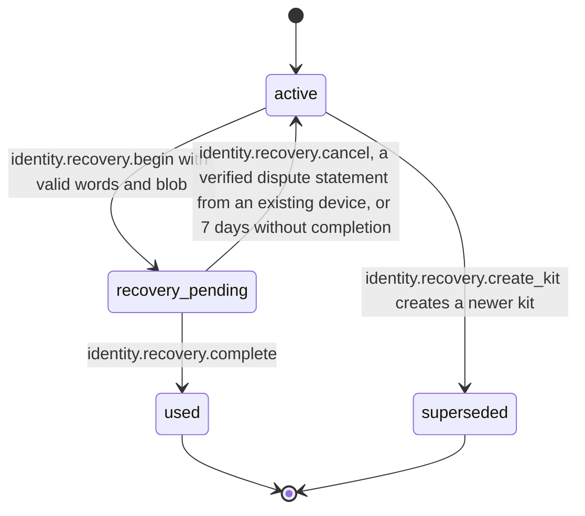

# PS-053-03 — Workflow state machine: Account recovery

**Status:** SPECIFIED (Stage 3). **Module:** [F07.S01.M03 Account recovery](SPEC.md) · **Scope:** MVP · **Code:** `packages/identity/src/accounts/recovery` · **Contracts:** [CTR-ID-001](../../../planning/contracts/CTR-ID-001.md), [CTR-EVT-001](../../../planning/contracts/CTR-EVT-001.md), [CTR-ERR-001](../../../planning/contracts/CTR-ERR-001.md), [CTR-CAP-001](../../../planning/contracts/CTR-CAP-001.md), [CTR-IDM-001](../../../planning/contracts/CTR-IDM-001.md), [CTR-FED-001](../../../planning/contracts/CTR-FED-001.md), [CTR-SCH-001](../../../planning/contracts/CTR-SCH-001.md), [CTR-PRV-001](../../../planning/contracts/CTR-PRV-001.md), [CTR-IOX-001](../../../planning/contracts/CTR-IOX-001.md), [CTR-UX-001](../../../planning/contracts/CTR-UX-001.md), [CTR-FLG-001](../../../planning/contracts/CTR-FLG-001.md)

> Generated from `module.spec.yaml` by `tools/specgen`. Edit the YAML, then run `pnpm spec:render`.

## Requirements

- **PS-053-03.R01** A kit is active until recovery starts, is superseded, or is used; used and superseded are final.
- **PS-053-03.R02** A pending recovery either completes into used, or returns to active by cancel, dispute or expiry after 7 days.
- **PS-053-03.R03** Completing with revocation of other devices requires the 72 hour window to have passed.

## Specification

### RecoveryKit lifecycle

Initial **active**; terminal **used**, **superseded**.

| Transition | Trigger | Guard / effect |
|---|---|---|
| active -> recovery_pending | identity.recovery.begin with valid words and blob | register new device key via F07.S01.M01, sign and queue the recovery notice, emit identity.recovery.requested |
| active -> superseded | identity.recovery.create_kit creates a newer kit | mark old kit superseded in the same transaction, emit identity.recovery.kit_created |
| recovery_pending -> used | identity.recovery.complete | if revokeOthersRequested require now at or after revokeOthersNotBefore, revoke others via F07.S01.M01, emit identity.recovery.completed |
| recovery_pending -> active | identity.recovery.cancel, a verified dispute statement from an existing device, or 7 days without completion | revoke the pending new device key unless the user keeps it, emit identity.recovery.cancelled |

### Timeouts and scheduled transitions

- Revocation of other devices is allowed 72 h (259 200 000 ms) after begin.
- A pending recovery expires 7 days after begin and returns the kit to active.
- Kit verification reminder shown 365 days after the last verification.

## Verification

| Test | Level | Covers | Scenario | Expected |
|---|---|---|---|---|
| TEST-PS-053-09.T04 | property | PS-053-01.R03, PS-053-03.R01, PS-053-03.R02, PS-053-03.R03 | random sequences of create, begin, complete, cancel, expire | only declared transitions succeed; one active or pending kit; used and superseded are final |
| TEST-PS-053-09.T05 | integration | PS-053-03.R03, PS-053-02.R03 | begin with revokeOthers then complete at 71 h and at 72 h | IDENTITY_RECOVERY_WINDOW_OPEN at 71 h; success at 72 h with D1 and D2 revoked and statements queued |
| TEST-PS-053-09.T06 | integration | PS-053-03.R02, PS-053-04.R03 | begin then dispute statement from D2 | kit returns to active, contested identity flagged, cancelled event emitted |
| TEST-PS-053-09.T13 | a11y | PS-053-01.R01, PS-053-03.R01 | create and recover screens with axe-core and keyboard only | zero serious or critical issues; paste of full phrase works |

## Dependencies

Module depends on: F07.S01.M01, F07.S02.M01, CTR-ID-001, CTR-EVT-001, CTR-ERR-001, CTR-CAP-001, CTR-IDM-001, CTR-FED-001, CTR-SCH-001, CTR-PRV-001, CTR-IOX-001, CTR-UX-001, CTR-FLG-001. Predecessor: [domain_schema.md](domain_schema.md).
