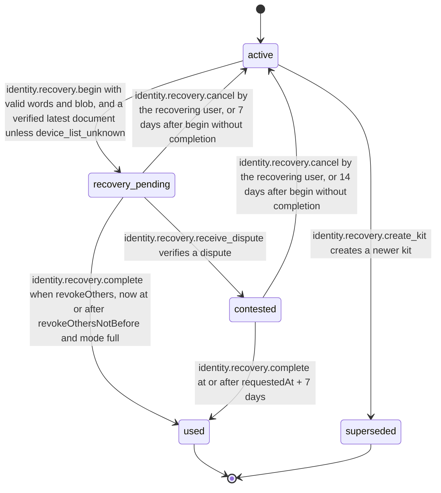
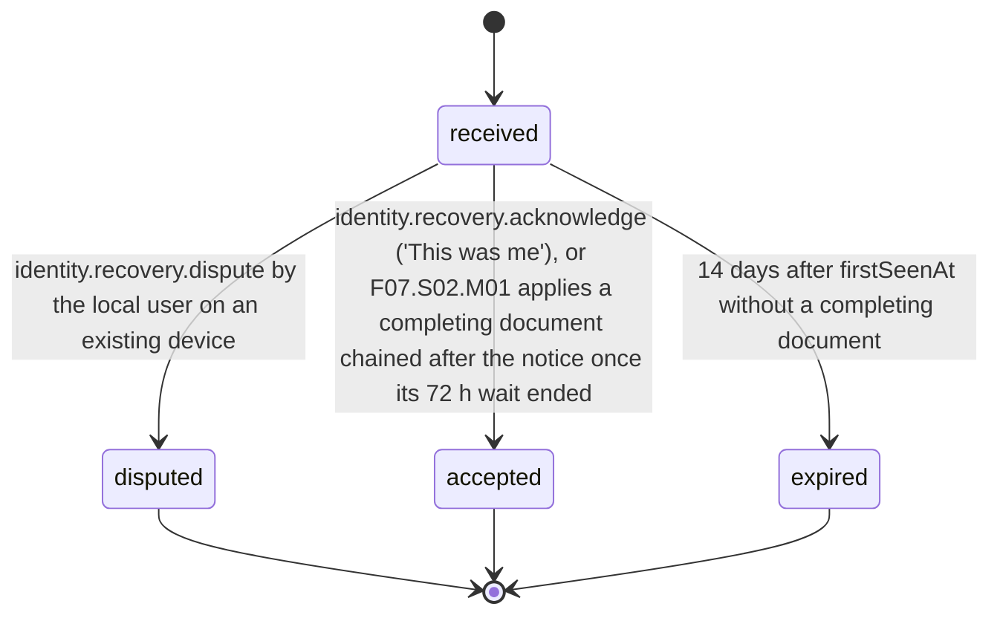

# PS-053-03 — Workflow state machine: Account recovery

**Status:** SPECIFIED (Stage 3). **Module:** [F07.S01.M03 Account recovery](SPEC.md) · **Scope:** MVP · **Code:** `packages/identity/src/accounts/recovery` · **Contracts:** [CTR-ID-001](../../../planning/contracts/CTR-ID-001.md), [CTR-EVT-001](../../../planning/contracts/CTR-EVT-001.md), [CTR-ERR-001](../../../planning/contracts/CTR-ERR-001.md), [CTR-CAP-001](../../../planning/contracts/CTR-CAP-001.md), [CTR-IDM-001](../../../planning/contracts/CTR-IDM-001.md), [CTR-FED-001](../../../planning/contracts/CTR-FED-001.md), [CTR-SCH-001](../../../planning/contracts/CTR-SCH-001.md), [CTR-PRV-001](../../../planning/contracts/CTR-PRV-001.md), [CTR-IOX-001](../../../planning/contracts/CTR-IOX-001.md), [CTR-UX-001](../../../planning/contracts/CTR-UX-001.md), [CTR-FLG-001](../../../planning/contracts/CTR-FLG-001.md)

> Generated from `module.spec.yaml` by `tools/specgen`. Edit the YAML, then run `pnpm spec:render`.

## Requirements

- **PS-053-03.R01** A kit is active until recovery starts, is superseded, or is used; used and superseded are final.
- **PS-053-03.R02** A pending recovery completes into used, returns to active by the recovering user's cancel or by expiry after 7 days (keeping the new key and cancelling the planned revocations), or becomes contested on a verified dispute, which never revokes the new key or resets the kit.
- **PS-053-03.R03** The recovering vault requests revocation of other devices only after 72 hours, or after 7 days when contested; honest clients and verifying vaults wait 72 hours from their own first sight of the notice, and the product does not claim more.
- **PS-053-03.R04** On existing devices an observed recovery notice moves from received to disputed, accepted or expired, and disputing needs no kit state.

## Specification

### RecoveryKit lifecycle

Initial **active**; terminal **used**, **superseded**.

| Transition | Trigger | Guard / effect |
|---|---|---|
| active -> recovery_pending | identity.recovery.begin with valid words and blob, and a verified latest document unless device_list_unknown | registerRecoveredKey via F07.S01.M01, issue the next document via F07.S02.M01, sign and queue the recovery notice, emit identity.recovery.requested |
| active -> superseded | identity.recovery.create_kit creates a newer kit | mark old kit superseded in the same transaction, emit identity.recovery.kit_created; the old kit still decrypts the root key |
| recovery_pending -> used | identity.recovery.complete; when revokeOthers, now at or after revokeOthersNotBefore and mode full | revoke plannedRevocations via F07.S01.M01 with revokeReason recovery and the notice cid, issue the document, emit identity.recovery.completed |
| recovery_pending -> contested | identity.recovery.receive_dispute verifies a dispute | set contestedAt, extend revokeOthersNotBefore to requestedAt + 7 days; new key and kit unchanged; peers see contested |
| recovery_pending -> active | identity.recovery.cancel by the recovering user, or 7 days after begin without completion | keep the new device key, drop plannedRevocations, emit identity.recovery.cancelled with reason user_cancelled or expired |
| contested -> used | identity.recovery.complete at or after requestedAt + 7 days | revoke plannedRevocations with the dispute cids listed; peers keep the DID contested until each viewer resolves it; emit identity.recovery.completed with contested true |
| contested -> active | identity.recovery.cancel by the recovering user, or 14 days after begin without completion | keep the new device key, drop plannedRevocations, emit identity.recovery.cancelled with reason user_cancelled or expired |

### RecoveryNotice (RecoveryKit role observed) lifecycle

Initial **received**; terminal **disputed**, **accepted**, **expired**.

| Transition | Trigger | Guard / effect |
|---|---|---|
| received -> disputed | identity.recovery.dispute by the local user on an existing device | sign classrup.identity.recovery_dispute/v1 with this device key, queue it to the new device's mailbox and the document's relays, mark the own DID contested in F07.S02.M01 |
| received -> accepted | identity.recovery.acknowledge ('This was me'), or F07.S02.M01 applies a completing document chained after the notice once its 72 h wait ended | close the banner; this device follows the new document and may itself be revoked |
| received -> expired | 14 days after firstSeenAt without a completing document | close the banner, keep the notice as evidence |

### Timeouts and scheduled transitions

- Revocation of other devices is allowed 72 h (259 200 000 ms) after begin, or 7 days after begin when contested.
- A pending recovery expires 7 days after begin and a contested one 14 days after begin; the kit returns to active and the new key stays.
- An observed notice expires 14 days after its first sight.
- Kit verification reminder shown 365 days after the last verification.

## Verification

| Test | Level | Covers | Scenario | Expected |
|---|---|---|---|---|
| TEST-PS-053-09.T04 | property | PS-053-01.R03, PS-053-03.R01, PS-053-03.R02 | random sequences of create, begin, complete, cancel, dispute and expiry | only declared transitions succeed; one active, pending or contested kit per vault; used and superseded are final |
| TEST-PS-053-09.T05 | integration | PS-053-03.R03, PS-053-02.R02 | honest client - begin with revokeOthers, complete at 71 h and at 72 h; peer P first saw the notice 10 h after begin | IDENTITY_RECOVERY_WINDOW_OPEN at 71 h; success at 72 h; P shows recovery pending and applies the revocation only at 82 h after begin |
| TEST-PS-053-09.T06 | integration | PS-053-03.R02, PS-053-05.R02 | begin, then a verified dispute from D2 arrives in the recovering vault | kit contested; complete refused with IDENTITY_RECOVERY_WINDOW_OPEN before 7 days and allowed at 7 days with contested true; the new key is not revoked |
| TEST-PS-053-09.T16 | abuse | PS-053-09.R04, PS-053-03.R03 | modified client completes at t+0 and publishes a revoking document whose issuedAt is before the notice's notBefore claim | peers mark the DID contested and keep D1 and D2 active |
| TEST-PS-053-09.T20 | integration | PS-053-03.R04, PS-053-02.R04 | existing device D2 without a kit record receives the notice, disputes it; a second notice for the same DID within 24 h; a dispute signed by revoked key D3 | observed record received then disputed and dispute queued; second notice quarantined and the DID contested; D3 dispute IDENTITY_RECOVERY_STATEMENT_INVALID |
| TEST-PS-053-09.T22 | integration | PS-053-03.R02 | pending recovery not completed for 7 days | kit back to active; new key kept and announced; planned revocations dropped; identity.recovery.cancelled with reason expired |

## Dependencies

Module depends on: F07.S01.M01, F07.S02.M01, F10.S01.M01, F10.S01.M02, F10.S01.M03, F10.S01.M04, F10.S02.M02, CTR-ID-001, CTR-EVT-001, CTR-ERR-001, CTR-CAP-001, CTR-IDM-001, CTR-FED-001, CTR-SCH-001, CTR-PRV-001, CTR-IOX-001, CTR-UX-001, CTR-FLG-001. Predecessor: [domain_schema.md](domain_schema.md).
