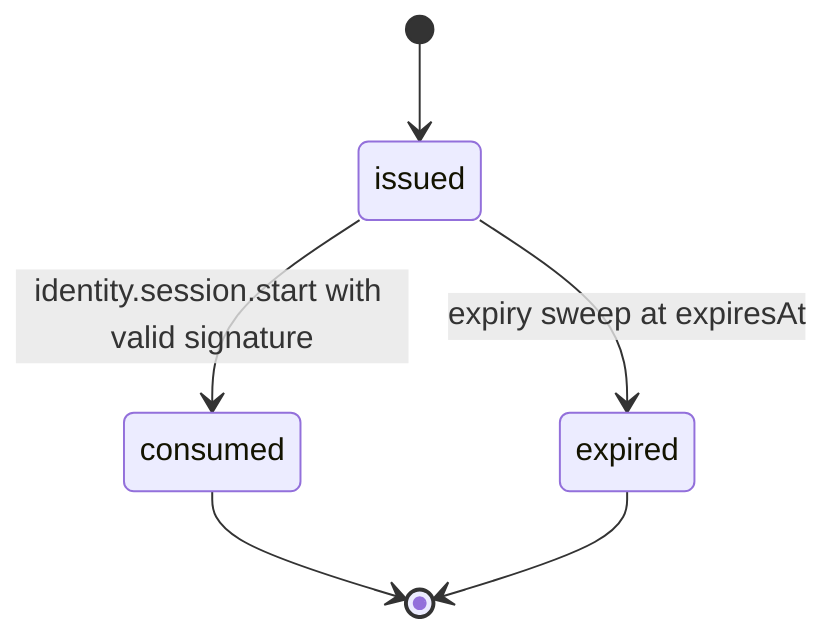
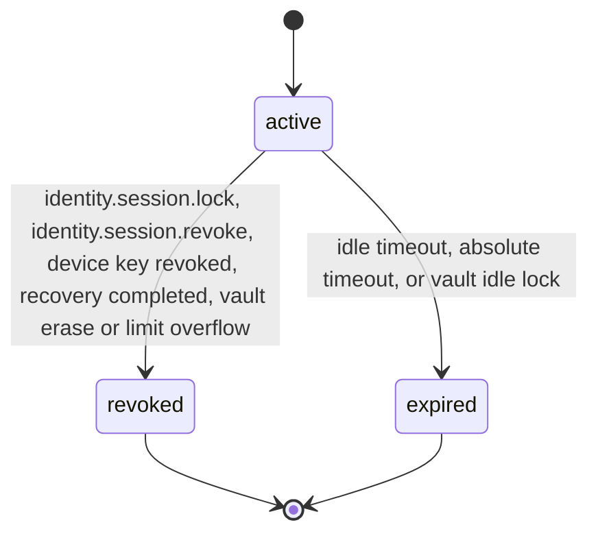

# PS-054-03 — Workflow state machine: Sessions

**Status:** SPECIFIED (Stage 3). **Module:** [F07.S01.M02 Sessions](SPEC.md) · **Scope:** MVP · **Code:** `packages/identity/src/accounts/sessions` · **Contracts:** [CTR-ID-001](../../../planning/contracts/CTR-ID-001.md), [CTR-EVT-001](../../../planning/contracts/CTR-EVT-001.md), [CTR-ERR-001](../../../planning/contracts/CTR-ERR-001.md), [CTR-CAP-001](../../../planning/contracts/CTR-CAP-001.md), [CTR-IDM-001](../../../planning/contracts/CTR-IDM-001.md), [CTR-SCH-001](../../../planning/contracts/CTR-SCH-001.md), [CTR-PRV-001](../../../planning/contracts/CTR-PRV-001.md), [CTR-OBS-001](../../../planning/contracts/CTR-OBS-001.md), [CTR-FLG-001](../../../planning/contracts/CTR-FLG-001.md)

> Generated from `module.spec.yaml` by `tools/specgen`. Edit the YAML, then run `pnpm spec:render`.

## Requirements

- **PS-054-03.R01** Challenges move from issued to consumed or expired exactly once and never return.
- **PS-054-03.R02** Sessions are active until locked, revoked or expired; the end is permanent, and a new login creates a new session.
- **PS-054-03.R03** Rotation replaces a relay token atomically with a new session and a 30 second overlap for the old token to cover in-flight requests.

## Specification

### LoginChallenge lifecycle

Initial **issued**; terminal **consumed**, **expired**.

| Transition | Trigger | Guard / effect |
|---|---|---|
| issued -> consumed | identity.session.start with valid signature | mark consumed in the same transaction as session insert |
| issued -> expired | expiry sweep at expiresAt | no token issued |

### Session lifecycle

Initial **active**; terminal **revoked**, **expired**.

| Transition | Trigger | Guard / effect |
|---|---|---|
| active -> revoked | identity.session.lock, identity.session.revoke, device key revoked, recovery completed, vault erase or limit overflow | set endReason, emit identity.session.revoked |
| active -> expired | idle timeout, absolute timeout, or vault idle lock | set endReason idle or absolute, emit identity.session.revoked |

### Timeouts and scheduled transitions

- LoginChallenge TTL 120 s; expiry sweep every 30 s; rows deleted 24 h after creation (RET-EPHEMERAL).
- Relay token idle timeout 7 days, absolute 30 days; sweep every 60 s; rows deleted 30 days after the end.
- Vault idle lock 15 minutes by default (1 minute to 8 hours), measured with a monotonic timer, also locks when the page is hidden for more than the timeout.

## Verification

| Test | Level | Covers | Scenario | Expected |
|---|---|---|---|---|
| TEST-PS-054-09.T03 | property | PS-054-03.R01, PS-054-03.R02 | random sequences of start, rotate, revoke, expire on sessions and challenges | only declared transitions succeed; ended sessions never revive; a challenge is consumed at most once |
| TEST-PS-054-09.T04 | integration | PS-054-03.R03, PS-054-06.R01 | rotate a token | old token valid for 30 s then rejected; new token works; one transaction |
| TEST-PS-054-09.T13 | a11y | PS-054-01.R01, PS-054-03.R01 | unlock screen and sessions list with axe-core and keyboard only | zero serious or critical issues; backoff text announced politely |

## Dependencies

Module depends on: F07.S01.M01, F07.S02.M01, CTR-ID-001, CTR-EVT-001, CTR-ERR-001, CTR-CAP-001, CTR-IDM-001, CTR-SCH-001, CTR-PRV-001, CTR-OBS-001, CTR-FLG-001. Predecessor: [domain_schema.md](domain_schema.md).
