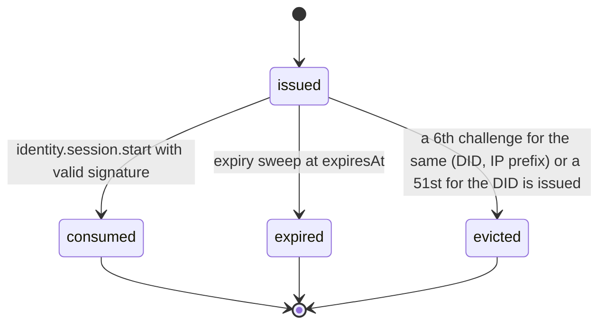
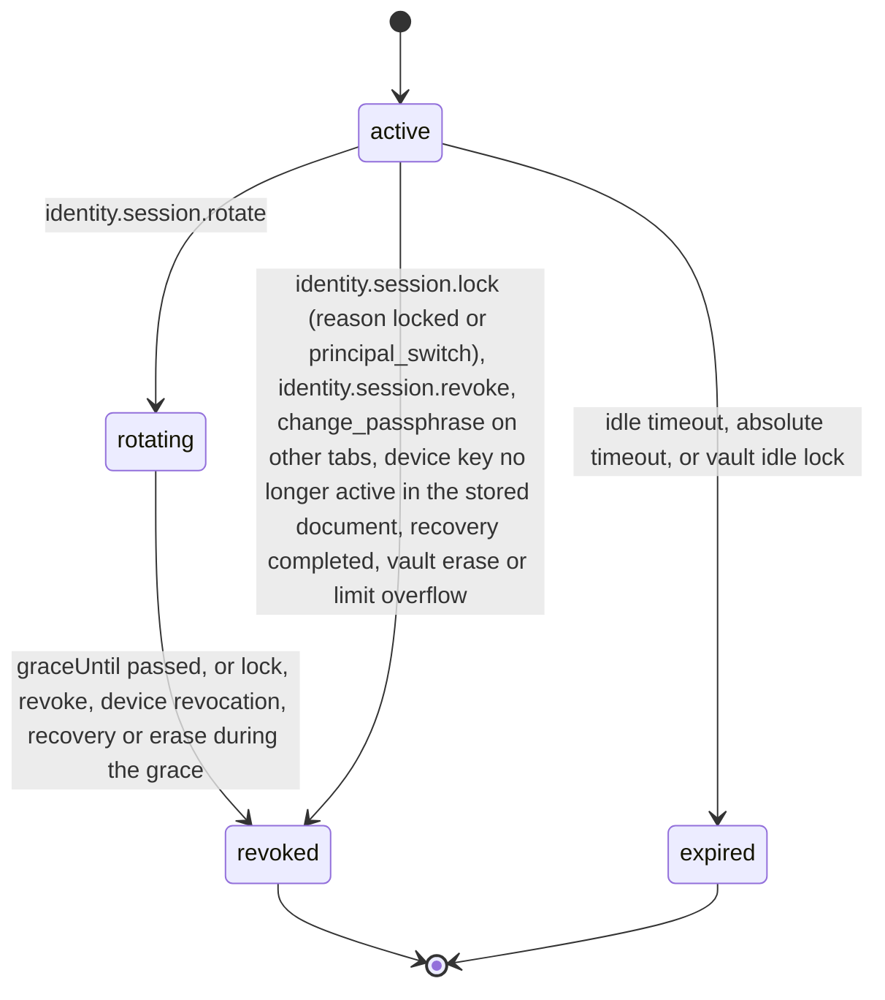

# PS-054-03 — Workflow state machine: Sessions

**Status:** SPECIFIED (Stage 3). **Module:** [F07.S01.M02 Sessions](SPEC.md) · **Scope:** MVP · **Code:** `packages/identity/src/accounts/sessions` · **Contracts:** [CTR-ID-001](../../../planning/contracts/CTR-ID-001.md), [CTR-EVT-001](../../../planning/contracts/CTR-EVT-001.md), [CTR-ERR-001](../../../planning/contracts/CTR-ERR-001.md), [CTR-CAP-001](../../../planning/contracts/CTR-CAP-001.md), [CTR-IDM-001](../../../planning/contracts/CTR-IDM-001.md), [CTR-SCH-001](../../../planning/contracts/CTR-SCH-001.md), [CTR-PRV-001](../../../planning/contracts/CTR-PRV-001.md), [CTR-OBS-001](../../../planning/contracts/CTR-OBS-001.md), [CTR-FLG-001](../../../planning/contracts/CTR-FLG-001.md)

> Generated from `module.spec.yaml` by `tools/specgen`. Edit the YAML, then run `pnpm spec:render`.

## Requirements

- **PS-054-03.R01** Challenges move from issued to consumed, expired or evicted exactly once and never return.
- **PS-054-03.R02** Sessions are active until locked, revoked or expired; the end is permanent, and a new login creates a new session.
- **PS-054-03.R03** Rotation moves the old session to rotating with graceUntil now plus 30 seconds, inserts the new session in the same transaction, and revokes the old one with reason rotated only when the grace ends.

## Specification

### LoginChallenge lifecycle

Initial **issued**; terminal **consumed**, **expired**, **evicted**.

| Transition | Trigger | Guard / effect |
|---|---|---|
| issued -> consumed | identity.session.start with valid signature | mark consumed in the same transaction as session insert |
| issued -> expired | expiry sweep at expiresAt | no token issued |
| issued -> evicted | a 6th challenge for the same (DID, IP prefix) or a 51st for the DID is issued | the oldest is evicted; no token can be issued for it |

### Session lifecycle

Initial **active**; terminal **revoked**, **expired**.

| Transition | Trigger | Guard / effect |
|---|---|---|
| active -> rotating | identity.session.rotate | new session inserted active in the same transaction; graceUntil = now + 30 s; old token still accepted until graceUntil |
| rotating -> revoked | graceUntil passed, or lock, revoke, device revocation, recovery or erase during the grace | endReason rotated or the explicit reason; emit identity.session.revoked |
| active -> revoked | identity.session.lock (reason locked or principal_switch), identity.session.revoke, change_passphrase on other tabs, device key no longer active in the stored document, recovery completed, vault erase or limit overflow | set endReason, emit identity.session.revoked |
| active -> expired | idle timeout, absolute timeout, or vault idle lock | set endReason idle or absolute, emit identity.session.revoked |

### Timeouts and scheduled transitions

- LoginChallenge TTL 120 s; expiry sweep every 30 s; rows deleted 24 h after creation (RET-EPHEMERAL).
- Relay token idle timeout 7 days, absolute 30 days; sweep every 60 s; rows deleted 30 days after the end.
- Rotation grace 30 s; the sweep ends rotating sessions at graceUntil and emits identity.session.revoked then.
- Vault idle lock 15 minutes by default (1 minute to 8 hours), measured with a monotonic timer, also locks when the page is hidden for more than the timeout.

## Verification

| Test | Level | Covers | Scenario | Expected |
|---|---|---|---|---|
| TEST-PS-054-09.T03 | property | PS-054-03.R01, PS-054-03.R02 | random sequences of issue, start, rotate, revoke, expire and eviction | only declared transitions succeed; ended sessions never revive; a challenge is consumed at most once |
| TEST-PS-054-09.T04 | integration | PS-054-03.R03, PS-054-04.R02, PS-054-06.R01 | rotate a token with an injected clock | old session rotating and accepted for 30 s, then revoked with reason rotated and identity.session.revoked emitted at grace end, not at the rotate call; new token works; one transaction |
| TEST-PS-054-09.T05 | unit | PS-054-02.R05, PS-054-03.R02 | vault unlock with wrong passphrase 6 times then correct; idle timeout 0 and 9 h; idle 15 min | backoff schedule applied; VALIDATION_FAILED for out-of-range timeouts; unlock succeeds; auto-lock after 15 minutes measured with monotonic clock |
| TEST-PS-054-09.T22 | integration | PS-054-04.R04, PS-054-03.R02 | P1 unlocked with relay tokens for R and S and 3 queued outbox entries locks the vault; then P2 unlocks its own vault on the same device while P1 is unlocked | on lock the raw tokens and vault key are gone from memory, the session ends with endReason locked, CLEAR_USER_CACHES reason lock is posted to the F15.S01.M02 worker stub and the entries stay unsent; P2's unlock locks P1 with endReason principal_switch and CLEAR_USER_CACHES reason principal_switch; P1's next unlock re-runs challenge-response before sending |

## Dependencies

Module depends on: F07.S01.M01, F07.S02.M01, F15.S01.M02, F10.S01.M02, F10.S01.M03, F10.S01.M04, F10.S02.M02, CTR-ID-001, CTR-EVT-001, CTR-ERR-001, CTR-CAP-001, CTR-IDM-001, CTR-SCH-001, CTR-PRV-001, CTR-OBS-001, CTR-FLG-001. Predecessor: [domain_schema.md](domain_schema.md).
