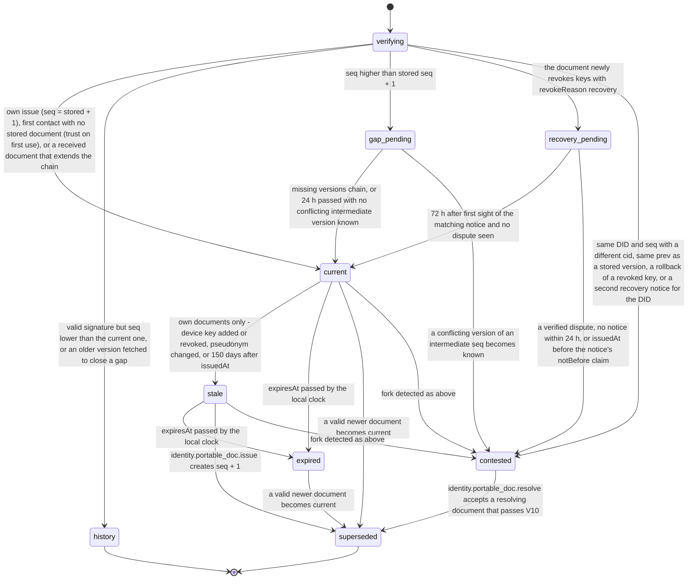

# PS-055-03 — Workflow state machine: Portable identity

**Status:** SPECIFIED (Stage 3). **Module:** [F07.S02.M01 Portable identity](SPEC.md) · **Scope:** MVP · **Code:** `packages/identity/src/profiles/portable` · **Contracts:** [CTR-ID-001](../../../planning/contracts/CTR-ID-001.md), [CTR-EVT-001](../../../planning/contracts/CTR-EVT-001.md), [CTR-ERR-001](../../../planning/contracts/CTR-ERR-001.md), [CTR-CAP-001](../../../planning/contracts/CTR-CAP-001.md), [CTR-IDM-001](../../../planning/contracts/CTR-IDM-001.md), [CTR-FED-001](../../../planning/contracts/CTR-FED-001.md), [CTR-SCH-001](../../../planning/contracts/CTR-SCH-001.md), [CTR-PRV-001](../../../planning/contracts/CTR-PRV-001.md), [CTR-OBS-001](../../../planning/contracts/CTR-OBS-001.md), [CTR-IOX-001](../../../planning/contracts/CTR-IOX-001.md), [CTR-FLG-001](../../../planning/contracts/CTR-FLG-001.md)

> Generated from `module.spec.yaml` by `tools/specgen`. Edit the YAML, then run `pnpm spec:render`.

## Requirements

- **PS-055-03.R01** A document moves from current to superseded when a valid newer version is accepted, to stale when the owner's state changes or 150 days pass, to expired when expiresAt passes, and to contested when a fork is detected.
- **PS-055-03.R02** A contested identity is resolved only by a signed document with a higher seq that chains from one competing version, lists every key revoked in any competing branch, and that the user accepts.
- **PS-055-03.R03** Superseded documents are kept for verification of old statements, and lower-seq documents received later are stored as history.

## Specification

### PortableIdentityDoc lifecycle

Initial **verifying**; terminal **superseded**, **history**.

| Transition | Trigger | Guard / effect |
|---|---|---|
| verifying -> current | own issue (seq = stored + 1), first contact with no stored document (trust on first use), or a received document that extends the chain | record firstSeenAt on first contact; emit identity.portable_doc.published |
| verifying -> history | valid signature but seq lower than the current one, or an older version fetched to close a gap | stored as history; never current |
| verifying -> gap_pending | seq higher than stored seq + 1 | apply its revocations at once (grow-only), buffer up to 24 h, fetch missing versions from the listed relays (FED-3) |
| verifying -> recovery_pending | the document newly revokes keys with revokeReason recovery | previous current stays current; wait 72 h from this vault's first sight of the matching notice |
| verifying -> contested | same DID and seq with a different cid, same prev as a stored version, a rollback of a revoked key, or a second recovery notice for the DID | freeze trust upgrades for this DID, warn the user, keep every version |
| gap_pending -> current | missing versions chain, or 24 h passed with no conflicting intermediate version known | set gap when versions are still missing; supersede the previous current; emit identity.portable_doc.published |
| gap_pending -> contested | a conflicting version of an intermediate seq becomes known | keep both; warn |
| recovery_pending -> current | 72 h after first sight of the matching notice and no dispute seen | supersede the previous current; emit identity.portable_doc.published |
| recovery_pending -> contested | a verified dispute, no notice within 24 h, or issuedAt before the notice's notBefore claim | keep both; the revocations are not applied |
| current -> stale | own documents only - device key added or revoked, pseudonym changed, or 150 days after issuedAt | mark stale and show the reissue prompt; the document stays valid for verification |
| current -> expired | expiresAt passed by the local clock | trust decisions treat the DID as expired and the UI prompts a refresh |
| stale -> expired | expiresAt passed by the local clock | same handling |
| current -> superseded | a valid newer document becomes current | keep as history, emit nothing further for this version |
| stale -> superseded | identity.portable_doc.issue creates seq + 1 | new document becomes current and is queued for publication |
| expired -> superseded | a valid newer document becomes current | keep as evidence |
| current -> contested | fork detected as above | same handling |
| stale -> contested | fork detected as above | same handling |
| contested -> superseded | identity.portable_doc.resolve accepts a resolving document that passes V10 | the resolving document becomes current; every competing version stays as evidence |

### Timeouts and scheduled transitions

- A current own document is marked stale-by-age at 150 days (30 days before expiry) to prompt a refresh; any document is expired at expiresAt (180 days).
- Gap buffer 24 h (86 400 000 ms) with fetch attempts from the listed relays at 1 min, 10 min, 1 h and 6 h.
- Recovery wait 72 h (259 200 000 ms) from this vault's first sight of the notice; a revoking document without a notice waits 24 h for it.
- Relay keeps the latest 20 versions per DID; older ones are purged when version 21 arrives.

## Verification

| Test | Level | Covers | Scenario | Expected |
|---|---|---|---|---|
| TEST-PS-055-09.T04 | integration | PS-055-03.R01, PS-055-03.R03 | receive seq 2, then seq 3, then a replay of seq 1, then a forked seq 3 | current moves forward; replay stored as history; fork marks contested; nothing is deleted |
| TEST-PS-055-09.T05 | integration | PS-055-03.R02, PS-055-02.R05 | resolve a contested DID with seq 4 chained from one branch that lists the union of both branches' revocations, and with one that omits branch B's revocation of D2 | the first becomes current after identity.portable_doc.resolve; the second is refused with IDENTITY_DOC_CHAIN_INVALID and the DID stays contested |
| TEST-PS-055-09.T06 | property | PS-055-01.R03, PS-055-03.R01, PS-055-03.R02, PS-055-03.R03, PS-055-09.R03 | random sequences of issue, receive (lower, equal, plus 1, gap, fork, recovery), expiry and device events | only declared transitions succeed; at most one current or expired per uncontested DID; lower seq stored as history; revokedUnion never shrinks; a resolving document that omits any branch revocation never resolves a fork |
| TEST-PS-055-09.T08 | integration | PS-055-03.R01, PS-055-04.R02 | own device key added, pseudonym changed, and 150 days pass | own current document becomes stale each time; reissue creates seq plus 1, supersedes it and emits published with origin own |
| TEST-PS-055-09.T23 | integration | PS-055-03.R01 | a received current document passes expiresAt; then a newer document arrives | status expired and key_status flags it; the newer one supersedes the expired one |

## Dependencies

Module depends on: F07.S01.M01, F10.S01.M01, F10.S01.M02, F10.S01.M03, F10.S01.M04, F10.S02.M02, CTR-ID-001, CTR-EVT-001, CTR-ERR-001, CTR-CAP-001, CTR-IDM-001, CTR-FED-001, CTR-SCH-001, CTR-PRV-001, CTR-OBS-001, CTR-IOX-001, CTR-FLG-001. Predecessor: [domain_schema.md](domain_schema.md).
