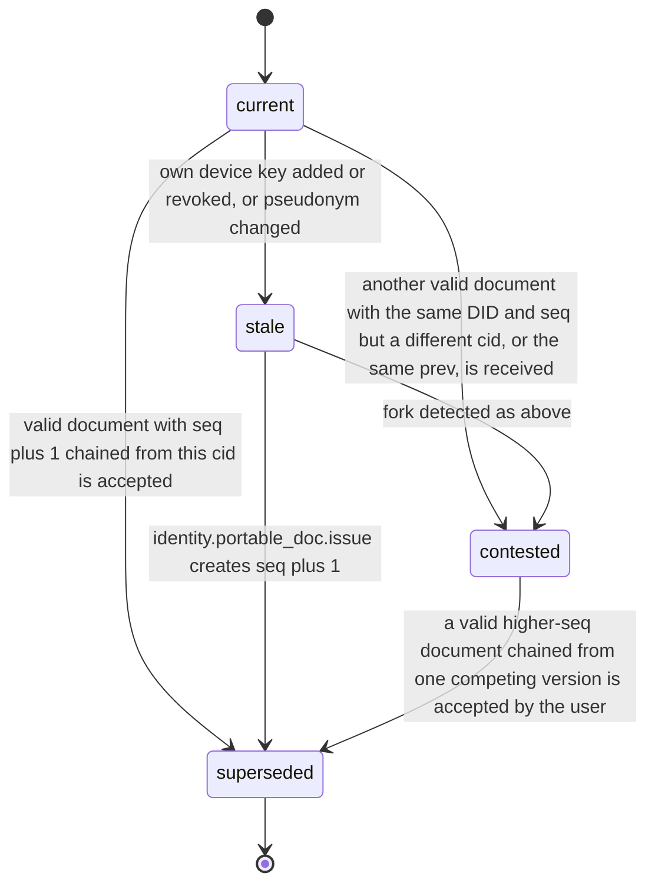

# PS-055-03 — Workflow state machine: Portable identity

**Status:** SPECIFIED (Stage 3). **Module:** [F07.S02.M01 Portable identity](SPEC.md) · **Scope:** MVP · **Code:** `packages/identity/src/profiles/portable` · **Contracts:** [CTR-ID-001](../../../planning/contracts/CTR-ID-001.md), [CTR-EVT-001](../../../planning/contracts/CTR-EVT-001.md), [CTR-ERR-001](../../../planning/contracts/CTR-ERR-001.md), [CTR-CAP-001](../../../planning/contracts/CTR-CAP-001.md), [CTR-IDM-001](../../../planning/contracts/CTR-IDM-001.md), [CTR-FED-001](../../../planning/contracts/CTR-FED-001.md), [CTR-SCH-001](../../../planning/contracts/CTR-SCH-001.md), [CTR-PRV-001](../../../planning/contracts/CTR-PRV-001.md), [CTR-OBS-001](../../../planning/contracts/CTR-OBS-001.md), [CTR-IOX-001](../../../planning/contracts/CTR-IOX-001.md), [CTR-FLG-001](../../../planning/contracts/CTR-FLG-001.md)

> Generated from `module.spec.yaml` by `tools/specgen`. Edit the YAML, then run `pnpm spec:render`.

## Requirements

- **PS-055-03.R01** A document moves from current to superseded when a valid higher seq arrives, to stale when the owner's state changes, and to contested when a fork is detected.
- **PS-055-03.R02** A contested identity is resolved only by a signed document with a higher seq that chains from one of the competing versions and that the user accepts.
- **PS-055-03.R03** Superseded documents are kept for verification of old statements.

## Specification

### PortableIdentityDoc lifecycle

Initial **current**; terminal **superseded**.

| Transition | Trigger | Guard / effect |
|---|---|---|
| current -> stale | own device key added or revoked, or pseudonym changed | mark stale and show reissue prompt, document stays valid for verification |
| current -> superseded | valid document with seq plus 1 chained from this cid is accepted | keep as history, emit nothing further |
| stale -> superseded | identity.portable_doc.issue creates seq plus 1 | new document becomes current and is queued for publication |
| current -> contested | another valid document with the same DID and seq but a different cid, or the same prev, is received | freeze trust upgrades for this DID, warn user, keep both |
| stale -> contested | fork detected as above | same handling |
| contested -> superseded | a valid higher-seq document chained from one competing version is accepted by the user | the chosen branch becomes current, the other branch stays superseded as evidence |

### Timeouts and scheduled transitions

- A current own document is marked stale-by-age at 150 days (30 days before expiry) to prompt a refresh.
- Relay keeps the latest 20 versions per DID; older ones are purged when version 21 arrives.

## Verification

| Test | Level | Covers | Scenario | Expected |
|---|---|---|---|---|
| TEST-PS-055-09.T04 | integration | PS-055-03.R01, PS-055-03.R02 | receive seq 2, then seq 3, then a replay of seq 1, then a forked seq 3 | current moves forward; replay stays history; fork marks contested; nothing is deleted |
| TEST-PS-055-09.T05 | integration | PS-055-03.R03, PS-055-02.R03 | resolve contested by receiving seq 4 chained from one branch and accepting | chosen branch current, other superseded as evidence |
| TEST-PS-055-09.T06 | property | PS-055-03.R01, PS-055-03.R02, PS-055-03.R03 | random sequences of issue, receive, device events | only declared transitions succeed; exactly one current per uncontested DID |

## Dependencies

Module depends on: F07.S01.M01, CTR-ID-001, CTR-EVT-001, CTR-ERR-001, CTR-CAP-001, CTR-IDM-001, CTR-FED-001, CTR-SCH-001, CTR-PRV-001, CTR-OBS-001, CTR-IOX-001, CTR-FLG-001. Predecessor: [domain_schema.md](domain_schema.md).
