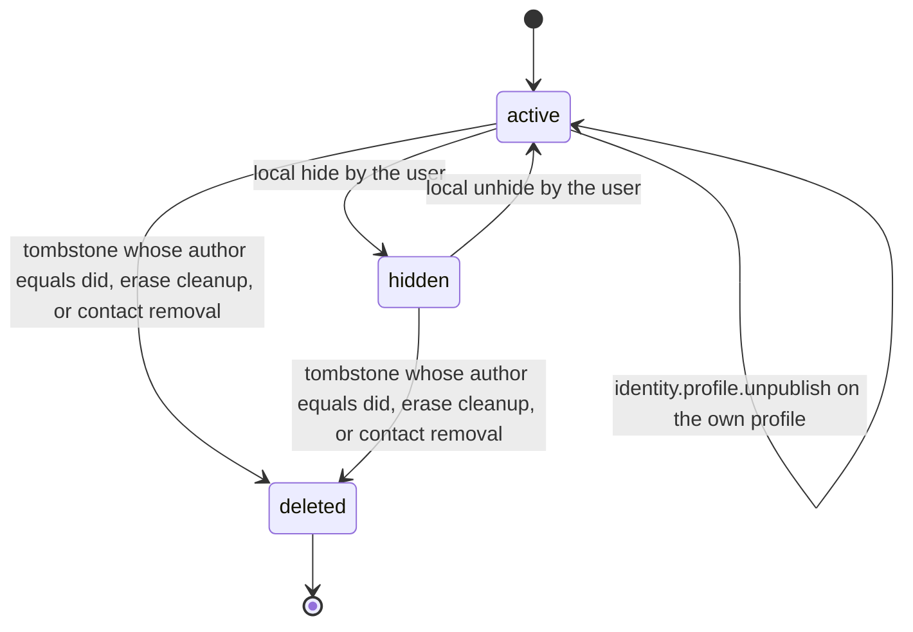
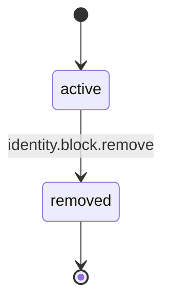

# PS-056-03 — Workflow state machine: Profiles

**Status:** SPECIFIED (Stage 3). **Module:** [F07.S02.M02 Profiles](SPEC.md) · **Scope:** MVP · **Code:** `packages/identity/src/profiles/profiles` · **Contracts:** [CTR-ID-001](../../../planning/contracts/CTR-ID-001.md), [CTR-EVT-001](../../../planning/contracts/CTR-EVT-001.md), [CTR-ERR-001](../../../planning/contracts/CTR-ERR-001.md), [CTR-CAP-001](../../../planning/contracts/CTR-CAP-001.md), [CTR-IDM-001](../../../planning/contracts/CTR-IDM-001.md), [CTR-FED-001](../../../planning/contracts/CTR-FED-001.md), [CTR-SCH-001](../../../planning/contracts/CTR-SCH-001.md), [CTR-PRV-001](../../../planning/contracts/CTR-PRV-001.md), [CTR-OBS-001](../../../planning/contracts/CTR-OBS-001.md), [CTR-IOX-001](../../../planning/contracts/CTR-IOX-001.md), [CTR-UX-001](../../../planning/contracts/CTR-UX-001.md), [CTR-FLG-001](../../../planning/contracts/CTR-FLG-001.md)

> Generated from `module.spec.yaml` by `tools/specgen`. Edit the YAML, then run `pnpm spec:render`.

## Requirements

- **PS-056-03.R01** A profile record in the vault is active, hidden by the local user, or deleted by a tombstone authored by its own DID, the owner's erase or contact removal; a relay's hosting action changes only that relay's copy.
- **PS-056-03.R02** A block is active until removed; removal is permanent for that entry and a re-block creates a new entry.
- **PS-056-03.R03** Hidden profiles return to active only by an explicit local unhide; relay hosting actions and their reversal never change vault records.

## Specification

### Profile lifecycle

Initial **active**; terminal **deleted**.

| Transition | Trigger | Guard / effect |
|---|---|---|
| active -> hidden | local hide by the user | stop showing the profile, keep data |
| hidden -> active | local unhide by the user | show again |
| active -> deleted | tombstone whose author equals did, erase cleanup, or contact removal | delete content, keep tombstone id |
| hidden -> deleted | tombstone whose author equals did, erase cleanup, or contact removal | delete content, keep tombstone id |
| active -> active | identity.profile.unpublish on the own profile | publishState withdrawn, tombstone queued per relay, emit identity.profile.updated with changedFields [withdrawn] |

### BlockEntry lifecycle

Initial **active**; terminal **removed**.

| Transition | Trigger | Guard / effect |
|---|---|---|
| active -> removed | identity.block.remove | emit identity.block.removed; statements from the DID are accepted again from now on |

### Timeouts and scheduled transitions

- Removed BlockEntry rows are purged 30 days after removal.
- Received profiles not viewed for 180 days are evicted from the cache (RET-STANDARD, least recently viewed first).

## Verification

| Test | Level | Covers | Scenario | Expected |
|---|---|---|---|---|
| TEST-PS-056-09.T04 | property | PS-056-03.R01, PS-056-03.R02, PS-056-03.R03 | random sequences of hide, unhide, tombstone, unpublish, block, unblock and relay hosting events | only declared transitions succeed; deleted and removed are final; relay hosting events never change a vault record |
| TEST-PS-056-09.T17 | integration | PS-056-04.R05, PS-056-03.R01 | moderation.action.applied and moderation.action.reverted delivered to a vault and to the relay runtime | the relay stops and then resumes serving its copy; the vault Profile is unchanged except an optional notServedBy provenance entry |

## Dependencies

Module depends on: F07.S01.M01, F07.S02.M01, F06.S02.M01, F10.S01.M01, F10.S01.M02, F10.S01.M03, F10.S01.M04, F10.S02.M02, F10.S02.M03, F15.S02.M03, CTR-ID-001, CTR-EVT-001, CTR-ERR-001, CTR-CAP-001, CTR-IDM-001, CTR-FED-001, CTR-SCH-001, CTR-PRV-001, CTR-OBS-001, CTR-IOX-001, CTR-UX-001, CTR-FLG-001. Predecessor: [domain_schema.md](domain_schema.md).
