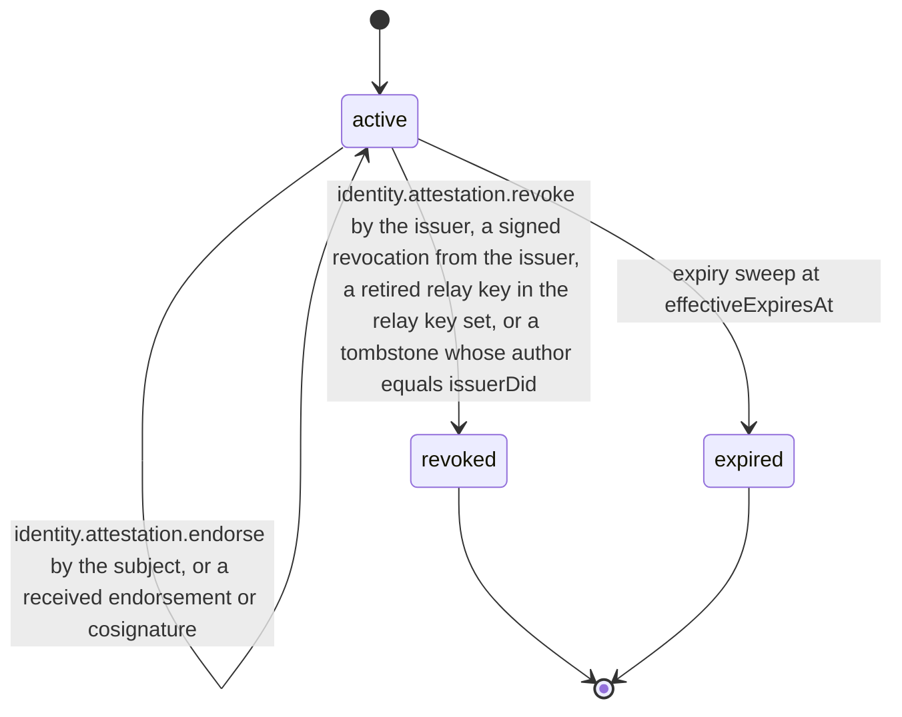

# PS-057-03 — Workflow state machine: Trust evidence

**Status:** SPECIFIED (Stage 3). **Module:** [F07.S03.M02 Trust evidence](SPEC.md) · **Scope:** MVP · **Code:** `packages/identity/src/trust/evidence` · **Contracts:** [CTR-ID-001](../../../planning/contracts/CTR-ID-001.md), [CTR-EVT-001](../../../planning/contracts/CTR-EVT-001.md), [CTR-ERR-001](../../../planning/contracts/CTR-ERR-001.md), [CTR-CAP-001](../../../planning/contracts/CTR-CAP-001.md), [CTR-IDM-001](../../../planning/contracts/CTR-IDM-001.md), [CTR-FED-001](../../../planning/contracts/CTR-FED-001.md), [CTR-SCH-001](../../../planning/contracts/CTR-SCH-001.md), [CTR-PRV-001](../../../planning/contracts/CTR-PRV-001.md), [CTR-OBS-001](../../../planning/contracts/CTR-OBS-001.md), [CTR-IOX-001](../../../planning/contracts/CTR-IOX-001.md), [CTR-FLG-001](../../../planning/contracts/CTR-FLG-001.md)

> Generated from `module.spec.yaml` by `tools/specgen`. Edit the YAML, then run `pnpm spec:render`.

## Requirements

- **PS-057-03.R01** An attestation is active until the issuer revokes it or it expires; both ends are final for that statement.
- **PS-057-03.R02** Revocation takes effect for a viewer only when the viewer receives the signed revocation, and the viewer's UI shows the last-checked time.
- **PS-057-03.R03** Re-issuing creates a new statement and a new attestation record.
- **PS-057-03.R04** A tombstone revokes an attestation only when its author equals the issuer; a tombstone signed by an origin relay only drops that relay's provenance entry, and the subject's endorsement changes display, not the statement.

## Specification

### TrustAttestation lifecycle

Initial **active**; terminal **revoked**, **expired**.

| Transition | Trigger | Guard / effect |
|---|---|---|
| active -> active | identity.attestation.endorse by the subject, or a received endorsement or cosignature | attach the endorsement; the claim becomes publishable and displayable |
| active -> revoked | identity.attestation.revoke by the issuer, a signed revocation from the issuer, a retired relay key in the relay key set, or a tombstone whose author equals issuerDid | set revocation details, emit identity.attestation.revoked |
| active -> expired | expiry sweep at effectiveExpiresAt | hide from default lists, keep as history, emit identity.attestation.revoked with reason expired |

### Timeouts and scheduled transitions

- Expiry sweep every 60 s while the app is open and at every unlock.
- Relay descriptors of the relay key set are re-fetched when older than 24 hours before a relay_email_check is displayed.
- Expired and revoked attestations are kept 2 years (RET-EVIDENCE) for verifying past statements, then deleted or pseudonymized.

## Verification

| Test | Level | Covers | Scenario | Expected |
|---|---|---|---|---|
| TEST-PS-057-09.T04 | property | PS-057-03.R01, PS-057-03.R02, PS-057-03.R03 | random sequences of receive, endorse, revoke, expire, re-issue and relay tombstones | only declared transitions succeed; revoked and expired are final; re-issue creates a new record |
| TEST-PS-057-09.T05 | integration | PS-057-03.R02, PS-057-06.R03 | revocation received after the subject endorsed and republished the claim | viewer marks revoked with lastChecked time; subject's copy shows revoked on next sync |
| TEST-PS-057-09.T19 | abuse | PS-057-03.R04 | a tombstone for Q's attestation signed by origin relay R1, then one signed by Q | after R1's tombstone the attestation stays active and only R1 leaves provenance; Q's tombstone revokes it |

## Dependencies

Module depends on: F07.S01.M01, F07.S02.M01, F07.S02.M02, F11.S01.M01, F11.S03.M01, F15.S02.M01, F16.S02.M02, F10.S01.M01, F10.S01.M02, F10.S01.M03, F10.S01.M04, F10.S02.M02, CTR-ID-001, CTR-EVT-001, CTR-ERR-001, CTR-CAP-001, CTR-IDM-001, CTR-FED-001, CTR-SCH-001, CTR-PRV-001, CTR-OBS-001, CTR-IOX-001, CTR-FLG-001. Predecessor: [domain_schema.md](domain_schema.md).
