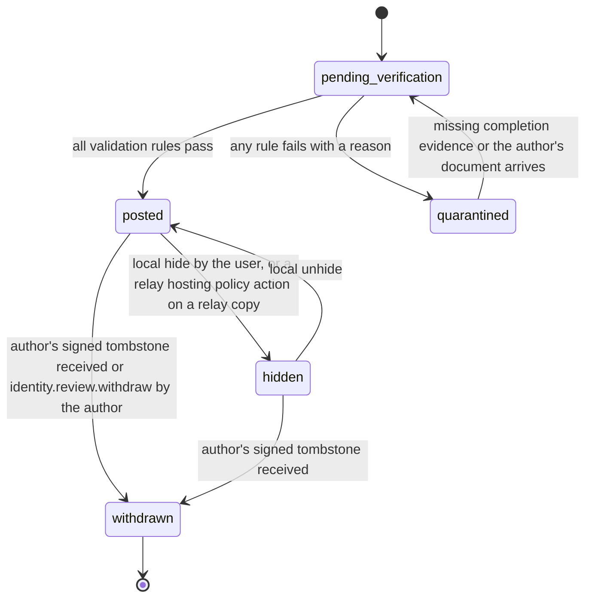
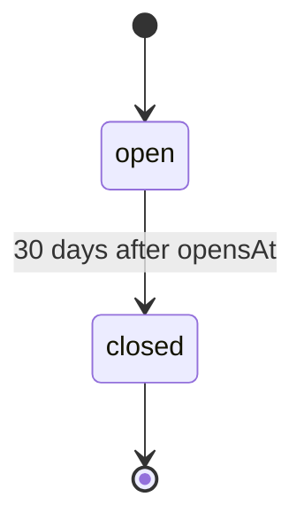

# PS-058-03 — Workflow state machine: Reputation

**Status:** SPECIFIED (Stage 3). **Module:** [F07.S03.M01 Reputation](SPEC.md) · **Scope:** MVP · **Code:** `packages/identity/src/trust/reputation` · **Contracts:** [CTR-ID-001](../../../planning/contracts/CTR-ID-001.md), [CTR-EVT-001](../../../planning/contracts/CTR-EVT-001.md), [CTR-ERR-001](../../../planning/contracts/CTR-ERR-001.md), [CTR-CAP-001](../../../planning/contracts/CTR-CAP-001.md), [CTR-IDM-001](../../../planning/contracts/CTR-IDM-001.md), [CTR-FED-001](../../../planning/contracts/CTR-FED-001.md), [CTR-SCH-001](../../../planning/contracts/CTR-SCH-001.md), [CTR-PRV-001](../../../planning/contracts/CTR-PRV-001.md), [CTR-COM-001](../../../planning/contracts/CTR-COM-001.md), [CTR-OBS-001](../../../planning/contracts/CTR-OBS-001.md), [CTR-IOX-001](../../../planning/contracts/CTR-IOX-001.md), [CTR-FLG-001](../../../planning/contracts/CTR-FLG-001.md)

> Generated from `module.spec.yaml` by `tools/specgen`. Edit the YAML, then run `pnpm spec:render`.

## Requirements

- **PS-058-03.R01** A received review starts pending verification and ends posted or quarantined; a quarantined review may be re-verified when missing evidence arrives.
- **PS-058-03.R02** A posted review can be hidden locally, restored, or withdrawn by its author's signed tombstone, which is final.
- **PS-058-03.R03** A ReviewWindow is open for 30 days from the local completion event and then closed.

## Specification

### Review lifecycle

Initial **pending_verification**; terminal **withdrawn**.

| Transition | Trigger | Guard / effect |
|---|---|---|
| pending_verification -> posted | all validation rules pass | store, emit identity.review.posted, schedule recompute of the subject summary |
| pending_verification -> quarantined | any rule fails with a reason | keep the statement for 30 days, excluded from summaries |
| quarantined -> pending_verification | missing completion evidence or the author's document arrives | re-run validation |
| posted -> hidden | local hide by the user, or a relay hosting policy action on a relay copy | excluded from this vault's summaries and lists |
| hidden -> posted | local unhide | included again and summary recomputed |
| posted -> withdrawn | author's signed tombstone received or identity.review.withdraw by the author | delete comment and tags, keep tombstone, recompute |
| hidden -> withdrawn | author's signed tombstone received | delete comment and tags, keep tombstone |

### ReviewWindow lifecycle

Initial **open**; terminal **closed**.

| Transition | Trigger | Guard / effect |
|---|---|---|
| open -> closed | 30 days after opensAt | no further own reviews for this context |

### Timeouts and scheduled transitions

- ReviewWindow closes 30 days after the local completion event (2 592 000 000 ms).
- Quarantined reviews are deleted 30 days after quarantine.
- Recompute is coalesced per subject with a 5 s delay and a full recompute of all subjects runs daily at 03:00 local time while the app is open.

## Verification

| Test | Level | Covers | Scenario | Expected |
|---|---|---|---|---|
| TEST-PS-058-09.T04 | property | PS-058-03.R01, PS-058-03.R02, PS-058-03.R03 | random sequences of receive, hide, unhide, withdraw, window expiry | only declared transitions succeed; withdrawn is final; quarantined can re-verify |

## Dependencies

Module depends on: F07.S01.M01, F07.S02.M02, CTR-ID-001, CTR-EVT-001, CTR-ERR-001, CTR-CAP-001, CTR-IDM-001, CTR-FED-001, CTR-SCH-001, CTR-PRV-001, CTR-COM-001, CTR-OBS-001, CTR-IOX-001, CTR-FLG-001. Predecessor: [domain_schema.md](domain_schema.md).
