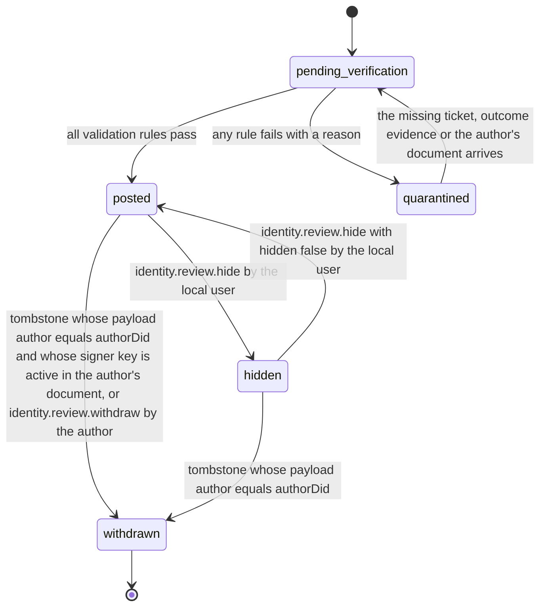
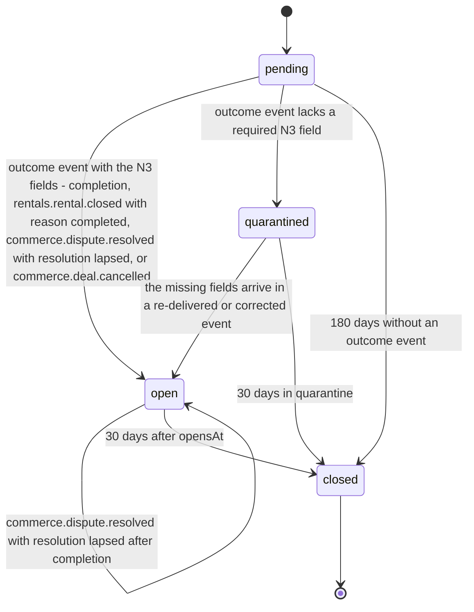

# PS-058-03 — Workflow state machine: Reputation

**Status:** SPECIFIED (Stage 3). **Module:** [F07.S03.M01 Reputation](SPEC.md) · **Scope:** MVP · **Code:** `packages/identity/src/trust/reputation` · **Contracts:** [CTR-ID-001](../../../planning/contracts/CTR-ID-001.md), [CTR-EVT-001](../../../planning/contracts/CTR-EVT-001.md), [CTR-ERR-001](../../../planning/contracts/CTR-ERR-001.md), [CTR-CAP-001](../../../planning/contracts/CTR-CAP-001.md), [CTR-IDM-001](../../../planning/contracts/CTR-IDM-001.md), [CTR-FED-001](../../../planning/contracts/CTR-FED-001.md), [CTR-SCH-001](../../../planning/contracts/CTR-SCH-001.md), [CTR-PRV-001](../../../planning/contracts/CTR-PRV-001.md), [CTR-COM-001](../../../planning/contracts/CTR-COM-001.md), [CTR-OBS-001](../../../planning/contracts/CTR-OBS-001.md), [CTR-IOX-001](../../../planning/contracts/CTR-IOX-001.md), [CTR-FLG-001](../../../planning/contracts/CTR-FLG-001.md)

> Generated from `module.spec.yaml` by `tools/specgen`. Edit the YAML, then run `pnpm spec:render`.

## Requirements

- **PS-058-03.R01** A received review starts pending verification and ends posted or quarantined; a quarantined review may be re-verified when missing evidence arrives.
- **PS-058-03.R02** A posted review can be hidden or restored only by the local user, and withdrawn only by a tombstone whose author is the review's author; relay hosting actions and relay-signed tombstones never change a vault's review records.
- **PS-058-03.R03** A ReviewWindow is pending from the opening of a context, opens for 30 days when an outcome event with the N3 fields arrives, is quarantined when a required field is missing, and then closes.

## Specification

### Review lifecycle

Initial **pending_verification**; terminal **withdrawn**.

| Transition | Trigger | Guard / effect |
|---|---|---|
| pending_verification -> posted | all validation rules pass | store, emit identity.review.posted, schedule recompute of the subject summary |
| pending_verification -> quarantined | any rule fails with a reason | keep the statement for 30 days, excluded from summaries |
| quarantined -> pending_verification | the missing ticket, outcome evidence or the author's document arrives | re-run validation |
| posted -> hidden | identity.review.hide by the local user | excluded from this vault's summaries and lists |
| hidden -> posted | identity.review.hide with hidden false by the local user | included again and summary recomputed |
| posted -> withdrawn | tombstone whose payload author equals authorDid and whose signer key is active in the author's document, or identity.review.withdraw by the author | delete comment and tags, keep tombstone, recompute |
| hidden -> withdrawn | tombstone whose payload author equals authorDid | delete comment and tags, keep tombstone |

### ReviewWindow lifecycle

Initial **pending**; terminal **closed**.

| Transition | Trigger | Guard / effect |
|---|---|---|
| pending -> open | outcome event with the N3 fields - completion, rentals.rental.closed with reason completed, commerce.dispute.resolved with resolution lapsed, or commerce.deal.cancelled | set outcome, compute pairs, opensAt = receipt time, closesAt = opensAt + 30 days; sign completion tickets after a completion |
| pending -> quarantined | outcome event lacks a required N3 field | record missingFields; no pair guessed |
| quarantined -> open | the missing fields arrive in a re-delivered or corrected event | compute pairs and open as above |
| quarantined -> closed | 30 days in quarantine | nothing can be posted |
| pending -> closed | 180 days without an outcome event | tickets kept as evidence |
| open -> open | commerce.dispute.resolved with resolution lapsed after completion | outcome becomes disputed and disputeFlag is set; closesAt unchanged |
| open -> closed | 30 days after opensAt | no further own reviews for this context |

### Timeouts and scheduled transitions

- ReviewWindow closes 30 days after the local outcome event (2 592 000 000 ms); a pending window without an outcome closes after 180 days; a quarantined window after 30 days.
- Quarantined reviews are deleted 30 days after quarantine.
- Recompute is coalesced per subject with a 5 s delay and a full recompute of all subjects runs daily at 03:00 local time while the app is open.

## Verification

| Test | Level | Covers | Scenario | Expected |
|---|---|---|---|---|
| TEST-PS-058-09.T04 | property | PS-058-03.R01, PS-058-03.R02, PS-058-03.R03 | random sequences of receive, hide, unhide, withdraw, relay tombstones, window outcomes and expiry | only declared transitions succeed; withdrawn is final; quarantined can re-verify; relay actions change no review |
| TEST-PS-058-09.T16 | abuse | PS-058-03.R02, PS-058-09.R04 | a tombstone targeting Q's public review signed by origin relay R1, then one signed by Q's device key | after the relay tombstone the review stays posted and only R1 leaves provenance and sourceCount; Q's tombstone withdraws it |
| TEST-PS-058-09.T17 | integration | PS-058-03.R02, PS-058-05.R03 | relay R1 stops serving a review copy and answers with a signed not-served statement | vault review stays posted, notServedBy records R1, sourceCount drops by one, the review is never excluded |

## Dependencies

Module depends on: F07.S01.M01, F07.S02.M01, F07.S02.M02, F09.S01.M01, F09.S02.M02, F10.S01.M01, F10.S01.M02, F10.S01.M03, F10.S01.M04, F10.S02.M02, CTR-ID-001, CTR-EVT-001, CTR-ERR-001, CTR-CAP-001, CTR-IDM-001, CTR-FED-001, CTR-SCH-001, CTR-PRV-001, CTR-COM-001, CTR-OBS-001, CTR-IOX-001, CTR-FLG-001. Predecessor: [domain_schema.md](domain_schema.md).
