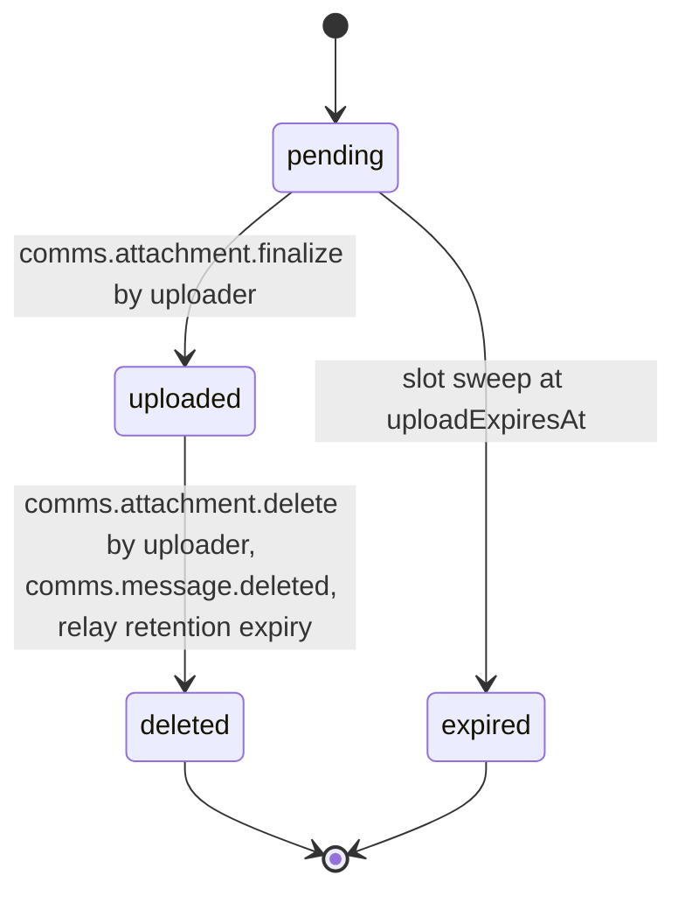

# PS-059-03 — Workflow state machine: Message attachments

**Status:** SPECIFIED (Stage 3). **Module:** [F08.S01.M03 Message attachments](SPEC.md) · **Scope:** MVP · **Code:** `packages/comms/src/messaging/attachments` · **Contracts:** [CTR-ID-001](../../../planning/contracts/CTR-ID-001.md), [CTR-EVT-001](../../../planning/contracts/CTR-EVT-001.md), [CTR-ERR-001](../../../planning/contracts/CTR-ERR-001.md), [CTR-CAP-001](../../../planning/contracts/CTR-CAP-001.md), [CTR-PRV-001](../../../planning/contracts/CTR-PRV-001.md), [CTR-IDM-001](../../../planning/contracts/CTR-IDM-001.md), [CTR-OBS-001](../../../planning/contracts/CTR-OBS-001.md), [CTR-IOX-001](../../../planning/contracts/CTR-IOX-001.md)

> Generated from `module.spec.yaml` by `tools/specgen`. Edit the YAML, then run `pnpm spec:render`.

## Requirements

- **PS-059-03.R01** An Attachment starts pending, becomes uploaded only after hash verification and ends deleted or expired; both ends are terminal.
- **PS-059-03.R02** Pending slots not finalized within 1 hour expire and their partial chunks are erased by a sweep every 5 minutes.
- **PS-059-03.R03** Deletion of the referencing message by its author, a signed vault wipe request or relay retention expiry (30 days after upload unless the author extends to 90 days) deletes the blob and moves the Attachment to deleted.

## Specification

### Attachment lifecycle

Initial **pending**; terminal **deleted**, **expired**.

| Transition | Trigger | Guard / effect |
|---|---|---|
| pending -> uploaded | comms.attachment.finalize by uploader | length and SHA-256 verified; emits comms.attachment.uploaded |
| pending -> expired | slot sweep at uploadExpiresAt | partial chunks erased |
| uploaded -> deleted | comms.attachment.delete by uploader, comms.message.deleted, relay retention expiry | blob erased; emits comms.attachment.deleted |

### Timeouts and scheduled transitions

- Slot sweep every 5 minutes expires pending attachments past uploadExpiresAt (1 h).
- Relay blob retention expiry removes uploaded blobs 30 days after upload (hosting policy default; author may extend to 90 days).

## Verification

| Test | Level | Covers | Scenario | Expected |
|---|---|---|---|---|
| TEST-PS-059-09.T04 | property | PS-059-03.R01, PS-059-03.R02, PS-059-03.R03 | random sequences of chunk, finalize, delete, sweep | only declared transitions succeed; deleted and expired never change |
| TEST-PS-059-09.T06 | integration | PS-059-04.R03, PS-059-03.R03 | author deletes message, vault wipe request, and 30-day expiry | signed relay delete issued or sweep runs, blob erased in each case and downloads return NOT_FOUND |

## Dependencies

Module depends on: F08.S01.M01, F08.S01.M02, CTR-ID-001, CTR-EVT-001, CTR-ERR-001, CTR-CAP-001, CTR-PRV-001, CTR-IDM-001, CTR-OBS-001, CTR-IOX-001. Predecessor: [domain_schema.md](domain_schema.md).
