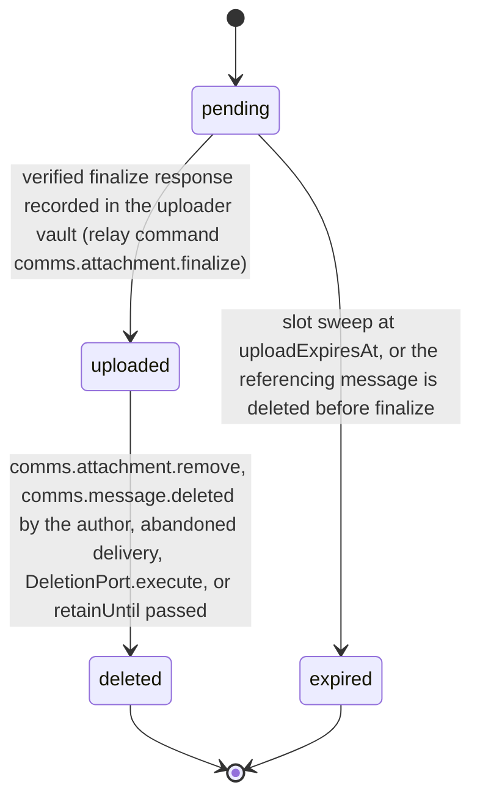

# PS-059-03 — Workflow state machine: Message attachments

**Status:** SPECIFIED (Stage 3). **Module:** [F08.S01.M03 Message attachments](SPEC.md) · **Scope:** MVP · **Code:** `packages/comms/src/messaging/attachments` · **Contracts:** [CTR-ID-001](../../../planning/contracts/CTR-ID-001.md), [CTR-EVT-001](../../../planning/contracts/CTR-EVT-001.md), [CTR-ERR-001](../../../planning/contracts/CTR-ERR-001.md), [CTR-CAP-001](../../../planning/contracts/CTR-CAP-001.md), [CTR-PRV-001](../../../planning/contracts/CTR-PRV-001.md), [CTR-IDM-001](../../../planning/contracts/CTR-IDM-001.md), [CTR-OBS-001](../../../planning/contracts/CTR-OBS-001.md), [CTR-IOX-001](../../../planning/contracts/CTR-IOX-001.md), [CTR-UX-001](../../../planning/contracts/CTR-UX-001.md)

> Generated from `module.spec.yaml` by `tools/specgen`. Edit the YAML, then run `pnpm spec:render`.

## Requirements

- **PS-059-03.R01** An Attachment starts pending, becomes uploaded only after hash verification and ends deleted or expired; both ends are terminal.
- **PS-059-03.R02** Pending slots not finalized within 1 hour expire and their partial chunks are erased by a sweep every 5 minutes.
- **PS-059-03.R03** Deletion of the referencing message by its author in any delivery state, abandonment of the message's outbox entry before any relay received it, a signed delete during account deletion, or relay retention expiry 30 days after upload deletes the blob and moves the Attachment to deleted; there is no retention extension.
- **PS-059-03.R04** comms.attachment.uploaded and comms.attachment.deleted are emitted in the uploader's vault when it records a verified finalize response, a delete response or the passing of the relay-signed retainUntil, taking threadId from the local record; relay commands emit no events (CTR-EVT-001 EVT-8, N17).

## Specification

### Attachment lifecycle

Initial **pending**; terminal **deleted**, **expired**.

| Transition | Trigger | Guard / effect |
|---|---|---|
| pending -> uploaded | verified finalize response recorded in the uploader vault (relay command comms.attachment.finalize) | length and SHA-256 verified, MediaBlob stored; emits comms.attachment.uploaded |
| pending -> expired | slot sweep at uploadExpiresAt, or the referencing message is deleted before finalize | partial chunks erased |
| uploaded -> deleted | comms.attachment.remove, comms.message.deleted by the author, abandoned delivery, DeletionPort.execute, or retainUntil passed | MediaBlob deleted from the live store; emits comms.attachment.deleted in the uploader vault |

### Timeouts and scheduled transitions

- Slot sweep every 5 minutes expires pending attachments past uploadExpiresAt (1 h).
- Relay sweep deletes uploaded blobs at retainUntil (30 days after upload); the uploader vault marks the attachment deleted with reason expiry when its clock passes the relay-signed retainUntil.

## Verification

| Test | Level | Covers | Scenario | Expected |
|---|---|---|---|---|
| TEST-PS-059-09.T04 | property | PS-059-03.R01, PS-059-03.R02, PS-059-03.R03 | random sequences of chunk, finalize, delete, sweep | only declared transitions succeed; deleted and expired never change |
| TEST-PS-059-09.T06 | integration | PS-059-04.R03, PS-059-03.R03 | author deletes the message in prepared and in peer_accepted state; delivery abandoned after 7 days; retainUntil passes | signed relay delete issued or sweep runs, blob erased from the live store in each case and downloads return NOT_FOUND |
| TEST-PS-059-09.T19 | integration | PS-059-03.R04 | finalize, delete and expiry responses recorded | comms.attachment.uploaded and comms.attachment.deleted emitted in the uploader vault with threadId from the local record; the relay emitted nothing and holds only thread_label_hash |

## Dependencies

Module depends on: F08.S01.M01, F08.S01.M02, F15.S02.M03, F10.S02.M03, F11.S02.M01, F15.S01.M01, F16.S02.M03, F12.S03.M03, F10.S01.M02, F10.S01.M03, F10.S01.M04, F10.S02.M02, CTR-ID-001, CTR-EVT-001, CTR-ERR-001, CTR-CAP-001, CTR-PRV-001, CTR-IDM-001, CTR-OBS-001, CTR-IOX-001, CTR-UX-001. Predecessor: [domain_schema.md](domain_schema.md).
