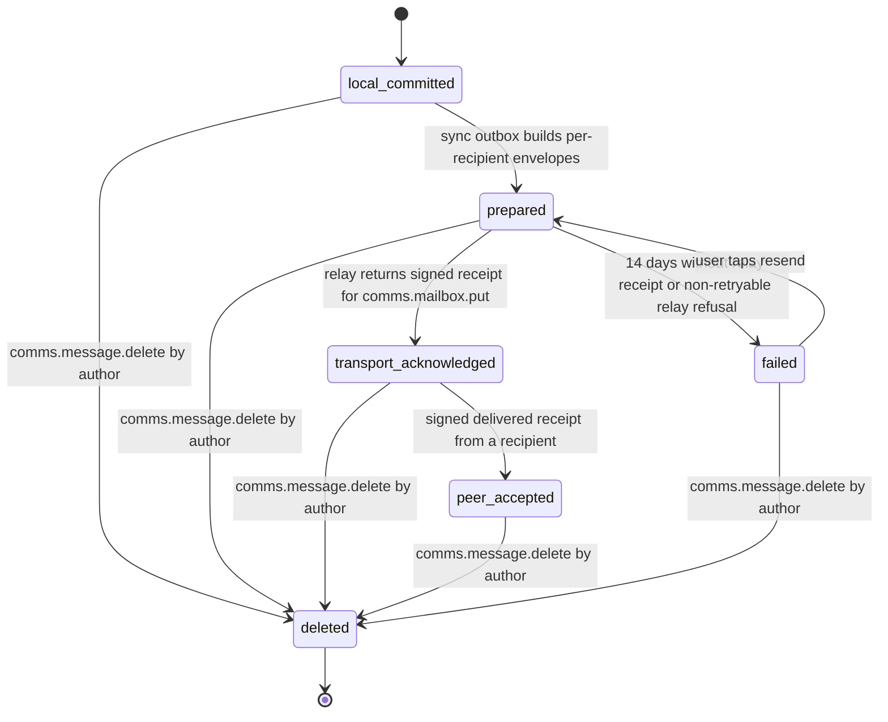
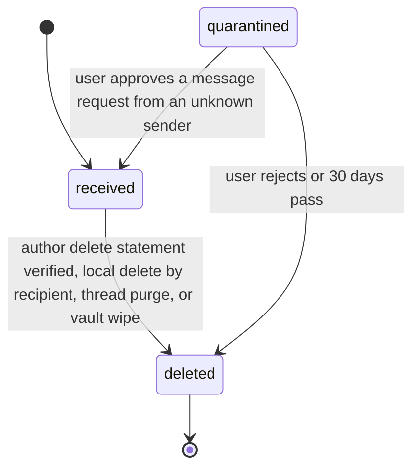

# PS-060-03 — Workflow state machine: Private messages

**Status:** SPECIFIED (Stage 3). **Module:** [F08.S01.M01 Private messages](SPEC.md) · **Scope:** MVP · **Code:** `packages/comms/src/messaging/private` · **Contracts:** [CTR-ID-001](../../../planning/contracts/CTR-ID-001.md), [CTR-EVT-001](../../../planning/contracts/CTR-EVT-001.md), [CTR-ERR-001](../../../planning/contracts/CTR-ERR-001.md), [CTR-CAP-001](../../../planning/contracts/CTR-CAP-001.md), [CTR-PRV-001](../../../planning/contracts/CTR-PRV-001.md), [CTR-IDM-001](../../../planning/contracts/CTR-IDM-001.md), [CTR-OBS-001](../../../planning/contracts/CTR-OBS-001.md), [CTR-FED-001](../../../planning/contracts/CTR-FED-001.md), [CTR-IOX-001](../../../planning/contracts/CTR-IOX-001.md)

> Generated from `module.spec.yaml` by `tools/specgen`. Edit the YAML, then run `pnpm spec:render`.

## Requirements

- **PS-060-03.R01** An outbound Message advances only forward through local committed, prepared, transport acknowledged and peer accepted, may fail while not yet transport acknowledged, and the UI shows exactly the reached state.
- **PS-060-03.R02** An inbound Message is created active or quarantined and can only be deleted afterwards; deleted is terminal and irreversible.
- **PS-060-03.R03** Receipts never change message state other than peer accepted; they are separate append-only rows.

## Specification

### Message lifecycle

Initial **local_committed**; terminal **deleted**.

| Transition | Trigger | Guard / effect |
|---|---|---|
| local_committed -> prepared | sync outbox builds per-recipient envelopes | one envelope per recipient mailbox written to outbox |
| prepared -> transport_acknowledged | relay returns signed receipt for comms.mailbox.put | relayReceipt stored; emits comms.message.sent |
| prepared -> failed | 14 days without relay receipt or non-retryable relay refusal | outbox entry marked failed, resend allowed as a new attempt |
| failed -> prepared | user taps resend | new envelope built with same messageId |
| transport_acknowledged -> peer_accepted | signed delivered receipt from a recipient | receipt stored |
| local_committed -> deleted | comms.message.delete by author | body erased, delete statement queued |
| prepared -> deleted | comms.message.delete by author | queued envelope cancelled, body erased |
| transport_acknowledged -> deleted | comms.message.delete by author | body erased, signed delete request queued; emits comms.message.deleted |
| peer_accepted -> deleted | comms.message.delete by author | body erased, signed delete request queued; emits comms.message.deleted |
| failed -> deleted | comms.message.delete by author | body erased |

### Message (inbound) lifecycle

Initial **received**; terminal **deleted**.

| Transition | Trigger | Guard / effect |
|---|---|---|
| received -> deleted | author delete statement verified, local delete by recipient, thread purge, or vault wipe | body erased; emits comms.message.deleted |
| quarantined -> received | user approves a message request from an unknown sender | verification re-run |
| quarantined -> deleted | user rejects or 30 days pass | envelope erased |

### Timeouts and scheduled transitions

- Outbox retries prepared envelopes with backoff 1 s, 2 s, 4 s ... capped at 15 min, until 14 days after creation.
- Relay deletes mailbox envelopes 30 days after receivedAt (hourly sweep).
- Quarantined inbound messages are erased 30 days after arrival.

## Verification

| Test | Level | Covers | Scenario | Expected |
|---|---|---|---|---|
| TEST-PS-060-09.T03 | unit | PS-060-01.R03, PS-060-03.R02 | inbound envelope accepted, then author delete statement applied | body erased, tombstone kept, seq not reused |
| TEST-PS-060-09.T05 | property | PS-060-03.R01, PS-060-03.R03 | random sequences of send, relay outcomes, receipts and delete | syncState only moves forward as declared; deleted never returns; UI state equals highest reached state |
| TEST-PS-060-09.T10 | e2e | PS-060-06.R03, PS-060-03.R01 | relay down for 4 days, then restored | messages stay prepared, then become transport acknowledged; recipient receives 30 messages in sender order; UI never shows delivered early |

## Dependencies

Module depends on: F08.S01.M02, F07.S01.M01, F07.S02.M02, F16.S02.M02, CTR-ID-001, CTR-EVT-001, CTR-ERR-001, CTR-CAP-001, CTR-PRV-001, CTR-IDM-001, CTR-OBS-001, CTR-FED-001, CTR-IOX-001. Predecessor: [domain_schema.md](domain_schema.md).
