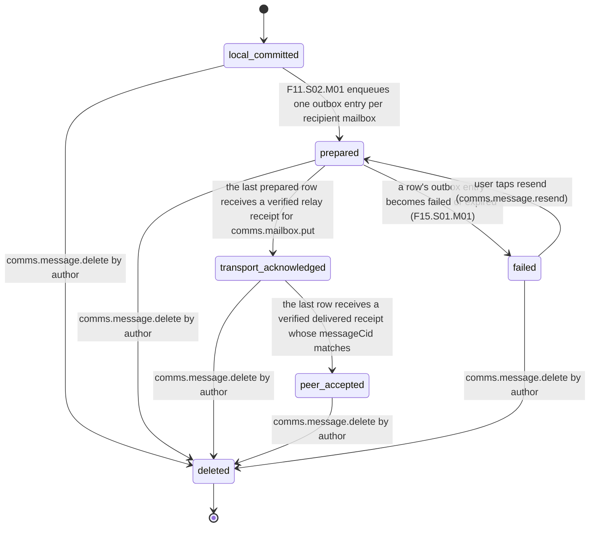
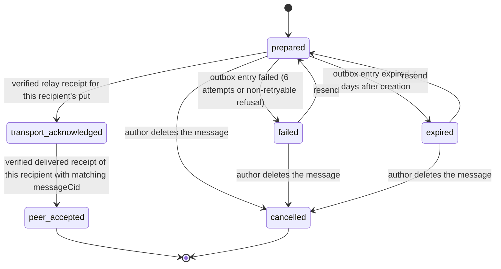
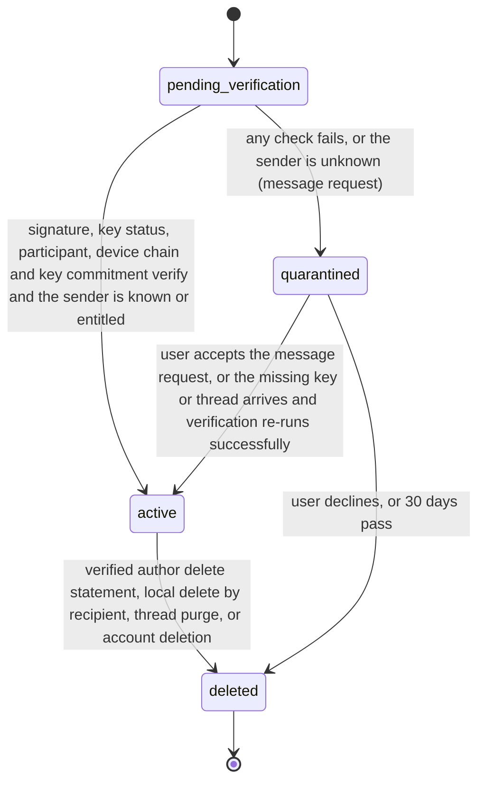

# PS-060-03 — Workflow state machine: Private messages

**Status:** SPECIFIED (Stage 3). **Module:** [F08.S01.M01 Private messages](SPEC.md) · **Scope:** MVP · **Code:** `packages/comms/src/messaging/private` · **Contracts:** [CTR-ID-001](../../../planning/contracts/CTR-ID-001.md), [CTR-EVT-001](../../../planning/contracts/CTR-EVT-001.md), [CTR-ERR-001](../../../planning/contracts/CTR-ERR-001.md), [CTR-CAP-001](../../../planning/contracts/CTR-CAP-001.md), [CTR-PRV-001](../../../planning/contracts/CTR-PRV-001.md), [CTR-IDM-001](../../../planning/contracts/CTR-IDM-001.md), [CTR-OBS-001](../../../planning/contracts/CTR-OBS-001.md), [CTR-FED-001](../../../planning/contracts/CTR-FED-001.md), [CTR-IOX-001](../../../planning/contracts/CTR-IOX-001.md), [CTR-UX-001](../../../planning/contracts/CTR-UX-001.md)

> Generated from `module.spec.yaml` by `tools/specgen`. Edit the YAML, then run `pnpm spec:render`.

## Requirements

- **PS-060-03.R01** Each outbound delivery row advances only forward through prepared, transport acknowledged and peer accepted, becomes failed or expired exactly when its F15.S01.M01 outbox entry does (failed after 6 attempts or a non-retryable refusal, expired 7 days after creation while unsent), and the message-level state is the minimum across rows; the UI shows exactly the reached state with 'k of n acknowledged'.
- **PS-060-03.R02** An inbound Message is created pending_verification and becomes active or quarantined; it can only be deleted afterwards and deleted is terminal and irreversible.
- **PS-060-03.R03** Receipts never change message state other than peer accepted of their own delivery row; they are separate append-only rows.
- **PS-060-03.R04** Every transition into deleted emits comms.message.deleted, with reason author for an author delete in any outbound state (local committed, prepared, failed, transport acknowledged or peer accepted), so referenced attachment blobs are cleaned up whatever the delivery state.

## Specification

### Message lifecycle

Initial **local_committed**; terminal **deleted**.

| Transition | Trigger | Guard / effect |
|---|---|---|
| local_committed -> prepared | F11.S02.M01 enqueues one outbox entry per recipient mailbox | one delivery row per recipient in state prepared |
| prepared -> transport_acknowledged | the last prepared row receives a verified relay receipt for comms.mailbox.put | derived minimum; comms.message.sent was emitted per row as each receipt arrived |
| prepared -> failed | a row's outbox entry becomes failed or expired (F15.S01.M01) | message shows failed for that recipient with resend |
| failed -> prepared | user taps resend (comms.message.resend) | identical signed envelope bytes (same messageCid) re-queued; only wrappedKeys may be rebuilt |
| transport_acknowledged -> peer_accepted | the last row receives a verified delivered receipt whose messageCid matches | receipt stored; UI shows n of n acknowledged |
| local_committed -> deleted | comms.message.delete by author | body erased, nothing queued yet is cancelled; emits comms.message.deleted (reason author) |
| prepared -> deleted | comms.message.delete by author | queued rows cancelled, body erased, signed delete request queued for rows already received; emits comms.message.deleted (reason author) |
| transport_acknowledged -> deleted | comms.message.delete by author | body erased, signed delete request queued; emits comms.message.deleted (reason author) |
| peer_accepted -> deleted | comms.message.delete by author | body erased, signed delete request queued; emits comms.message.deleted (reason author) |
| failed -> deleted | comms.message.delete by author | rows cancelled, body erased; emits comms.message.deleted (reason author) |

### Message delivery row (per recipient) lifecycle

Initial **prepared**; terminal **peer_accepted**, **cancelled**.

| Transition | Trigger | Guard / effect |
|---|---|---|
| prepared -> transport_acknowledged | verified relay receipt for this recipient's put | relayReceipt stored; emits comms.message.sent for this recipient |
| prepared -> failed | outbox entry failed (6 attempts or non-retryable refusal) | error code stored |
| prepared -> expired | outbox entry expired 7 days after creation | user was prompted on day 6 |
| failed -> prepared | resend | new outbox entry for the identical envelope |
| expired -> prepared | resend | new outbox entry for the identical envelope |
| transport_acknowledged -> peer_accepted | verified delivered receipt of this recipient with matching messageCid | receiptCid stored |
| prepared -> cancelled | author deletes the message | outbox entry cancelled |
| failed -> cancelled | author deletes the message | nothing sent |
| expired -> cancelled | author deletes the message | nothing sent |

### Message (inbound) lifecycle

Initial **pending_verification**; terminal **deleted**.

| Transition | Trigger | Guard / effect |
|---|---|---|
| pending_verification -> active | signature, key status, participant, device chain and key commitment verify and the sender is known or entitled | emits comms.message.received |
| pending_verification -> quarantined | any check fails, or the sender is unknown (message request) | quarantineReason stored |
| quarantined -> active | user accepts the message request, or the missing key or thread arrives and verification re-runs successfully | emits comms.message.received |
| quarantined -> deleted | user declines, or 30 days pass | envelope erased; emits comms.message.deleted (reason purge) |
| active -> deleted | verified author delete statement, local delete by recipient, thread purge, or account deletion | body erased; emits comms.message.deleted |

### Timeouts and scheduled transitions

- Delivery rows follow the F15.S01.M01 outbox timers (CTR-IDM-001 IDM-4 backoff base 500 ms, cap 30 s, full jitter, 6 attempts; unsent entries expire 7 days after creation after a day-6 prompt; transport_acknowledged entries leave the outbox 30 days after the relay receipt while the row stays transport_acknowledged).
- Relay deletes mailbox envelopes 30 days after receivedAt (hourly sweep).
- Quarantined inbound messages are erased 30 days after arrival.
- Relay request (keyid, nonce) pairs are kept 600 s for replay detection (F11.S01.M03 NonceStore, RET-EPHEMERAL).
- Each own mailbox ID is rotated 30 days after registration or the last rotation, per relay; the previous ID forwards for 14 days.
- Request-key first-put rows (comms_mailbox_writer) are deleted 30 days after the first put; pre-signed mailbox close statements are accepted for 30 days after signing.

## Verification

| Test | Level | Covers | Scenario | Expected |
|---|---|---|---|---|
| TEST-PS-060-09.T03 | unit | PS-060-01.R03, PS-060-03.R02 | inbound envelope moves pending_verification to active, then the author delete statement is applied | body erased, tombstone kept, seq not reused, comms.message.deleted emitted |
| TEST-PS-060-09.T05 | property | PS-060-03.R01, PS-060-03.R03 | random sequences of send, relay outcomes per recipient, receipts and delete | rows only move forward as declared; message state equals the minimum row state; deleted never returns; UI state equals the reached state |
| TEST-PS-060-09.T10 | e2e | PS-060-06.R03, PS-060-03.R01 | relay down for 4 days then restored; second run with relay down for 8 days | first: rows stay prepared then become transport acknowledged and the recipient receives 30 messages in sender order; second: day-6 prompt, entries expire at 7 days, message shows failed with resend; UI never shows delivered early |
| TEST-PS-060-09.T18 | integration | PS-060-01.R05, PS-060-03.R01, PS-060-04.R01 | A sends in TG; B acknowledges, C does not; then C sends a receipt for a different messageCid | message shows transport acknowledged with 1 of 2 acknowledged; C's mismatched receipt rejected with COMMS_MESSAGE_RECEIPT_MISMATCH; peer accepted only after C's matching receipt |
| TEST-PS-060-09.T25 | unit | PS-060-03.R04, PS-060-04.R04 | author deletes messages in local_committed, prepared, failed, transport_acknowledged and peer_accepted; inspect statement registry entries | comms.message.deleted with reason author in every case; registry lists message, delete, receipt and mailbox_close statements with signer roles and no F16.S02.M03 context for relay requests |
| TEST-PS-060-09.T27 | integration | PS-060-04.R08, PS-060-03.R01 | put twice with identical ciphertext; a receipt with a wrong destination or digest; a receipt signed by a retired relay key | each put returns a classrup.platform.relay_receipt/v1 with destination <relayId>/mailbox/<mailboxId>, the ciphertext digest and no cid; the duplicate returns the stored receipt; the mismatched receipt leaves the row prepared; the retired-key receipt verifies against the published key set |

## Dependencies

Module depends on: F08.S01.M02, F07.S01.M01, F07.S02.M01, F07.S02.M02, F16.S02.M01, F16.S02.M02, F16.S02.M03, F11.S01.M01, F11.S01.M02, F11.S01.M03, F11.S02.M01, F15.S01.M01, F15.S02.M01, F15.S04.M03, F12.S03.M03, F12.S03.M04, F10.S01.M02, F10.S01.M03, F10.S01.M04, F10.S02.M02, CTR-ID-001, CTR-EVT-001, CTR-ERR-001, CTR-CAP-001, CTR-PRV-001, CTR-IDM-001, CTR-OBS-001, CTR-FED-001, CTR-IOX-001, CTR-UX-001. Predecessor: [domain_schema.md](domain_schema.md).
