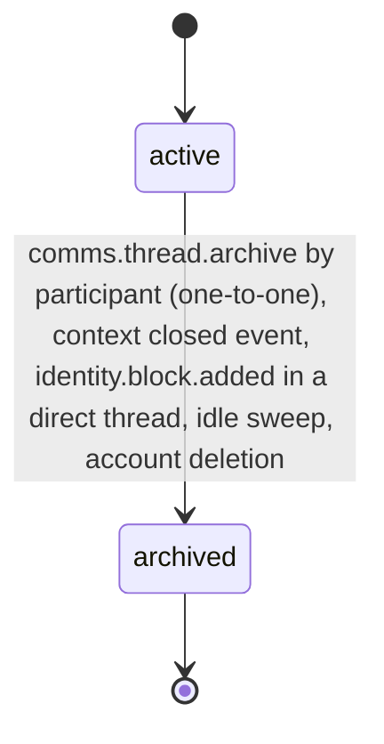

# PS-061-03 — Workflow state machine: Conversation threads

**Status:** SPECIFIED (Stage 3). **Module:** [F08.S01.M02 Conversation threads](SPEC.md) · **Scope:** MVP · **Code:** `packages/comms/src/messaging/threads` · **Contracts:** [CTR-FED-001](../../../planning/contracts/CTR-FED-001.md), [CTR-ID-001](../../../planning/contracts/CTR-ID-001.md), [CTR-EVT-001](../../../planning/contracts/CTR-EVT-001.md), [CTR-ERR-001](../../../planning/contracts/CTR-ERR-001.md), [CTR-CAP-001](../../../planning/contracts/CTR-CAP-001.md), [CTR-PRV-001](../../../planning/contracts/CTR-PRV-001.md), [CTR-IDM-001](../../../planning/contracts/CTR-IDM-001.md), [CTR-OBS-001](../../../planning/contracts/CTR-OBS-001.md)

> Generated from `module.spec.yaml` by `tools/specgen`. Edit the YAML, then run `pnpm spec:render`.

## Requirements

- **PS-061-03.R01** A Thread is active until archived; archived is terminal and a new conversation needs a new thread.
- **PS-061-03.R02** Archival happens by context closure, block, idle timeout of 90 days, manual action by any participant in one-to-one threads, or account deletion.
- **PS-061-03.R03** Archiving emits comms.thread.archived once and triggers the message purge schedule in F08.S01.M01.

## Specification

### Thread lifecycle

Initial **active**; terminal **archived**.

| Transition | Trigger | Guard / effect |
|---|---|---|
| active -> archived | comms.thread.archive by participant (one-to-one), context closed event, identity.block.added in a direct thread, idle sweep, account deletion | roster frozen; emits comms.thread.archived |

### Timeouts and scheduled transitions

- Idle sweep hourly archives active threads with no message for 90 days (reason idle).
- Threads whose listing context closed are archived 14 days after the closure event (reason context_closed).

## Verification

| Test | Level | Covers | Scenario | Expected |
|---|---|---|---|---|
| TEST-PS-061-09.T03 | property | PS-061-03.R01, PS-061-03.R02 | random sequences of create, archive, mute, join and leave events | archived never leaves archived; roster never exceeds 12; unique active pair holds |
| TEST-PS-061-09.T04 | integration | PS-061-03.R03, PS-061-06.R03 | archive thread | one comms.thread.archived event and purge schedule exist in the same transaction |
| TEST-PS-061-09.T09 | e2e | PS-061-06.R01, PS-061-03.R01 | block added while direct thread active | thread archived for both, blocked party shown archived without reason |

## Dependencies

Module depends on: F07.S02.M02, F07.S01.M01, F01.S01.M01, F02.S01.M01, CTR-FED-001, CTR-ID-001, CTR-EVT-001, CTR-ERR-001, CTR-CAP-001, CTR-PRV-001, CTR-IDM-001, CTR-OBS-001. Predecessor: [domain_schema.md](domain_schema.md).
