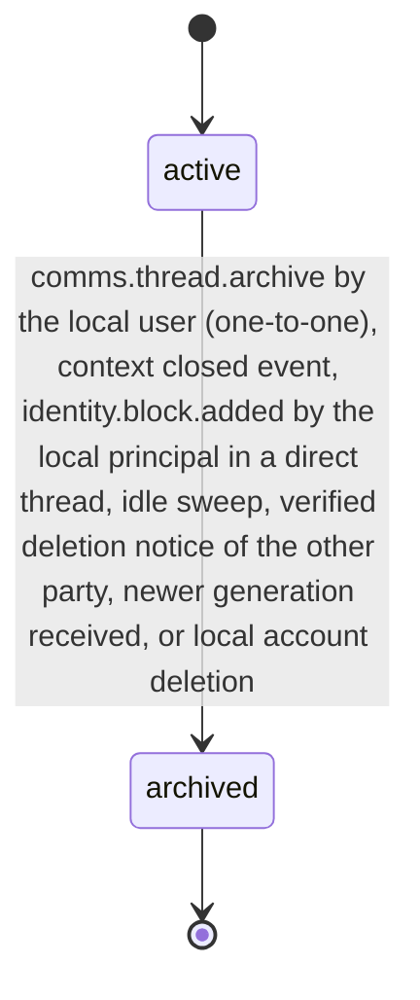
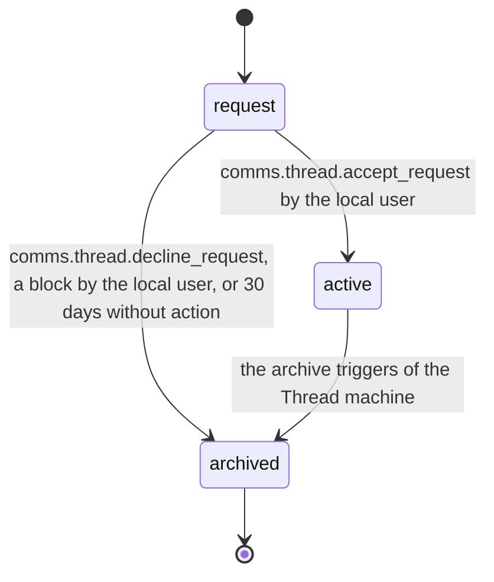

# PS-061-03 — Workflow state machine: Conversation threads

**Status:** SPECIFIED (Stage 3). **Module:** [F08.S01.M02 Conversation threads](SPEC.md) · **Scope:** MVP · **Code:** `packages/comms/src/messaging/threads` · **Contracts:** [CTR-FED-001](../../../planning/contracts/CTR-FED-001.md), [CTR-ID-001](../../../planning/contracts/CTR-ID-001.md), [CTR-EVT-001](../../../planning/contracts/CTR-EVT-001.md), [CTR-ERR-001](../../../planning/contracts/CTR-ERR-001.md), [CTR-CAP-001](../../../planning/contracts/CTR-CAP-001.md), [CTR-PRV-001](../../../planning/contracts/CTR-PRV-001.md), [CTR-IDM-001](../../../planning/contracts/CTR-IDM-001.md), [CTR-OBS-001](../../../planning/contracts/CTR-OBS-001.md), [CTR-UX-001](../../../planning/contracts/CTR-UX-001.md)

> Generated from `module.spec.yaml` by `tools/specgen`. Edit the YAML, then run `pnpm spec:render`.

## Requirements

- **PS-061-03.R01** A Thread is active, or in request until the local user accepts it, until archived; archived is terminal and a new conversation after an archive is a new thread of the next generation.
- **PS-061-03.R02** Archival happens by context closure, the local principal's own block, idle timeout of 90 days, manual action by the local user in one-to-one threads, a declined request, a newer generation (superseded), the verified departure of the other party of a two-party thread, or the local user's account deletion.
- **PS-061-03.R03** Archiving emits comms.thread.archived once and triggers the message purge schedule in F08.S01.M01.
- **PS-061-03.R04** Superseding happens only when a newer generation replaces a thread that one vault had archived; messages in flight for the older threadId are re-homed into the newer thread for 7 days instead of being dropped, and concurrent creates never supersede because they derive the same threadId.

## Specification

### Thread lifecycle

Initial **active**; terminal **archived**.

| Transition | Trigger | Guard / effect |
|---|---|---|
| active -> archived | comms.thread.archive by the local user (one-to-one), context closed event, identity.block.added by the local principal in a direct thread, idle sweep, verified deletion notice of the other party, newer generation received, or local account deletion | roster frozen; emits comms.thread.archived |

### Thread (inbound message request) lifecycle

Initial **request**; terminal **archived**.

| Transition | Trigger | Guard / effect |
|---|---|---|
| request -> active | comms.thread.accept_request by the local user | roster stored; emits comms.thread.created with origin mirrored |
| request -> archived | comms.thread.decline_request, a block by the local user, or 30 days without action | reason declined or blocked; nothing is sent to the requester; emits comms.thread.archived |
| active -> archived | the archive triggers of the Thread machine | emits comms.thread.archived |

### Timeouts and scheduled transitions

- Idle sweep hourly archives active threads with no message for 90 days (reason idle).
- Threads whose listing context closed are archived 14 days after the closure event (reason context_closed).
- Message requests not accepted within 30 days are archived with reason declined.
- Superseded threads stop re-homing envelopes 7 days after archive.

## Verification

| Test | Level | Covers | Scenario | Expected |
|---|---|---|---|---|
| TEST-PS-061-09.T03 | property | PS-061-03.R01, PS-061-03.R02 | random sequences of create, archive, mute, join, leave, request accept and decline | archived never leaves archived; roster never exceeds 12; at most one non-archived thread per derivation key |
| TEST-PS-061-09.T04 | integration | PS-061-03.R03, PS-061-06.R03 | archive thread | one comms.thread.archived event and purge schedule exist in the same transaction |
| TEST-PS-061-09.T09 | e2e | PS-061-06.R01, PS-061-03.R01 | A blocks B while a direct thread is active | A's vault archives with reason blocked and drops B's later messages; B's vault state, responses and sync states are identical to an unblocked control run |
| TEST-PS-061-09.T18 | integration | PS-061-03.R04, PS-061-06.R01 | A archives the listing thread, opens a new one (generation 2) while B has a message in flight for generation 1 | B's vault archives generation 1 with reason superseded; the in-flight message is re-homed into generation 2 and shown |

## Dependencies

Module depends on: F07.S02.M02, F07.S01.M01, F01.S01.M01, F02.S01.M01, F02.S01.M02, F16.S02.M02, F16.S02.M03, F11.S01.M01, F11.S02.M01, F15.S01.M01, F10.S01.M02, F10.S01.M03, F10.S01.M04, F10.S02.M02, CTR-FED-001, CTR-ID-001, CTR-EVT-001, CTR-ERR-001, CTR-CAP-001, CTR-PRV-001, CTR-IDM-001, CTR-OBS-001, CTR-UX-001. Predecessor: [domain_schema.md](domain_schema.md).
