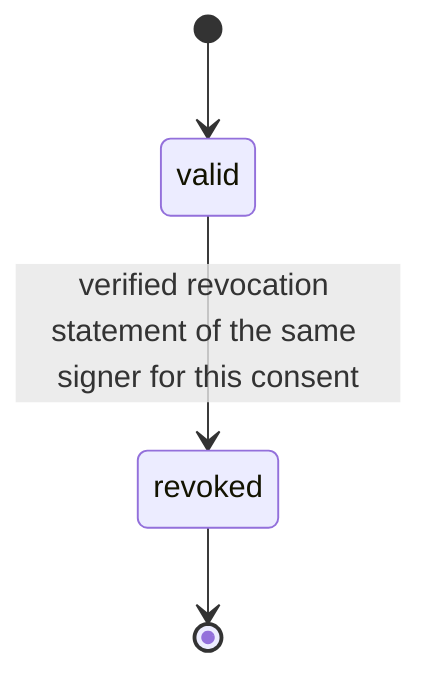
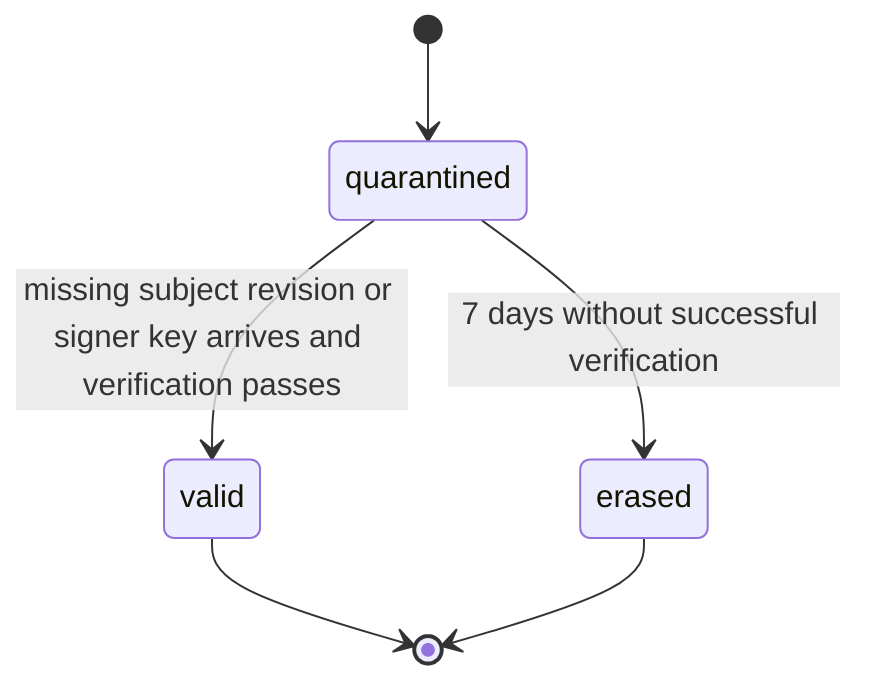

# PS-062-03 — Workflow state machine: Explicit consent capture

**Status:** SPECIFIED (Stage 3). **Module:** [F08.S02.M02 Explicit consent capture](SPEC.md) · **Scope:** MVP · **Code:** `packages/comms/src/negotiation/consent` · **Contracts:** [CTR-FED-001](../../../planning/contracts/CTR-FED-001.md), [CTR-ID-001](../../../planning/contracts/CTR-ID-001.md), [CTR-EVT-001](../../../planning/contracts/CTR-EVT-001.md), [CTR-ERR-001](../../../planning/contracts/CTR-ERR-001.md), [CTR-CAP-001](../../../planning/contracts/CTR-CAP-001.md), [CTR-PRV-001](../../../planning/contracts/CTR-PRV-001.md), [CTR-IDM-001](../../../planning/contracts/CTR-IDM-001.md), [CTR-OBS-001](../../../planning/contracts/CTR-OBS-001.md), [CTR-COM-001](../../../planning/contracts/CTR-COM-001.md)

> Generated from `module.spec.yaml` by `tools/specgen`. Edit the YAML, then run `pnpm spec:render`.

## Requirements

- **PS-062-03.R01** A stored ConsentStatement of kind consent is valid until revoked; revoked is terminal and a new consent needs a new statement.
- **PS-062-03.R02** Quarantined statements become valid when the missing subject or key arrives and verification succeeds, or are erased after 7 days.
- **PS-062-03.R03** Conflicts between consent and decline or revocation for one subject hash are reported by verify as conflicted and are never resolved by comparing claimed times.

## Specification

### ConsentStatement lifecycle

Initial **valid**; terminal **revoked**.

| Transition | Trigger | Guard / effect |
|---|---|---|
| valid -> revoked | verified revocation statement of the same signer for this consent | revocation record linked; emits comms.consent.revoked |

### ConsentStatement (inbound waiting) lifecycle

Initial **quarantined**; terminal **valid**, **erased**.

| Transition | Trigger | Guard / effect |
|---|---|---|
| quarantined -> valid | missing subject revision or signer key arrives and verification passes | provenance stored; emits comms.consent.received |
| quarantined -> erased | 7 days without successful verification | raw statement deleted, counter incremented |

### Timeouts and scheduled transitions

- Quarantined inbound statements are retried on every new statement or key arrival and erased 7 days after first receipt.

## Verification

| Test | Level | Covers | Scenario | Expected |
|---|---|---|---|---|
| TEST-PS-062-09.T03 | property | PS-062-01.R03, PS-062-03.R01 | random sequences of sign, revoke, accept, subject revisions | revoked never returns to valid; id equals cid; verify result depends only on stored statements |
| TEST-PS-062-09.T05 | integration | PS-062-03.R02, PS-062-03.R03 | consent arrives before subject; later subject arrives; and a decline plus consent by one signer | first becomes valid after subject; second returns verify conflicted and neither wins by claimed time |
| TEST-PS-062-09.T09 | integration | PS-062-06.R03, PS-062-03.R01 | two signer devices sign and revoke concurrently | both stored, verify returns revoked, no overwrite |

## Dependencies

Module depends on: F07.S01.M01, F16.S02.M03, CTR-FED-001, CTR-ID-001, CTR-EVT-001, CTR-ERR-001, CTR-CAP-001, CTR-PRV-001, CTR-IDM-001, CTR-OBS-001, CTR-COM-001. Predecessor: [domain_schema.md](domain_schema.md).
