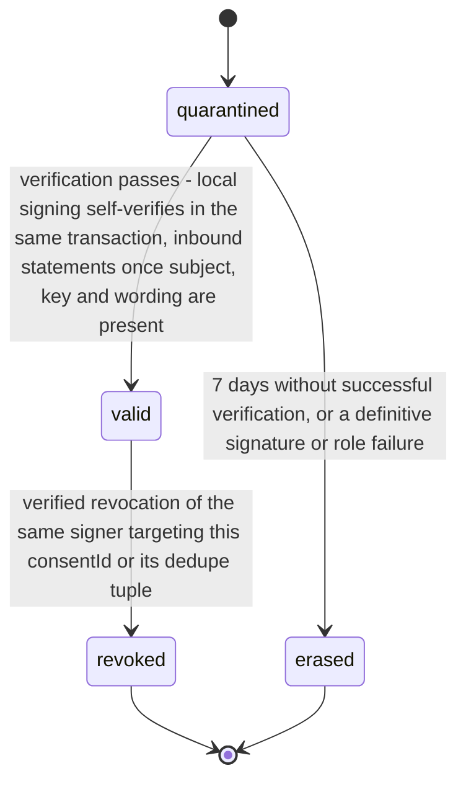

# PS-062-03 — Workflow state machine: Explicit consent capture

**Status:** SPECIFIED (Stage 3). **Module:** [F08.S02.M02 Explicit consent capture](SPEC.md) · **Scope:** MVP · **Code:** `packages/comms/src/negotiation/consent` · **Contracts:** [CTR-FED-001](../../../planning/contracts/CTR-FED-001.md), [CTR-ID-001](../../../planning/contracts/CTR-ID-001.md), [CTR-EVT-001](../../../planning/contracts/CTR-EVT-001.md), [CTR-ERR-001](../../../planning/contracts/CTR-ERR-001.md), [CTR-CAP-001](../../../planning/contracts/CTR-CAP-001.md), [CTR-PRV-001](../../../planning/contracts/CTR-PRV-001.md), [CTR-IDM-001](../../../planning/contracts/CTR-IDM-001.md), [CTR-OBS-001](../../../planning/contracts/CTR-OBS-001.md), [CTR-COM-001](../../../planning/contracts/CTR-COM-001.md), [CTR-IOX-001](../../../planning/contracts/CTR-IOX-001.md), [CTR-UX-001](../../../planning/contracts/CTR-UX-001.md)

> Generated from `module.spec.yaml` by `tools/specgen`. Edit the YAML, then run `pnpm spec:render`.

## Requirements

- **PS-062-03.R01** Each ConsentStatement follows one machine - quarantined until verified, then valid; a valid consent becomes revoked by a verified revocation of the same signer; revoked and erased are terminal; decline and revocation records take status valid when verified and are never revoked themselves; a re-consent after revocation is a new record.
- **PS-062-03.R02** Quarantined statements become valid when the missing subject, key or wording arrives and verification succeeds, or are erased after 7 days.
- **PS-062-03.R03** Conflicts between consent and decline, or between a consent and a revocation that arrived after the owning module committed, for one subject hash are reported by verify as conflicted and are never resolved by comparing claimed times.

## Specification

### ConsentStatement lifecycle

Initial **quarantined**; terminal **revoked**, **erased**.

| Transition | Trigger | Guard / effect |
|---|---|---|
| quarantined -> valid | verification passes - local signing self-verifies in the same transaction, inbound statements once subject, key and wording are present | firstSeenAt set; emits comms.consent.signed for local statements or comms.consent.received for inbound ones |
| quarantined -> erased | 7 days without successful verification, or a definitive signature or role failure | raw statement deleted, counter incremented |
| valid -> revoked | verified revocation of the same signer targeting this consentId or its dedupe tuple | revocation record linked; emits comms.consent.revoked (afterCommit true when the owning module had committed) |

### Timeouts and scheduled transitions

- Quarantined inbound statements are retried on every new statement, key or registry arrival and erased 7 days after first receipt.

## Verification

| Test | Level | Covers | Scenario | Expected |
|---|---|---|---|---|
| TEST-PS-062-09.T03 | property | PS-062-01.R03, PS-062-03.R01 | random sequences of sign, revoke, accept, subject revisions | revoked never returns to valid; id equals cid; verify result depends only on stored statements |
| TEST-PS-062-09.T05 | integration | PS-062-03.R02, PS-062-03.R03 | consent arrives before subject; later subject arrives; and a decline plus consent by one signer | first becomes valid after subject; second returns verify conflicted and neither wins by claimed time |
| TEST-PS-062-09.T15 | integration | PS-062-02.R04, PS-062-03.R03 | three vaults: P2 revokes after P1's owning module committed and before P3's committed | P1 stores it and verify returns conflicted so its module freezes; P3 verify returns revoked; a local revoke on the committed subject is refused with COMMS_CONSENT_NOT_REVOCABLE |
| TEST-PS-062-09.T21 | integration | PS-062-03.R01 | P1 consents, revokes and consents again to the same revision | the second consent is a new valid record; verify returns valid |

## Dependencies

Module depends on: F07.S01.M01, F07.S02.M02, F07.S02.M01, F16.S02.M02, F16.S02.M03, F11.S01.M01, F11.S02.M01, F15.S01.M01, F10.S01.M02, F10.S01.M03, F10.S01.M04, F10.S02.M02, CTR-FED-001, CTR-ID-001, CTR-EVT-001, CTR-ERR-001, CTR-CAP-001, CTR-PRV-001, CTR-IDM-001, CTR-OBS-001, CTR-COM-001, CTR-IOX-001, CTR-UX-001. Predecessor: [domain_schema.md](domain_schema.md).
