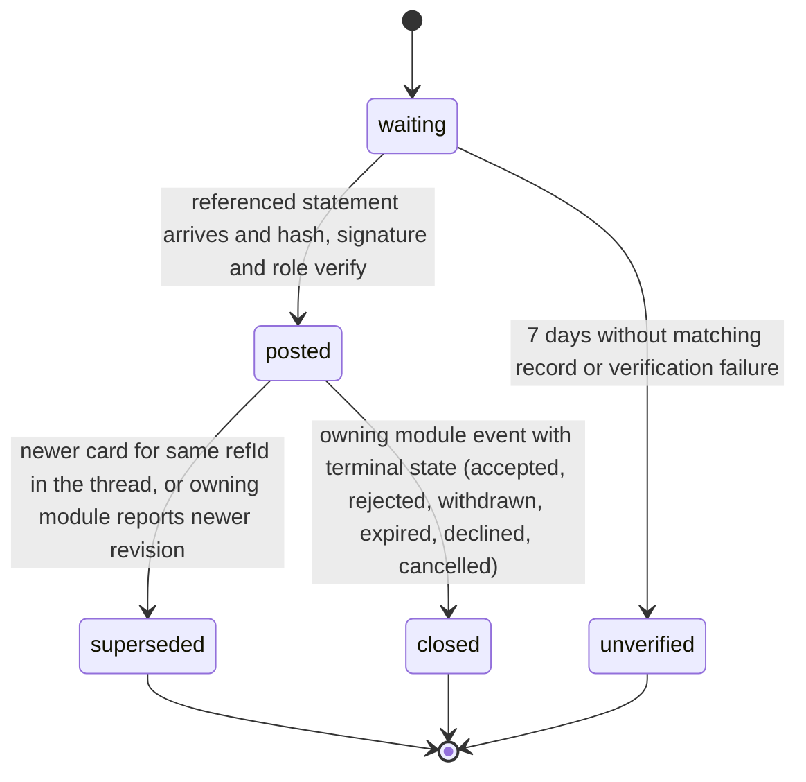

# PS-063-03 — Workflow state machine: In-thread structured offers

**Status:** SPECIFIED (Stage 3). **Module:** [F08.S02.M01 In-thread structured offers](SPEC.md) · **Scope:** MVP · **Code:** `packages/comms/src/negotiation/offers` · **Contracts:** [CTR-FED-001](../../../planning/contracts/CTR-FED-001.md), [CTR-ID-001](../../../planning/contracts/CTR-ID-001.md), [CTR-EVT-001](../../../planning/contracts/CTR-EVT-001.md), [CTR-ERR-001](../../../planning/contracts/CTR-ERR-001.md), [CTR-CAP-001](../../../planning/contracts/CTR-CAP-001.md), [CTR-PRV-001](../../../planning/contracts/CTR-PRV-001.md), [CTR-IDM-001](../../../planning/contracts/CTR-IDM-001.md), [CTR-OBS-001](../../../planning/contracts/CTR-OBS-001.md)

> Generated from `module.spec.yaml` by `tools/specgen`. Edit the YAML, then run `pnpm spec:render`.

## Requirements

- **PS-063-03.R01** A card is created waiting or posted and moves to superseded, closed or unverified; superseded, closed and unverified are terminal for display.
- **PS-063-03.R02** Closing follows only verified terminal events of the owning module and never the card poster's own claim.
- **PS-063-03.R03** A waiting card that gets no matching record within 7 days becomes unverified and is not retried automatically.

## Specification

### ThreadOfferCard lifecycle

Initial **waiting**; terminal **superseded**, **closed**, **unverified**.

| Transition | Trigger | Guard / effect |
|---|---|---|
| waiting -> posted | referenced statement arrives and hash, signature and role verify | emits comms.offer_card.posted for inbound cards |
| waiting -> unverified | 7 days without matching record or verification failure | reason stored |
| posted -> superseded | newer card for same refId in the thread, or owning module reports newer revision | links to newer card |
| posted -> closed | owning module event with terminal state (accepted, rejected, withdrawn, expired, declined, cancelled) | closedReason stored |

### Timeouts and scheduled transitions

- Waiting cards are re-verified when new statements arrive and expire to unverified after 7 days.

## Verification

| Test | Level | Covers | Scenario | Expected |
|---|---|---|---|---|
| TEST-PS-063-09.T03 | property | PS-063-03.R01, PS-063-03.R02 | random sequences of owning-module events and card posts | transitions only as declared; closed and superseded never change; closed only follows verified terminal events |
| TEST-PS-063-09.T04 | integration | PS-063-03.R03 | card arrives before its referenced offer statement; statement arrives on day 3, another card never arrives for 7 days | first becomes posted, second becomes unverified |

## Dependencies

Module depends on: F08.S01.M01, F08.S01.M02, F01.S04.M01, F02.S01.M01, CTR-FED-001, CTR-ID-001, CTR-EVT-001, CTR-ERR-001, CTR-CAP-001, CTR-PRV-001, CTR-IDM-001, CTR-OBS-001. Predecessor: [domain_schema.md](domain_schema.md).
