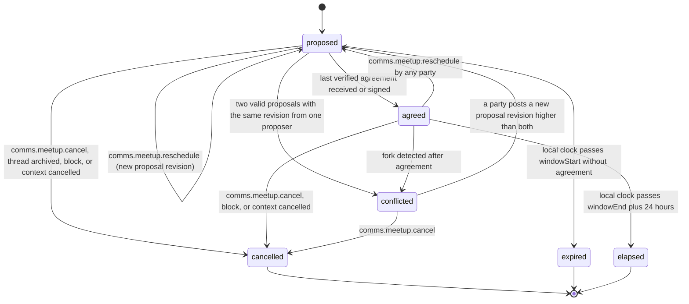

# PS-064-03 — Workflow state machine: Meetup coordination

**Status:** SPECIFIED (Stage 3). **Module:** [F08.S03.M03 Meetup coordination](SPEC.md) · **Scope:** MVP · **Code:** `packages/comms/src/meetups/coordination` · **Contracts:** [CTR-FED-001](../../../planning/contracts/CTR-FED-001.md), [CTR-ID-001](../../../planning/contracts/CTR-ID-001.md), [CTR-EVT-001](../../../planning/contracts/CTR-EVT-001.md), [CTR-ERR-001](../../../planning/contracts/CTR-ERR-001.md), [CTR-CAP-001](../../../planning/contracts/CTR-CAP-001.md), [CTR-PRV-001](../../../planning/contracts/CTR-PRV-001.md), [CTR-IDM-001](../../../planning/contracts/CTR-IDM-001.md), [CTR-OBS-001](../../../planning/contracts/CTR-OBS-001.md)

> Generated from `module.spec.yaml` by `tools/specgen`. Edit the YAML, then run `pnpm spec:render`.

## Requirements

- **PS-064-03.R01** A meetup starts proposed; reschedule creates a new proposal revision, clears prior agreements and stays proposed until every party agreed.
- **PS-064-03.R02** Agreed is computed only from verified consent statements for the current hash; a reschedule from agreed moves back to proposed.
- **PS-064-03.R03** Cancelled, expired and elapsed are terminal; conflicted ends only by a new proposal revision from either party.

## Specification

### Meetup lifecycle

Initial **proposed**; terminal **cancelled**, **expired**, **elapsed**.

| Transition | Trigger | Guard / effect |
|---|---|---|
| proposed -> proposed | comms.meetup.reschedule (new proposal revision) | rescheduleCount + 1, agreements cleared; emits comms.meetup.proposed |
| proposed -> agreed | last verified agreement received or signed | all parties hold valid agreement for proposalHash; emits comms.meetup.agreed |
| agreed -> proposed | comms.meetup.reschedule by any party | rescheduleCount + 1, agreements cleared; emits comms.meetup.proposed |
| proposed -> conflicted | two valid proposals with the same revision from one proposer | meetup frozen, both proposals kept |
| agreed -> conflicted | fork detected after agreement | meetup frozen |
| conflicted -> proposed | a party posts a new proposal revision higher than both | agreements cleared; emits comms.meetup.proposed |
| proposed -> cancelled | comms.meetup.cancel, thread archived, block, or context cancelled | emits comms.meetup.cancelled |
| agreed -> cancelled | comms.meetup.cancel, block, or context cancelled | emits comms.meetup.cancelled |
| conflicted -> cancelled | comms.meetup.cancel | emits comms.meetup.cancelled |
| proposed -> expired | local clock passes windowStart without agreement | no event beyond local state |
| agreed -> elapsed | local clock passes windowEnd plus 24 hours | meetup closed for record keeping |

### Timeouts and scheduled transitions

- Local sweep every 60 s while the app runs and on app start moves proposed meetups past windowStart to expired.
- Agreed meetups move to elapsed 24 hours after windowEnd.

## Verification

| Test | Level | Covers | Scenario | Expected |
|---|---|---|---|---|
| TEST-PS-064-09.T03 | property | PS-064-03.R01, PS-064-03.R02, PS-064-03.R03 | random sequences of propose, agree, reschedule, cancel, clock jumps | agreed only with all verified agreements for current hash; rescheduleCount never above 5; terminal states never change |
| TEST-PS-064-09.T04 | integration | PS-064-03.R01, PS-064-03.R02 | B agrees; A reschedules; B agrees to the new hash | agreed only after the second agreement, earlier agreement ignored for the new hash |

## Dependencies

Module depends on: F08.S01.M01, F08.S01.M02, F08.S02.M02, F08.S03.M01, CTR-FED-001, CTR-ID-001, CTR-EVT-001, CTR-ERR-001, CTR-CAP-001, CTR-PRV-001, CTR-IDM-001, CTR-OBS-001. Predecessor: [domain_schema.md](domain_schema.md).
