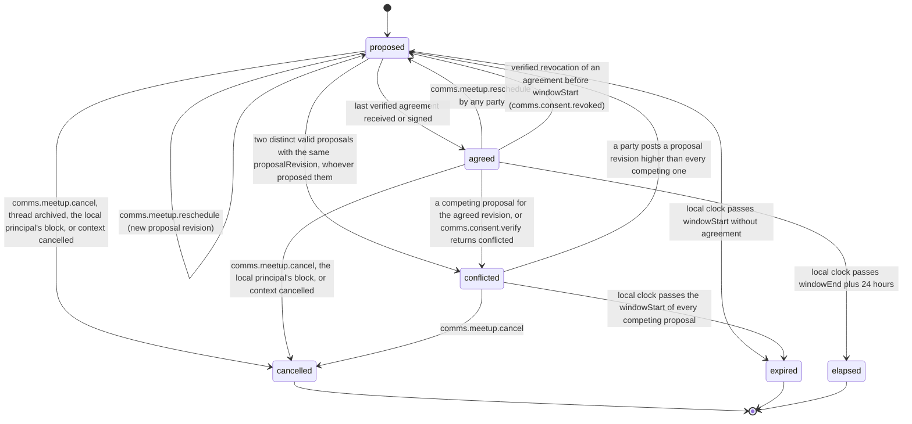

# PS-064-03 — Workflow state machine: Meetup coordination

**Status:** SPECIFIED (Stage 3). **Module:** [F08.S03.M03 Meetup coordination](SPEC.md) · **Scope:** MVP · **Code:** `packages/comms/src/meetups/coordination` · **Contracts:** [CTR-FED-001](../../../planning/contracts/CTR-FED-001.md), [CTR-ID-001](../../../planning/contracts/CTR-ID-001.md), [CTR-EVT-001](../../../planning/contracts/CTR-EVT-001.md), [CTR-ERR-001](../../../planning/contracts/CTR-ERR-001.md), [CTR-CAP-001](../../../planning/contracts/CTR-CAP-001.md), [CTR-PRV-001](../../../planning/contracts/CTR-PRV-001.md), [CTR-IDM-001](../../../planning/contracts/CTR-IDM-001.md), [CTR-OBS-001](../../../planning/contracts/CTR-OBS-001.md), [CTR-UX-001](../../../planning/contracts/CTR-UX-001.md)

> Generated from `module.spec.yaml` by `tools/specgen`. Edit the YAML, then run `pnpm spec:render`.

## Requirements

- **PS-064-03.R01** A meetup starts proposed; reschedule creates a new proposal revision, clears prior agreements and stays proposed until every party agreed.
- **PS-064-03.R02** Agreed is computed only from verified consent statements of every party, the proposer included, for the current hash; a reschedule or a verified revocation of an agreement before windowStart moves an agreed meetup back to proposed.
- **PS-064-03.R03** Cancelled, expired and elapsed are terminal; conflicted ends by a new proposal revision higher than every competing one, by a cancellation, or by expiry once the local clock passes the windowStart of every competing proposal.
- **PS-064-03.R04** Propose and reschedule sign the proposer's own consent.comms.meetup.agree.v1 consent in the same transaction, so the agreement evidence is uniform for every party; agreed is not a commit, and consents may be revoked until windowStart (ConsentSubjectPort.isCommitted).
- **PS-064-03.R05** A conflict is any two distinct valid proposals with the same proposalRevision and different proposalHash, whoever proposed them, and it freezes the meetup for explicit renegotiation.

## Specification

### Meetup lifecycle

Initial **proposed**; terminal **cancelled**, **expired**, **elapsed**.

| Transition | Trigger | Guard / effect |
|---|---|---|
| proposed -> proposed | comms.meetup.reschedule (new proposal revision) | rescheduleCount + 1, agreements cleared, proposer consent signed; emits comms.meetup.proposed (reason reschedule) |
| proposed -> agreed | last verified agreement received or signed | every party including the proposer holds a valid agreement for proposalHash; emits comms.meetup.agreed |
| agreed -> proposed | comms.meetup.reschedule by any party | rescheduleCount + 1, agreements cleared; emits comms.meetup.proposed (reason reschedule) |
| agreed -> proposed | verified revocation of an agreement before windowStart (comms.consent.revoked) | agreement removed; emits comms.meetup.proposed (reason agreement_revoked) |
| proposed -> conflicted | two distinct valid proposals with the same proposalRevision, whoever proposed them | meetup frozen, competing proposals kept |
| agreed -> conflicted | a competing proposal for the agreed revision, or comms.consent.verify returns conflicted | meetup frozen |
| conflicted -> proposed | a party posts a proposal revision higher than every competing one | agreements cleared; emits comms.meetup.proposed (reason conflict_resolved) |
| proposed -> cancelled | comms.meetup.cancel, thread archived, the local principal's block, or context cancelled | emits comms.meetup.cancelled |
| agreed -> cancelled | comms.meetup.cancel, the local principal's block, or context cancelled | emits comms.meetup.cancelled |
| conflicted -> cancelled | comms.meetup.cancel | emits comms.meetup.cancelled |
| proposed -> expired | local clock passes windowStart without agreement | no event beyond local state |
| conflicted -> expired | local clock passes the windowStart of every competing proposal | no event beyond local state |
| agreed -> elapsed | local clock passes windowEnd plus 24 hours | meetup closed for record keeping |

### Timeouts and scheduled transitions

- Local sweep every 60 s while the app runs and on app start moves proposed meetups past windowStart to expired.
- Conflicted meetups expire when the local clock passes the windowStart of every competing proposal.
- Agreed meetups move to elapsed 24 hours after windowEnd.

## Verification

| Test | Level | Covers | Scenario | Expected |
|---|---|---|---|---|
| TEST-PS-064-09.T03 | property | PS-064-03.R01, PS-064-03.R02, PS-064-03.R03 | random sequences of propose, agree, revoke, reschedule, cancel, clock jumps | agreed only with all verified agreements for current hash; rescheduleCount never above 5; terminal states never change |
| TEST-PS-064-09.T04 | integration | PS-064-03.R01, PS-064-03.R02 | B agrees; A reschedules; B agrees to the new hash | agreed only after the second agreement, earlier agreement ignored for the new hash |
| TEST-PS-064-09.T08 | integration | PS-064-06.R01, PS-064-06.R02, PS-064-06.R03, PS-064-03.R05, PS-064-09.R03 | A and B reschedule concurrently while offline, then sync | two proposals with one revision from two proposers; meetup conflicted in both vaults, neither overwrites; agreeing a stale hash stored but ignored |
| TEST-PS-064-09.T15 | integration | PS-064-03.R04, PS-064-01.R05, PS-064-09.R03 | two vaults: A proposes (A's consent included), B agrees; B revokes before windowStart; repeat with B trying to revoke after windowStart | agreed in both vaults; then proposed again in both (reason agreement_revoked); after windowStart the local revoke is refused because isCommitted is true |
| TEST-PS-064-09.T16 | integration | PS-064-03.R03, PS-064-09.R03 | conflicted meetup with two competing proposals; clock passes the first windowStart, then the second | still conflicted after the first, expired after the second |

## Dependencies

Module depends on: F08.S01.M01, F08.S01.M02, F08.S02.M02, F08.S03.M01, F06.S02.M01, F07.S02.M02, F16.S02.M02, F11.S01.M01, F11.S02.M01, F15.S01.M01, F10.S01.M02, F10.S01.M03, F10.S01.M04, F10.S02.M02, CTR-FED-001, CTR-ID-001, CTR-EVT-001, CTR-ERR-001, CTR-CAP-001, CTR-PRV-001, CTR-IDM-001, CTR-OBS-001, CTR-UX-001. Predecessor: [domain_schema.md](domain_schema.md).
