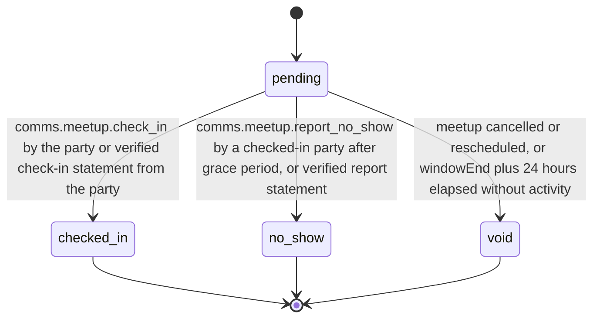
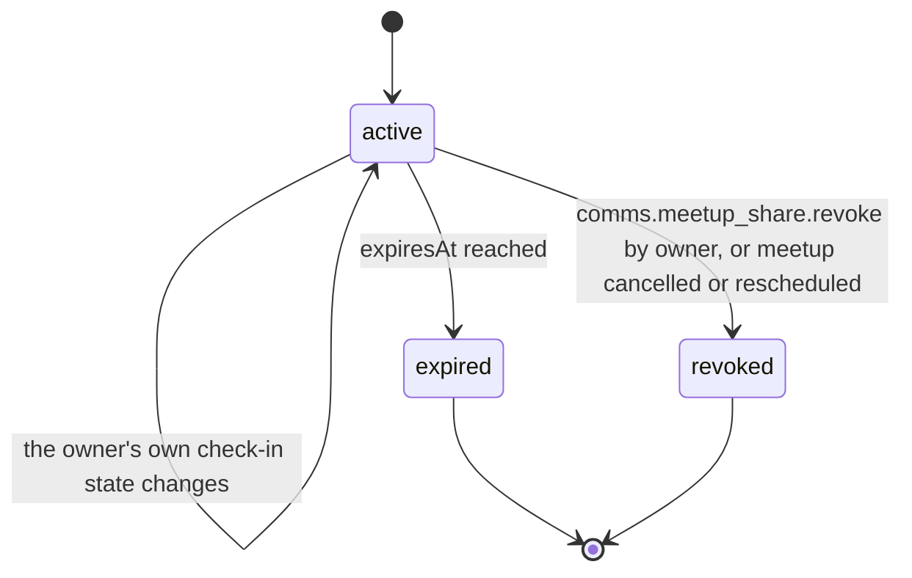

# PS-065-03 — Workflow state machine: Meetup handoff check-in

**Status:** SPECIFIED (Stage 3). **Module:** [F08.S03.M02 Meetup handoff check-in](SPEC.md) · **Scope:** MVP · **Code:** `packages/comms/src/meetups/handoff` · **Contracts:** [CTR-FED-001](../../../planning/contracts/CTR-FED-001.md), [CTR-ID-001](../../../planning/contracts/CTR-ID-001.md), [CTR-EVT-001](../../../planning/contracts/CTR-EVT-001.md), [CTR-ERR-001](../../../planning/contracts/CTR-ERR-001.md), [CTR-CAP-001](../../../planning/contracts/CTR-CAP-001.md), [CTR-PRV-001](../../../planning/contracts/CTR-PRV-001.md), [CTR-IDM-001](../../../planning/contracts/CTR-IDM-001.md), [CTR-OBS-001](../../../planning/contracts/CTR-OBS-001.md), [CTR-FLG-001](../../../planning/contracts/CTR-FLG-001.md), [CTR-UX-001](../../../planning/contracts/CTR-UX-001.md)

> Generated from `module.spec.yaml` by `tools/specgen`. Edit the YAML, then run `pnpm spec:render`.

## Requirements

- **PS-065-03.R01** Each MeetupCheckin starts pending and ends in exactly one of checked_in, no_show or void, which are terminal; a no-show report about a party that already checked in, or a check-in arriving after a report, sets the report fields and the contradicted flag without a state change.
- **PS-065-03.R02** A MeetupShare is active until it expires or is revoked; both end states are terminal, delete the relay blob through comms.meetup_share.delete and emit comms.meetup_share.revoked with reason owner, cancelled, rescheduled or expired.
- **PS-065-03.R03** Check-in states advance only from verified statements and never from timers alone, except void for elapsed windows.
- **PS-065-03.R04** When contradicted becomes true after comms.meetup.no_show was emitted without it, comms.meetup.no_show_contradicted is emitted in the same transaction so consumers that weighed the claim (F12.S03.M02) can reverse it; a report that is contradicted on arrival emits comms.meetup.no_show with contradicted true.

## Specification

### MeetupCheckin lifecycle

Initial **pending**; terminal **checked_in**, **no_show**, **void**.

| Transition | Trigger | Guard / effect |
|---|---|---|
| pending -> checked_in | comms.meetup.check_in by the party or verified check-in statement from the party | signature verified; emits comms.meetup.checked_in |
| pending -> no_show | comms.meetup.report_no_show by a checked-in party after grace period, or verified report statement | marked as claim of reporter; emits comms.meetup.no_show |
| pending -> void | meetup cancelled or rescheduled, or windowEnd plus 24 hours elapsed without activity | reason stored |

### MeetupShare lifecycle

Initial **active**; terminal **expired**, **revoked**.

| Transition | Trigger | Guard / effect |
|---|---|---|
| active -> active | the owner's own check-in state changes | snapshot re-encrypted, snapshotRevision + 1, blob updated |
| active -> revoked | comms.meetup_share.revoke by owner, or meetup cancelled or rescheduled | relay blob deleted by comms.meetup_share.delete; emits comms.meetup_share.revoked |
| active -> expired | expiresAt reached | relay blob deleted by comms.meetup_share.delete (the relay sweep also deletes it); emits comms.meetup_share.revoked with reason expired |

### Timeouts and scheduled transitions

- Relay deletes expired share blobs within 5 minutes of expiresAt (sweep every 60 s).
- Local sweep voids pending check-ins 24 hours after windowEnd and expires shares at expiresAt.

## Verification

| Test | Level | Covers | Scenario | Expected |
|---|---|---|---|---|
| TEST-PS-065-09.T03 | property | PS-065-03.R01, PS-065-03.R02, PS-065-03.R03 | random sequences of check-in, report, cancel, expiry and clock jumps | terminal states never change; contradicted only as a flag; no_show only after checked-in reporter; share states only active to expired or revoked |
| TEST-PS-065-09.T05 | integration | PS-065-04.R03, PS-065-03.R01 | agreed event, cancellation event and a return to proposed (reschedule) delivered | pending records created, then voided with shares revoked |
| TEST-PS-065-09.T16 | integration | PS-065-03.R04 | report stored first, then the accused's check-in arrives; second run with the check-in stored first, then the report | first: comms.meetup.no_show then comms.meetup.no_show_contradicted once; second: comms.meetup.no_show with contradicted true and no separate contradiction event; record status stays as first reached |
| TEST-PS-065-09.T19 | contract | PS-065-04.R04, PS-065-03.R02 | registry entries for checkin and no_show_report; share expiry | signer roles listed; expiry deletes the relay blob and emits comms.meetup_share.revoked with reason expired |

## Dependencies

Module depends on: F08.S03.M03, F08.S01.M01, F07.S02.M02, F16.S02.M02, F16.S02.M03, F11.S01.M01, F11.S02.M01, F15.S01.M01, F12.S03.M03, F10.S01.M02, F10.S01.M03, F10.S01.M04, F10.S02.M02, CTR-FED-001, CTR-ID-001, CTR-EVT-001, CTR-ERR-001, CTR-CAP-001, CTR-PRV-001, CTR-IDM-001, CTR-OBS-001, CTR-FLG-001, CTR-UX-001. Predecessor: [domain_schema.md](domain_schema.md).
