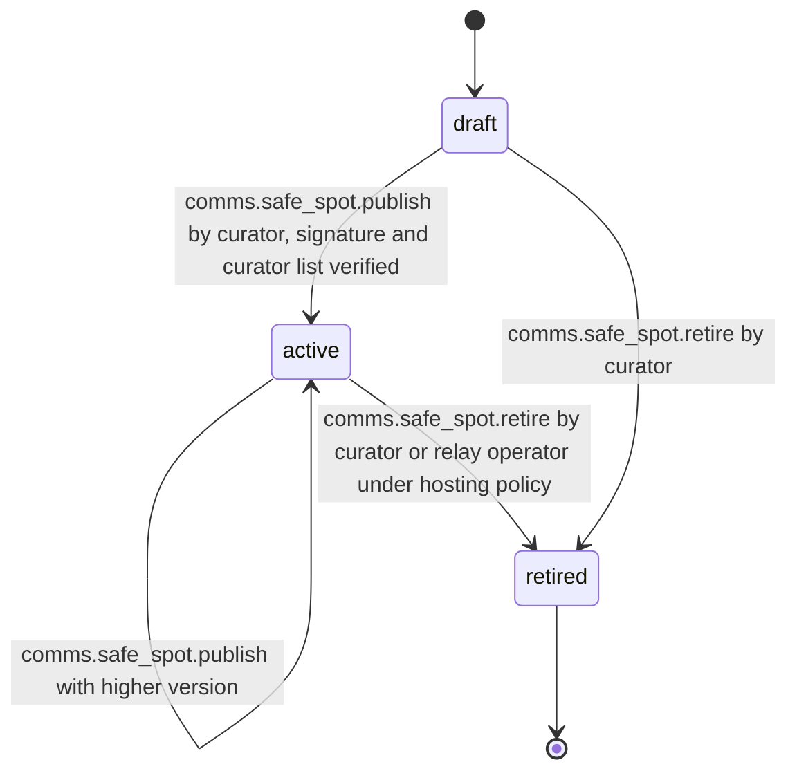

# PS-066-03 — Workflow state machine: Safe meetup guidance

**Status:** SPECIFIED (Stage 3). **Module:** [F08.S03.M01 Safe meetup guidance](SPEC.md) · **Scope:** MVP · **Code:** `packages/comms/src/meetups/safe` · **Contracts:** [CTR-FED-001](../../../planning/contracts/CTR-FED-001.md), [CTR-ID-001](../../../planning/contracts/CTR-ID-001.md), [CTR-EVT-001](../../../planning/contracts/CTR-EVT-001.md), [CTR-ERR-001](../../../planning/contracts/CTR-ERR-001.md), [CTR-CAP-001](../../../planning/contracts/CTR-CAP-001.md), [CTR-PRV-001](../../../planning/contracts/CTR-PRV-001.md), [CTR-IDM-001](../../../planning/contracts/CTR-IDM-001.md), [CTR-OBS-001](../../../planning/contracts/CTR-OBS-001.md), [CTR-FLG-001](../../../planning/contracts/CTR-FLG-001.md)

> Generated from `module.spec.yaml` by `tools/specgen`. Edit the YAML, then run `pnpm spec:render`.

## Requirements

- **PS-066-03.R01** A SafeSpot moves draft to active to retired; retired is terminal and a returning venue is published as a new spot.
- **PS-066-03.R02** Publishing validates and signs in the curator vault; relays and vaults only verify and store.
- **PS-066-03.R03** Retired spots are removed from suggestions immediately in vaults that received the retirement statement and keep a tombstone for 180 days.

## Specification

### SafeSpot lifecycle

Initial **draft**; terminal **retired**.

| Transition | Trigger | Guard / effect |
|---|---|---|
| draft -> active | comms.safe_spot.publish by curator, signature and curator list verified | statement stored; relay index updated |
| active -> active | comms.safe_spot.publish with higher version | older version superseded |
| active -> retired | comms.safe_spot.retire by curator or relay operator under hosting policy | tombstone with reason signed |
| draft -> retired | comms.safe_spot.retire by curator | draft discarded |

### Timeouts and scheduled transitions

- Vault cache refresh every 7 days while online; list marked possibly outdated after 30 days.
- Tombstones are purged 180 days after retirement.

## Verification

| Test | Level | Covers | Scenario | Expected |
|---|---|---|---|---|
| TEST-PS-066-09.T03 | property | PS-066-03.R01, PS-066-03.R02, PS-066-03.R03 | random sequences of publish, retire, refresh | retired never returns to active; at most one active version per curator and venue; tombstone purged at 180 days |
| TEST-PS-066-09.T09 | abuse | PS-066-07.R03, PS-066-03.R02 | 201st change in a day by one curator; forged relay statement | RATE_LIMITED; forged statement discarded and cache unchanged |

## Dependencies

Module depends on: F06.S02.M01, F16.S01.M01, CTR-FED-001, CTR-ID-001, CTR-EVT-001, CTR-ERR-001, CTR-CAP-001, CTR-PRV-001, CTR-IDM-001, CTR-OBS-001, CTR-FLG-001. Predecessor: [domain_schema.md](domain_schema.md).
