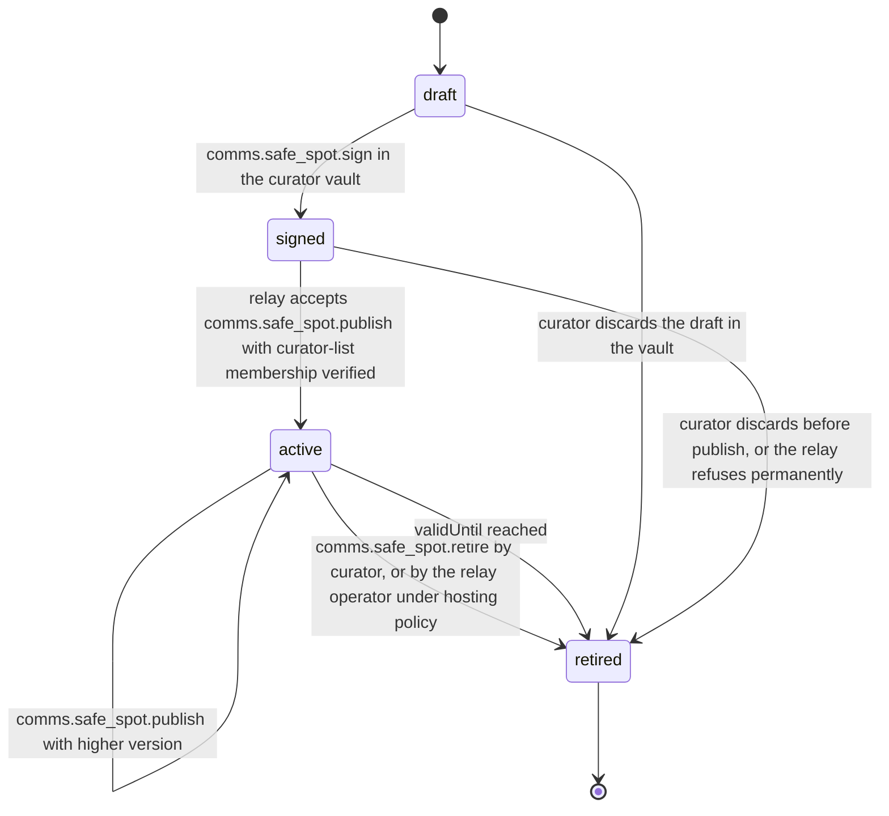
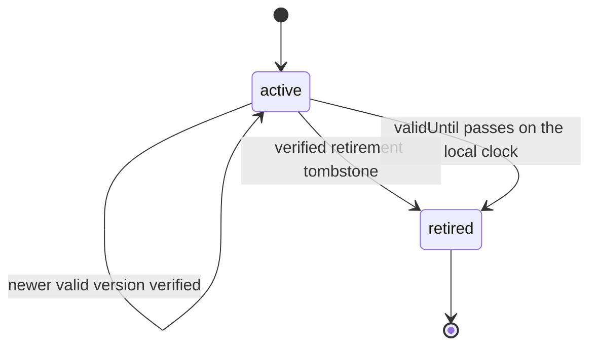

# PS-066-03 — Workflow state machine: Safe meetup guidance

**Status:** SPECIFIED (Stage 3). **Module:** [F08.S03.M01 Safe meetup guidance](SPEC.md) · **Scope:** MVP · **Code:** `packages/comms/src/meetups/safe` · **Contracts:** [CTR-FED-001](../../../planning/contracts/CTR-FED-001.md), [CTR-ID-001](../../../planning/contracts/CTR-ID-001.md), [CTR-EVT-001](../../../planning/contracts/CTR-EVT-001.md), [CTR-ERR-001](../../../planning/contracts/CTR-ERR-001.md), [CTR-CAP-001](../../../planning/contracts/CTR-CAP-001.md), [CTR-PRV-001](../../../planning/contracts/CTR-PRV-001.md), [CTR-IDM-001](../../../planning/contracts/CTR-IDM-001.md), [CTR-OBS-001](../../../planning/contracts/CTR-OBS-001.md), [CTR-FLG-001](../../../planning/contracts/CTR-FLG-001.md), [CTR-UX-001](../../../planning/contracts/CTR-UX-001.md)

> Generated from `module.spec.yaml` by `tools/specgen`. Edit the YAML, then run `pnpm spec:render`.

## Requirements

- **PS-066-03.R01** A SafeSpot is drafted and signed in the curator's vault, becomes active when the hosting relay accepts it, and is retired by its curator, by the relay operator or when validUntil passes; retired is terminal and a returning venue is published as a new spot.
- **PS-066-03.R02** Publishing validates and signs in the curator vault; relays and vaults only verify and store.
- **PS-066-03.R03** Retired spots are removed from suggestions immediately in vaults that received the retirement statement and keep a tombstone for 180 days.
- **PS-066-03.R04** Expiry by validUntil is applied in every vault on its own clock, so an expired spot is filtered from suggestions at once even before the relay's retirement arrives, and the relay retires it with reason expired.

## Specification

### SafeSpot (curator vault and hosting relay) lifecycle

Initial **draft**; terminal **retired**.

| Transition | Trigger | Guard / effect |
|---|---|---|
| draft -> signed | comms.safe_spot.sign in the curator vault | statement signed after V01 to V08; queued for publish |
| signed -> active | relay accepts comms.safe_spot.publish with curator-list membership verified | relay index updated |
| active -> active | comms.safe_spot.publish with higher version | older version superseded |
| active -> retired | comms.safe_spot.retire by curator, or by the relay operator under hosting policy | tombstone with reason signed |
| active -> retired | validUntil reached | retiredReason expired; relay tombstone with reason expired |
| draft -> retired | curator discards the draft in the vault | retiredReason discarded; nothing published |
| signed -> retired | curator discards before publish, or the relay refuses permanently | retiredReason discarded |

### SafeSpot (cached copy in a member vault) lifecycle

Initial **active**; terminal **retired**.

| Transition | Trigger | Guard / effect |
|---|---|---|
| active -> active | newer valid version verified | older version superseded in the cache |
| active -> retired | verified retirement tombstone | removed from suggestions; tombstone kept 180 days |
| active -> retired | validUntil passes on the local clock | retiredReason expired; removed from suggestions |

### Timeouts and scheduled transitions

- Vault cache refresh every 7 days while online; list marked possibly outdated after 30 days.
- Vault and relay sweeps retire spots at validUntil (relay hourly, vault on every suggest and app start).
- Tombstones are purged 180 days after retirement.
- Spot reports are kept by the relay for 30 days (RET-SHORT).

## Verification

| Test | Level | Covers | Scenario | Expected |
|---|---|---|---|---|
| TEST-PS-066-09.T03 | property | PS-066-03.R01, PS-066-03.R03 | random sequences of draft, sign, publish, retire, refresh and clock jumps | retired never returns to active; at most one active version per curator and venue; tombstone purged at 180 days |
| TEST-PS-066-09.T09 | abuse | PS-066-03.R02 | 201st change in a day by one curator; statement altered by the relay after signing | RATE_LIMITED; altered statement discarded and cache unchanged |
| TEST-PS-066-09.T15 | unit | PS-066-03.R04 | clock passes a spot's validUntil before the relay retirement arrives | spot filtered from suggestions immediately and stored retired with reason expired; relay sweep issues the expired tombstone |

## Dependencies

Module depends on: F06.S02.M01, F16.S01.M01, F16.S02.M03, F11.S01.M01, F11.S01.M03, F12.S03.M03, F10.S01.M02, F10.S01.M03, F10.S01.M04, F10.S02.M02, CTR-FED-001, CTR-ID-001, CTR-EVT-001, CTR-ERR-001, CTR-CAP-001, CTR-PRV-001, CTR-IDM-001, CTR-OBS-001, CTR-FLG-001, CTR-UX-001. Predecessor: [domain_schema.md](domain_schema.md).
