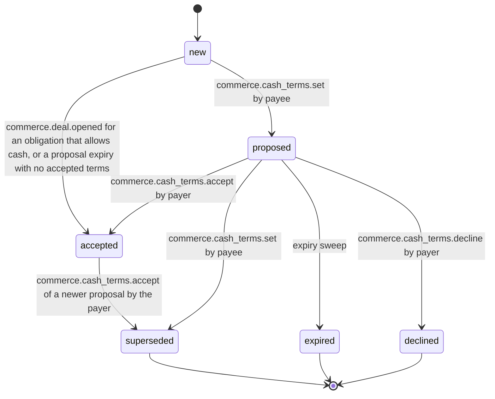

# PS-067-03 — Workflow state machine: Cash payments

**Status:** SPECIFIED (Stage 3). **Module:** [F09.S01.M02 Cash payments](SPEC.md) · **Scope:** MVP · **Code:** `packages/commerce/src/payments/cash` · **Contracts:** [CTR-COM-001](../../../planning/contracts/CTR-COM-001.md), [CTR-MNY-001](../../../planning/contracts/CTR-MNY-001.md), [CTR-ID-001](../../../planning/contracts/CTR-ID-001.md), [CTR-EVT-001](../../../planning/contracts/CTR-EVT-001.md), [CTR-ERR-001](../../../planning/contracts/CTR-ERR-001.md), [CTR-CAP-001](../../../planning/contracts/CTR-CAP-001.md), [CTR-IDM-001](../../../planning/contracts/CTR-IDM-001.md), [CTR-PRV-001](../../../planning/contracts/CTR-PRV-001.md), [CTR-FED-001](../../../planning/contracts/CTR-FED-001.md)

> Generated from `module.spec.yaml` by `tools/specgen`. Edit the YAML, then run `pnpm spec:render`.

## Requirements

- **PS-067-03.R01** Default terms enter directly as accepted when the Deal opens; proposals start as proposed and end as accepted, declined, superseded or expired.
- **PS-067-03.R02** A new proposal supersedes an earlier unaccepted proposal; accepted terms stay in force until the payer accepts a newer proposal, and claims keep the termsCid they were made under.
- **PS-067-03.R03** Expiry after 7 days leaves the prior accepted terms in force, and creates default accepted terms in the same transaction only when none exist.

## Specification

### CashTerms lifecycle

Initial **new**; terminal **superseded**, **expired**, **declined**.

| Transition | Trigger | Guard / effect |
|---|---|---|
| proposed -> accepted | commerce.cash_terms.accept by payer | acceptance statement signed; in the same transaction the previously accepted terms become superseded |
| proposed -> superseded | commerce.cash_terms.set by payee | a newer proposal replaces this unaccepted one |
| accepted -> superseded | commerce.cash_terms.accept of a newer proposal by the payer | only in that acceptance transaction; existing claims keep their termsCid |
| proposed -> expired | expiry sweep | 7 days without acceptance; the prior accepted terms stay in force, or default accepted terms are created in the same transaction when none exist |
| new -> accepted | commerce.deal.opened for an obligation that allows cash, or a proposal expiry with no accepted terms | default terms (acknowledgement required, no receipt) need no acceptance and no statement; no row exists before this |
| new -> proposed | commerce.cash_terms.set by payee | signed cash_terms statement; expectedRevision equals the revision of the in-force terms; no row exists before this |
| proposed -> declined | commerce.cash_terms.decline by payer | signed decline statement; the prior accepted terms stay in force |

### Timeouts and scheduled transitions

- Proposal expiry sweep every 5 min and at vault unlock: proposed terms older than 7 days become expired, and default accepted terms are created in the same transaction only when the obligation has no accepted terms.

## Verification

| Test | Level | Covers | Scenario | Expected |
|---|---|---|---|---|
| TEST-PS-067-09.T03 | property | PS-067-03.R01, PS-067-03.R02 | random sequences of set, accept, decline and expiry | only declared transitions succeed; at most one accepted terms per obligation at any time |
| TEST-PS-067-09.T04 | integration | PS-067-03.R02, PS-067-03.R03 | clock advanced 7 days on a proposal while the defaults are in force; claim made under accepted terms then a new proposal | proposal expires and the prior accepted terms stay in force; the existing claim keeps the termsCid it was signed with |
| TEST-PS-067-09.T14 | integration | PS-067-03.R01 | payer declines a proposal, then tries to accept it | proposed to declined with a signed decline statement and the prior accepted terms still in force; accept refused with CONFLICT_STATE |
| TEST-PS-067-09.T15 | integration | PS-067-03.R02, PS-067-01.R04, PS-067-04.R05 | defaults in force, payee proposes receiptRequired true, payer claims before accepting, then accepts and claims again | first claim signs the default termsCid; defaults superseded only in the acceptance transaction; second claim signs the new termsCid and triggers the receipt prompt after acknowledgement |

## Dependencies

Module depends on: F09.S01.M01, F09.S02.M01, F09.S03.M03, F18.S01.M01, F07.S02.M02, F11.S01.M01, F11.S01.M03, F10.S01.M02, F10.S01.M03, F10.S01.M04, F10.S02.M02, CTR-COM-001, CTR-MNY-001, CTR-ID-001, CTR-EVT-001, CTR-ERR-001, CTR-CAP-001, CTR-IDM-001, CTR-PRV-001, CTR-FED-001. Predecessor: [domain_schema.md](domain_schema.md).
