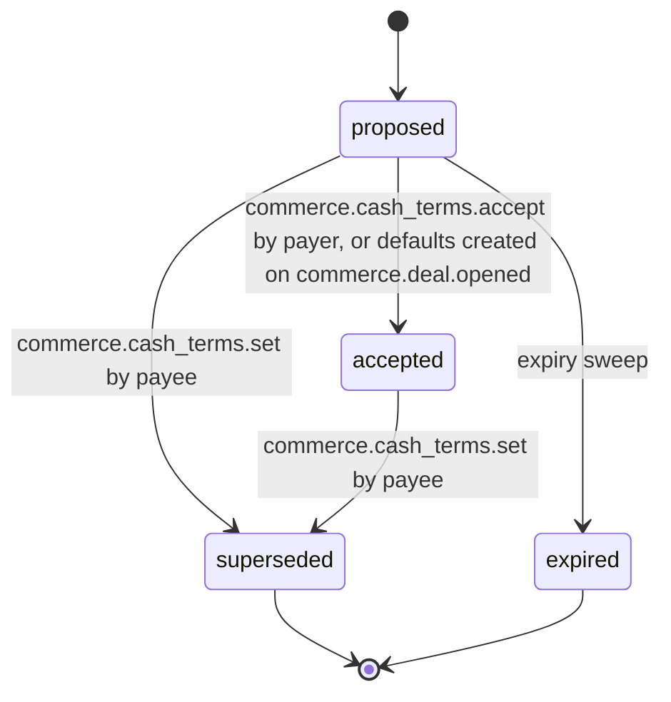

# PS-067-03 — Workflow state machine: Cash payments

**Status:** SPECIFIED (Stage 3). **Module:** [F09.S01.M02 Cash payments](SPEC.md) · **Scope:** MVP · **Code:** `packages/commerce/src/payments/cash` · **Contracts:** [CTR-COM-001](../../../planning/contracts/CTR-COM-001.md), [CTR-MNY-001](../../../planning/contracts/CTR-MNY-001.md), [CTR-ID-001](../../../planning/contracts/CTR-ID-001.md), [CTR-EVT-001](../../../planning/contracts/CTR-EVT-001.md), [CTR-ERR-001](../../../planning/contracts/CTR-ERR-001.md), [CTR-CAP-001](../../../planning/contracts/CTR-CAP-001.md), [CTR-IDM-001](../../../planning/contracts/CTR-IDM-001.md), [CTR-PRV-001](../../../planning/contracts/CTR-PRV-001.md), [CTR-FED-001](../../../planning/contracts/CTR-FED-001.md)

> Generated from `module.spec.yaml` by `tools/specgen`. Edit the YAML, then run `pnpm spec:render`.

## Requirements

- **PS-067-03.R01** Terms start as proposed and end as accepted, superseded or expired; default terms are created already accepted.
- **PS-067-03.R02** A new proposal supersedes the previous one without altering claims made under it.
- **PS-067-03.R03** Expiry after 7 days returns the obligation to default terms.

## Specification

### CashTerms lifecycle

Initial **proposed**; terminal **superseded**, **expired**.

| Transition | Trigger | Guard / effect |
|---|---|---|
| proposed -> accepted | commerce.cash_terms.accept by payer, or defaults created on commerce.deal.opened | acceptance statement signed; defaults need no acceptance |
| proposed -> superseded | commerce.cash_terms.set by payee | newer proposal replaces it |
| accepted -> superseded | commerce.cash_terms.set by payee | payer must accept again; existing claims keep old terms |
| proposed -> expired | expiry sweep | 7 days without acceptance; default terms apply |

### Timeouts and scheduled transitions

- Proposal expiry sweep every 5 min and at vault unlock: proposed terms older than 7 days become expired.

## Verification

| Test | Level | Covers | Scenario | Expected |
|---|---|---|---|---|
| TEST-PS-067-09.T03 | property | PS-067-03.R01, PS-067-03.R02 | random sequences of set, accept and expiry | only declared transitions succeed; at most one accepted terms per obligation |
| TEST-PS-067-09.T04 | integration | PS-067-03.R02, PS-067-03.R03 | clock advanced 7 days on a proposal; claim made under old terms then new proposal | proposal expires to defaults; existing claim keeps old terms |

## Dependencies

Module depends on: F09.S01.M01, F09.S03.M03, F18.S01.M01, CTR-COM-001, CTR-MNY-001, CTR-ID-001, CTR-EVT-001, CTR-ERR-001, CTR-CAP-001, CTR-IDM-001, CTR-PRV-001, CTR-FED-001. Predecessor: [domain_schema.md](domain_schema.md).
