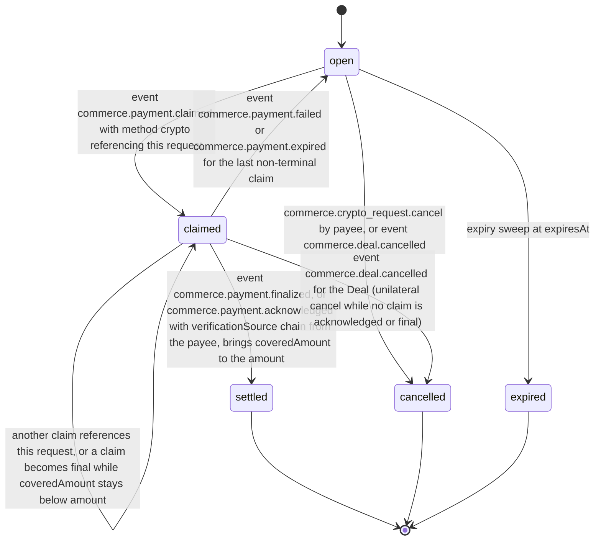
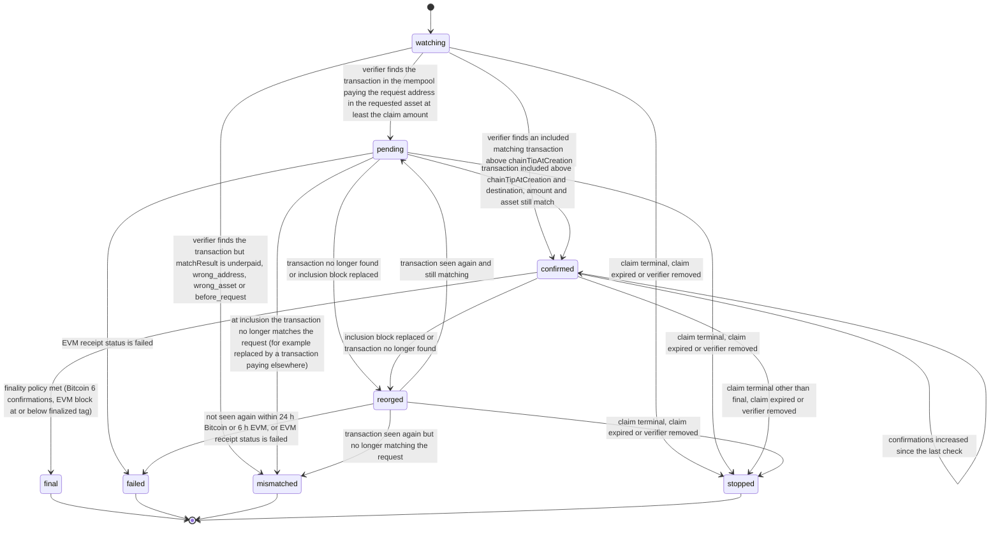

# PS-068-03 — Workflow state machine: Crypto payments

**Status:** SPECIFIED (Stage 3). **Module:** [F09.S01.M03 Crypto payments](SPEC.md) · **Scope:** MVP · **Code:** `packages/commerce/src/payments/crypto` · **Contracts:** [CTR-COM-001](../../../planning/contracts/CTR-COM-001.md), [CTR-MNY-001](../../../planning/contracts/CTR-MNY-001.md), [CTR-ID-001](../../../planning/contracts/CTR-ID-001.md), [CTR-EVT-001](../../../planning/contracts/CTR-EVT-001.md), [CTR-ERR-001](../../../planning/contracts/CTR-ERR-001.md), [CTR-CAP-001](../../../planning/contracts/CTR-CAP-001.md), [CTR-IDM-001](../../../planning/contracts/CTR-IDM-001.md), [CTR-PRV-001](../../../planning/contracts/CTR-PRV-001.md), [CTR-FED-001](../../../planning/contracts/CTR-FED-001.md), [CTR-FLG-001](../../../planning/contracts/CTR-FLG-001.md)

> Generated from `module.spec.yaml` by `tools/specgen`. Edit the YAML, then run `pnpm spec:render`.

## Requirements

- **PS-068-03.R01** Requests and observations follow the declared machines; any other transition is refused with CONFLICT_STATE.
- **PS-068-03.R02** An observation advances only on data from a configured ChainVerifierPort adapter; with none configured no observation is created and the claim stays claimed (COM-5).
- **PS-068-03.R03** A reorg moves a confirmed or pending observation to reorged; a reorged observation returns to pending if the transaction reappears and becomes failed after the grace period (24 h Bitcoin, 6 h EVM) or immediately for a reverted EVM transaction.
- **PS-068-03.R04** Observation stops when the claim reaches a terminal state, the claim expires after 14 days, or the user removes the verifier.
- **PS-068-03.R05** commerce.payment.confirming is emitted only for a transaction whose destination, asset and amount match the request and whose inclusion is above chainTipAtCreation; a transaction that does not match (underpaid, wrong_address, wrong_asset, before_request) or reverts moves the observation to mismatched or failed and emits commerce.payment.failed with that reason, labelled 'transaction does not match request'.
- **PS-068-03.R06** Every increase of confirmations on a confirmed observation emits commerce.payment.confirming with confirmations and requiredConfirmations and refreshes lastProgressAt; EVM observations show 'awaiting finalized checkpoint' instead of N of M.
- **PS-068-03.R07** Observations are per vault - payer and payee each run their own verifier - and in the payee's vault commerce.payment.finalized makes F09.S01.M01 sign classrup.commerce.payment_ack/v1 with verification.source chain; the payer's vault shows its own final as 'final per your verifier; payee has not confirmed' until that statement arrives.
- **PS-068-03.R08** final is set only when the finality policy is met and is terminal; for 100 further blocks the observation keeps a light watch, and a replaced inclusion block raises a deep-reorg alert without regressing the observation or the claim.
- **PS-068-03.R09** An underpaid transaction leaves the request claimable for the remainder - the payer may claim the received amount and pay the rest in another transaction - and the request is settled only when final claims cover the amount.

## Specification

### CryptoPaymentRequest lifecycle

Initial **open**; terminal **settled**, **cancelled**, **expired**.

| Transition | Trigger | Guard / effect |
|---|---|---|
| open -> claimed | event commerce.payment.claimed with method crypto referencing this request | claim id added; claim amount at most the uncovered remainder |
| claimed -> claimed | another claim references this request, or a claim becomes final while coveredAmount stays below amount | claimIds and coveredAmount updated |
| claimed -> open | event commerce.payment.failed or commerce.payment.expired for the last non-terminal claim | request validity remains; payer may submit another transaction |
| claimed -> settled | event commerce.payment.finalized, or commerce.payment.acknowledged with verificationSource chain from the payee, brings coveredAmount to the amount | finality reached for the whole amount |
| open -> cancelled | commerce.crypto_request.cancel by payee, or event commerce.deal.cancelled | signed cancel statement for a payee cancel; refused once claimed |
| claimed -> cancelled | event commerce.deal.cancelled for the Deal (unilateral cancel while no claim is acknowledged or final) | observations stopped |
| open -> expired | expiry sweep at expiresAt | no claim attached |

### ChainObservation lifecycle

Initial **watching**; terminal **final**, **failed**, **mismatched**, **stopped**.

| Transition | Trigger | Guard / effect |
|---|---|---|
| watching -> pending | verifier finds the transaction in the mempool paying the request address in the requested asset at least the claim amount | emits commerce.payment.confirming with confirmations 0 |
| watching -> confirmed | verifier finds an included matching transaction above chainTipAtCreation | emits commerce.payment.confirming then commerce.payment.confirmed in one transaction |
| watching -> mismatched | verifier finds the transaction but matchResult is underpaid, wrong_address, wrong_asset or before_request | no confirming event; emits commerce.payment.failed with that reason and receivedAmount; label 'transaction does not match request' |
| pending -> confirmed | transaction included above chainTipAtCreation and destination, amount and asset still match | emits commerce.payment.confirmed |
| pending -> mismatched | at inclusion the transaction no longer matches the request (for example replaced by a transaction paying elsewhere) | emits commerce.payment.failed with that reason |
| pending -> failed | EVM receipt status is failed | emits commerce.payment.failed with reason reverted |
| confirmed -> confirmed | confirmations increased since the last check | emits commerce.payment.confirming with confirmations and requiredConfirmations; lastProgressAt refreshed |
| confirmed -> final | finality policy met (Bitcoin 6 confirmations, EVM block at or below finalized tag) | emits commerce.payment.finalized; postFinalWatchUntil set to final height + 100 |
| pending -> reorged | transaction no longer found or inclusion block replaced | emits commerce.payment.reorged |
| confirmed -> reorged | inclusion block replaced or transaction no longer found | emits commerce.payment.reorged |
| reorged -> pending | transaction seen again and still matching | emits commerce.payment.confirming |
| reorged -> mismatched | transaction seen again but no longer matching the request | emits commerce.payment.failed with that reason |
| reorged -> failed | not seen again within 24 h Bitcoin or 6 h EVM, or EVM receipt status is failed | emits commerce.payment.failed with reason absent or reverted |
| watching -> stopped | claim terminal, claim expired or verifier removed | no event |
| pending -> stopped | claim terminal, claim expired or verifier removed | no event |
| confirmed -> stopped | claim terminal other than final, claim expired or verifier removed | no event |
| reorged -> stopped | claim terminal, claim expired or verifier removed | no event |

### Timeouts and scheduled transitions

- Polling: one chain-tip request per configured endpoint per interval (Bitcoin 60 s, EVM 24 s) while the PWA is running; per-observation calls only when the tip moved since that observation's lastTipSeen, and for EVM observations past inclusion at most every 5 min; exponential backoff to 10 min on endpoint errors; periodic background sync every 15 min where the browser allows.
- Poll budget: 900 endpoint calls per hour per vault (tip polls for two chains with two endpoints each use at most 420). When the budget is reached, observations closest to finality are checked first, the per-observation interval doubles up to 10 min, deferred observations set budgetPausedAt and show 'verification paused - check budget reached', and tip polls continue.
- Request expiry sweep every 5 min; default request validity 7 days.
- Reorg grace: 24 h for Bitcoin and 6 h for EVM chains before failed.
- Post-final watch: 100 blocks after final on tip changes within the budget; a replaced inclusion block sets deepReorgAlertAt and shows the alert to the parties without a state change.
- Held claims: the txid is looked up on each poll for 24 h; when found the claim is released to F09.S01.M01 for signing and sending, otherwise it is discarded locally with its txRef.

## Verification

| Test | Level | Covers | Scenario | Expected |
|---|---|---|---|---|
| TEST-PS-068-09.T03 | unit | PS-068-02.R03, PS-068-03.R02 | no verifier configured and a crypto claim made | claim stays claimed, verification.source self, no observation, COMMERCE_CRYPTO_NO_VERIFIER on refresh |
| TEST-PS-068-09.T04 | integration | PS-068-02.R03, PS-068-03.R05 | underpaid, wrong address, wrong token contract and reverted transactions | matchResult recorded; no commerce.payment.confirming emitted; commerce.payment.failed with the matching reason; claim never confirmed |
| TEST-PS-068-09.T05 | property | PS-068-03.R01 | random verifier answer sequences | only declared transitions occur; final is never followed by another state |
| TEST-PS-068-09.T06 | integration | PS-068-03.R03 | Bitcoin block orphaned at 2 confirmations then transaction re-included; and absent for 24 h | reorged then pending then confirmed; second case ends failed |
| TEST-PS-068-09.T07 | integration | PS-068-03.R02, PS-068-03.R04 | Bitcoin at 5 then 6 confirmations; EVM below then at finalized tag; claim expiry at 14 days | finalized only at 6 and finalized tag; observation stopped at expiry |
| TEST-PS-068-09.T19 | integration | PS-068-03.R05, PS-068-02.R03 | each matchResult underpaid, wrong_address, wrong_asset, before_request and reverted, from watching, pending and reorged | observation mismatched or failed; commerce.payment.failed carries the reason; label 'transaction does not match request'; no confirming event |
| TEST-PS-068-09.T20 | integration | PS-068-03.R06 | Bitcoin confirmations 1, 2, 3 then 6; EVM transaction before and at the finalized tag | confirming emitted at each increase with confirmations and requiredConfirmations and lastProgressAt refreshed; EVM label 'awaiting finalized checkpoint', never 'N of 0' |
| TEST-PS-068-09.T21 | integration | PS-068-03.R07 | vaults A and B with a verifier only in payer vault A; later B configures one | A reads 'final per your verifier; payee has not confirmed' and its request stays claimed; after B finalizes, F09.S01.M01 in B signs payment_ack with source chain and both vaults settle the request and complete the Deal |
| TEST-PS-068-09.T22 | integration | PS-068-03.R08 | transaction final at 6 confirmations, inclusion block replaced 40 blocks later, then 100 blocks pass | observation stays final, deepReorgAlertAt set and shown, claim not regressed; watch ends after 100 blocks |
| TEST-PS-068-09.T23 | integration | PS-068-03.R09, PS-068-01.R05 | transaction underpaid by 4 000 sats, then a claim for the received amount and a second transaction for the remainder | first claim failed underpaid; the next two claims attach to the same request; request settled only when both are final |

## Dependencies

Module depends on: F09.S01.M01, F09.S03.M01, F09.S03.M03, F07.S02.M02, F11.S01.M01, F11.S01.M03, F10.S01.M01, F10.S01.M02, F10.S01.M03, F10.S01.M04, F10.S02.M02, CTR-COM-001, CTR-MNY-001, CTR-ID-001, CTR-EVT-001, CTR-ERR-001, CTR-CAP-001, CTR-IDM-001, CTR-PRV-001, CTR-FED-001, CTR-FLG-001. Predecessor: [domain_schema.md](domain_schema.md).
