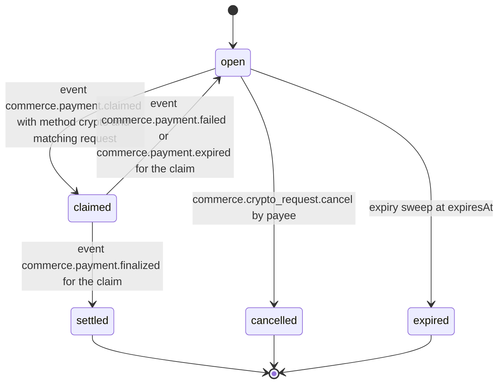
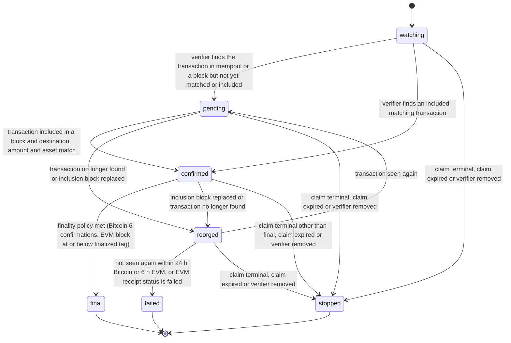

# PS-068-03 — Workflow state machine: Crypto payments

**Status:** SPECIFIED (Stage 3). **Module:** [F09.S01.M03 Crypto payments](SPEC.md) · **Scope:** MVP · **Code:** `packages/commerce/src/payments/crypto` · **Contracts:** [CTR-COM-001](../../../planning/contracts/CTR-COM-001.md), [CTR-MNY-001](../../../planning/contracts/CTR-MNY-001.md), [CTR-ID-001](../../../planning/contracts/CTR-ID-001.md), [CTR-EVT-001](../../../planning/contracts/CTR-EVT-001.md), [CTR-ERR-001](../../../planning/contracts/CTR-ERR-001.md), [CTR-CAP-001](../../../planning/contracts/CTR-CAP-001.md), [CTR-IDM-001](../../../planning/contracts/CTR-IDM-001.md), [CTR-PRV-001](../../../planning/contracts/CTR-PRV-001.md), [CTR-FED-001](../../../planning/contracts/CTR-FED-001.md), [CTR-FLG-001](../../../planning/contracts/CTR-FLG-001.md)

> Generated from `module.spec.yaml` by `tools/specgen`. Edit the YAML, then run `pnpm spec:render`.

## Requirements

- **PS-068-03.R01** Requests and observations follow the declared machines; any other transition is refused with CONFLICT_STATE.
- **PS-068-03.R02** An observation advances only on data from a configured ChainVerifierPort adapter; with none configured no observation is created and the claim stays claimed (COM-5).
- **PS-068-03.R03** A reorg moves a confirmed or pending observation to reorged; a reorged observation returns to pending if the transaction reappears and becomes failed after the grace period (24 h Bitcoin, 6 h EVM) or immediately for a reverted EVM transaction.
- **PS-068-03.R04** Observation stops when the claim reaches a terminal state, the claim expires after 14 days, or the user removes the verifier.

## Specification

### CryptoPaymentRequest lifecycle

Initial **open**; terminal **settled**, **cancelled**, **expired**.

| Transition | Trigger | Guard / effect |
|---|---|---|
| open -> claimed | event commerce.payment.claimed with method crypto and matching request | claim references this request |
| claimed -> open | event commerce.payment.failed or commerce.payment.expired for the claim | request validity remains; payer may submit another transaction |
| claimed -> settled | event commerce.payment.finalized for the claim | finality reached |
| open -> cancelled | commerce.crypto_request.cancel by payee | signed cancel statement; refused once claimed |
| open -> expired | expiry sweep at expiresAt | no claim attached |

### ChainObservation lifecycle

Initial **watching**; terminal **final**, **failed**, **stopped**.

| Transition | Trigger | Guard / effect |
|---|---|---|
| watching -> pending | verifier finds the transaction in mempool or a block but not yet matched or included | emits commerce.payment.confirming |
| watching -> confirmed | verifier finds an included, matching transaction | emits commerce.payment.confirming then commerce.payment.confirmed in one transaction |
| pending -> confirmed | transaction included in a block and destination, amount and asset match | emits commerce.payment.confirmed |
| confirmed -> final | finality policy met (Bitcoin 6 confirmations, EVM block at or below finalized tag) | emits commerce.payment.finalized |
| pending -> reorged | transaction no longer found or inclusion block replaced | emits commerce.payment.reorged |
| confirmed -> reorged | inclusion block replaced or transaction no longer found | emits commerce.payment.reorged |
| reorged -> pending | transaction seen again | emits commerce.payment.confirming |
| reorged -> failed | not seen again within 24 h Bitcoin or 6 h EVM, or EVM receipt status is failed | emits commerce.payment.failed |
| watching -> stopped | claim terminal, claim expired or verifier removed | no event |
| pending -> stopped | claim terminal, claim expired or verifier removed | no event |
| confirmed -> stopped | claim terminal other than final, claim expired or verifier removed | no event |
| reorged -> stopped | claim terminal, claim expired or verifier removed | no event |

### Timeouts and scheduled transitions

- Polling: Bitcoin every 60 s, EVM every 24 s while the PWA is running; exponential backoff to 10 min on endpoint errors; periodic background sync every 15 min where the browser allows.
- Request expiry sweep every 5 min; default request validity 7 days.
- Reorg grace: 24 h for Bitcoin and 6 h for EVM chains before failed.

## Verification

| Test | Level | Covers | Scenario | Expected |
|---|---|---|---|---|
| TEST-PS-068-09.T03 | unit | PS-068-02.R03, PS-068-03.R02 | no verifier configured and a crypto claim made | claim stays claimed, verification.source self, no observation, COMMERCE_CRYPTO_NO_VERIFIER on refresh |
| TEST-PS-068-09.T05 | property | PS-068-03.R01 | random verifier answer sequences | only declared transitions occur; final is never followed by another state |
| TEST-PS-068-09.T06 | integration | PS-068-03.R03 | Bitcoin block orphaned at 2 confirmations then transaction re-included; and absent for 24 h | reorged then pending then confirmed; second case ends failed |
| TEST-PS-068-09.T07 | integration | PS-068-03.R02, PS-068-03.R04 | Bitcoin at 5 then 6 confirmations; EVM below then at finalized tag; claim expiry at 14 days | finalized only at 6 and finalized tag; observation stopped at expiry |

## Dependencies

Module depends on: F09.S01.M01, F09.S03.M01, F09.S03.M03, CTR-COM-001, CTR-MNY-001, CTR-ID-001, CTR-EVT-001, CTR-ERR-001, CTR-CAP-001, CTR-IDM-001, CTR-PRV-001, CTR-FED-001, CTR-FLG-001. Predecessor: [domain_schema.md](domain_schema.md).
