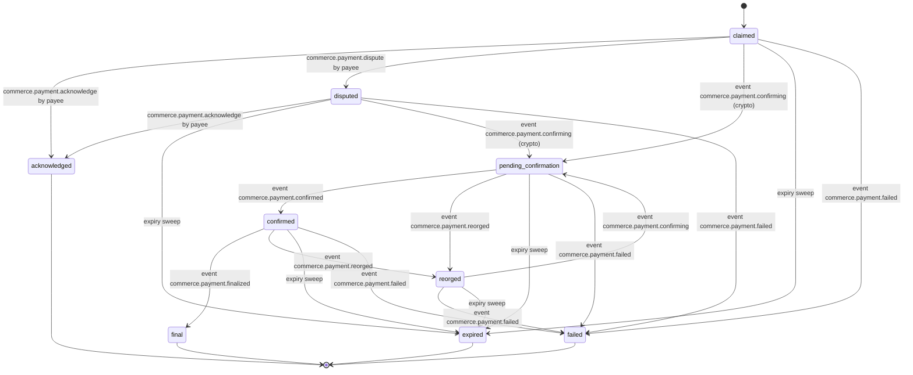
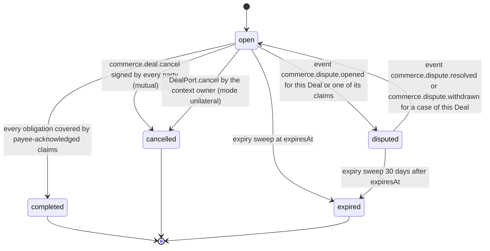

# PS-069-03 — Workflow state machine: Noncustodial payment claims

**Status:** SPECIFIED (Stage 3). **Module:** [F09.S01.M01 Noncustodial payment claims](SPEC.md) · **Scope:** MVP · **Code:** `packages/commerce/src/payments/noncustodial` · **Contracts:** [CTR-COM-001](../../../planning/contracts/CTR-COM-001.md), [CTR-MNY-001](../../../planning/contracts/CTR-MNY-001.md), [CTR-ID-001](../../../planning/contracts/CTR-ID-001.md), [CTR-EVT-001](../../../planning/contracts/CTR-EVT-001.md), [CTR-ERR-001](../../../planning/contracts/CTR-ERR-001.md), [CTR-CAP-001](../../../planning/contracts/CTR-CAP-001.md), [CTR-IDM-001](../../../planning/contracts/CTR-IDM-001.md), [CTR-PRV-001](../../../planning/contracts/CTR-PRV-001.md), [CTR-FED-001](../../../planning/contracts/CTR-FED-001.md), [CTR-OBS-001](../../../planning/contracts/CTR-OBS-001.md)

> Generated from `module.spec.yaml` by `tools/specgen`. Edit the YAML, then run `pnpm spec:render`.

## Requirements

- **PS-069-03.R01** Deal and PaymentClaim follow the declared machines; any other transition is refused with CONFLICT_STATE.
- **PS-069-03.R02** Crypto statuses are set only by events from the crypto module (F09.S01.M03) and reflect this vault's own verifier; no command can set confirmed or final directly (COM-5).
- **PS-069-03.R03** Any non-final claim without a payee acknowledgement moves to expired after 14 days without progress, computed from local lastProgressAt.
- **PS-069-03.R04** A Deal completes only when its obligations are covered by payee-acknowledged claims, and a disputed Deal returns to open only when every case on it has been resolved or withdrawn (openCaseIds empty).
- **PS-069-03.R05** A context owner can cancel an open Deal unilaterally through DealPort.cancel while no claim is acknowledged or final, with reason context_voided, withdrawn_before_accept or non_payment; the signed deal_cancel is applied by the other vaults and shown as one-sided, and every other cancellation needs all parties' signatures.
- **PS-069-03.R06** For crypto the payee's vault signs classrup.commerce.payment_ack/v1 with verification.source chain when its own verifier reports final; the payer's vault labels its own final 'final per your verifier; payee has not confirmed' and completes the Deal only on that signed statement, and no Deal expires while this vault knows a final observation that awaits the payee's statement.
- **PS-069-03.R07** An open Deal whose obligations are partly covered expires at expiresAt with reason expired_partial, a disputed Deal expires only 30 days after expiresAt, and a case opened on a completed, cancelled or expired Deal only sets disputeFlag.
- **PS-069-03.R08** Chain events for a disputed crypto claim continue the crypto machine with the dispute statement kept, a transaction that does not match the request fails the claim with its reason, and chain events for a terminal claim only update verification fields and are acknowledged by the consumer instead of failing.
- **PS-069-03.R09** Labels follow COM-4 exactly - claimed (unverified), acknowledged by payee, confirmed N of M per your verifier (awaiting finalized checkpoint on EVM), final per your verifier with or without the payee's confirmation - and no label shows completion on a payer claim alone.

## Specification

### PaymentClaim lifecycle

Initial **claimed**; terminal **acknowledged**, **final**, **failed**, **expired**.

| Transition | Trigger | Guard / effect |
|---|---|---|
| claimed -> acknowledged | commerce.payment.acknowledge by payee | method cash or external only; verification.source counterparty; ackCid set; emits commerce.payment.acknowledged |
| claimed -> disputed | commerce.payment.dispute by payee | emits commerce.payment.disputed |
| disputed -> acknowledged | commerce.payment.acknowledge by payee | method cash or external only, the same guard as from claimed; both signed statements kept; emits commerce.payment.acknowledged |
| claimed -> pending_confirmation | event commerce.payment.confirming (crypto) | emitted only for a transaction that matches the request; verification.source chain |
| pending_confirmation -> confirmed | event commerce.payment.confirmed | address and amount matched by verifier |
| confirmed -> final | event commerce.payment.finalized | finality policy met (COM-5); in the payee vault the module signs payment_ack/v1 with verification.source chain, sets ackCid and emits commerce.payment.acknowledged |
| pending_confirmation -> reorged | event commerce.payment.reorged | chain reorganized |
| confirmed -> reorged | event commerce.payment.reorged | chain reorganized |
| reorged -> pending_confirmation | event commerce.payment.confirming | transaction seen again |
| reorged -> failed | event commerce.payment.failed | transaction absent past the reorg grace period |
| claimed -> expired | expiry sweep | 14 days without progress and no payee acknowledgement held; emits commerce.payment.expired |
| disputed -> expired | expiry sweep | 14 days without progress and no payee acknowledgement held; emits commerce.payment.expired |
| pending_confirmation -> expired | expiry sweep | 14 days without progress and no payee acknowledgement held; emits commerce.payment.expired |
| confirmed -> expired | expiry sweep | 14 days without progress and no payee acknowledgement held; emits commerce.payment.expired |
| reorged -> expired | expiry sweep | 14 days without progress and no payee acknowledgement held; emits commerce.payment.expired |
| disputed -> pending_confirmation | event commerce.payment.confirming (crypto) | dispute statement retained; the crypto machine continues and the payee vault signs its chain acknowledgement at final |
| claimed -> failed | event commerce.payment.failed | reason underpaid, wrong_address, wrong_asset, reverted or before_request; label 'transaction does not match request' |
| pending_confirmation -> failed | event commerce.payment.failed | reason reverted or a mismatch found at inclusion |
| confirmed -> failed | event commerce.payment.failed | reason reverted |
| disputed -> failed | event commerce.payment.failed | mismatch or revert reported for a disputed crypto claim; dispute statement retained |

### Deal lifecycle

Initial **open**; terminal **completed**, **cancelled**, **expired**.

| Transition | Trigger | Guard / effect |
|---|---|---|
| open -> completed | every obligation covered by payee-acknowledged claims | ack source counterparty (cash, external) or chain (crypto); completion body signed as deal_completion/v1; emits commerce.deal.completed with completionCid |
| open -> disputed | event commerce.dispute.opened for this Deal or one of its claims | case id added to openCaseIds; claims remain but no completion while disputed |
| disputed -> open | event commerce.dispute.resolved or commerce.dispute.withdrawn for a case of this Deal | case id removed; only when openCaseIds becomes empty; completion re-evaluated |
| open -> cancelled | commerce.deal.cancel signed by every party (mutual) | no claim in claimed or later non-terminal state; emits commerce.deal.cancelled with mode mutual |
| open -> expired | expiry sweep at expiresAt | reason expired when nothing is covered and expired_partial when some obligations are covered; never while this vault holds a final observation awaiting the payee's chain acknowledgement; emits commerce.deal.cancelled |
| open -> cancelled | DealPort.cancel by the context owner (mode unilateral) | no claim acknowledged or final; reason context_voided, withdrawn_before_accept or non_payment; signed deal_cancel applied by the other vaults and shown as one-sided; emits commerce.deal.cancelled |
| disputed -> expired | expiry sweep 30 days after expiresAt | reason expired or expired_partial; open cases keep their own clock; emits commerce.deal.cancelled |

### Timeouts and scheduled transitions

- Claim expiry sweep every 5 min in the open vault and at vault unlock: non-final claims with lastProgressAt older than 14 days and no payee acknowledgement become expired.
- Deal expiry sweep at the same cadence: open Deals past expiresAt (default 30 days) become expired with reason expired or expired_partial, disputed Deals 30 days later; Deals with a final observation awaiting the payee's chain acknowledgement are skipped.
- Statements with an unknown parent (Deal, claim or prev in the author's chain) wait up to 24 h (FED-3) and are then dropped with reason parent_unknown; the quarantine holds at most 500 entries or 5 MiB with oldest-first eviction.
- Held claims (sendHold) are re-checked by the method module on each poll for 24 h and then deleted locally with their txRef, never having been signed or sent.

## Verification

| Test | Level | Covers | Scenario | Expected |
|---|---|---|---|---|
| TEST-PS-069-09.T04 | property | PS-069-03.R01 | random command and event sequences on a claim | only declared transitions succeed; others return CONFLICT_STATE |
| TEST-PS-069-09.T05 | unit | PS-069-03.R02 | try to move a claim to confirmed or final through user input | refused; only crypto events can set it |
| TEST-PS-069-09.T06 | integration | PS-069-03.R03 | clock advanced 14 days without progress | claimed, disputed, pending_confirmation, confirmed and reorged claims without a payee acknowledgement become expired and emit commerce.payment.expired; a claim holding the payee's chain acknowledgement does not expire |
| TEST-PS-069-09.T07 | integration | PS-069-03.R04 | two cases opened on one Deal; the first resolved with a refund-claimed outcome, then the second withdrawn | Deal stays disputed after the first and returns to open only after the second; no claim status changed; no money movement API invoked |
| TEST-PS-069-09.T17 | e2e | PS-069-03.R09 | buyer claims cash payment, seller acknowledges on another device, both screens checked; crypto claim shown at 2 of 6 and final in the payer vault | labels read claimed (unverified) then acknowledged by payee; crypto reads confirmed 2 of 6 per your verifier then final per your verifier, payee has not confirmed; Deal completed only after acknowledgement; axe zero serious issues |
| TEST-PS-069-09.T22 | integration | PS-069-03.R05, PS-069-05.R04 | context owner voids an open Deal through DealPort.cancel; a non-owner tries; the owner tries after a claim was acknowledged | one-sided cancel applied in the other vault and labelled one-sided; non-owner FORBIDDEN or quarantined; CONFLICT_STATE after acknowledgement |
| TEST-PS-069-09.T23 | integration | PS-069-03.R06 | two vaults with a verifier only in the payer vault; crypto claim reaches final there; later the payee configures a verifier | payer reads final per your verifier, payee has not confirmed, and its Deal neither completes nor expires; after the payee vault signs its chain acknowledgement both Deals complete with the same completionCid |
| TEST-PS-069-09.T24 | integration | PS-069-03.R07 | Deal with two obligations, one acknowledged, passes expiresAt; disputed Deal 30 days past expiresAt; case opened on a completed Deal | first expires with reason expired_partial; disputed Deal expires then; completed Deal only gets disputeFlag |
| TEST-PS-069-09.T25 | integration | PS-069-03.R08 | disputed crypto claim receives confirming; mismatched transaction reported as failed; finalized event for a failed claim | disputed to pending_confirmation with the dispute statement kept; claimed to failed with its reason; late event only updates verification fields and is acknowledged |

## Dependencies

Module depends on: F09.S03.M01, F09.S03.M03, F07.S01.M01, F07.S02.M01, F07.S02.M02, F11.S01.M01, F11.S01.M03, F16.S02.M03, F10.S01.M02, F10.S01.M03, F10.S01.M04, F10.S02.M02, CTR-COM-001, CTR-MNY-001, CTR-ID-001, CTR-EVT-001, CTR-ERR-001, CTR-CAP-001, CTR-IDM-001, CTR-PRV-001, CTR-FED-001, CTR-OBS-001. Predecessor: [domain_schema.md](domain_schema.md).
