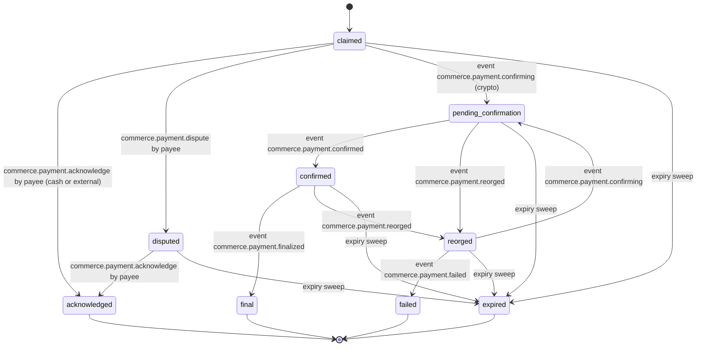
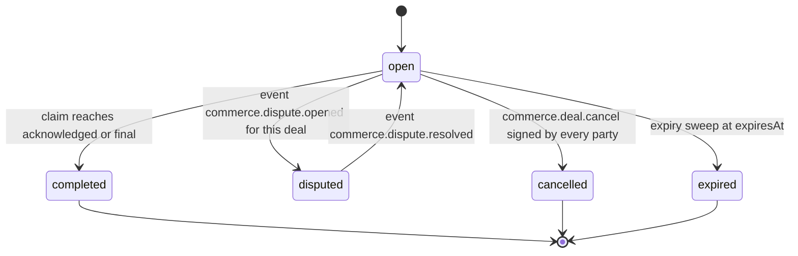

# PS-069-03 — Workflow state machine: Noncustodial payment claims

**Status:** SPECIFIED (Stage 3). **Module:** [F09.S01.M01 Noncustodial payment claims](SPEC.md) · **Scope:** MVP · **Code:** `packages/commerce/src/payments/noncustodial` · **Contracts:** [CTR-COM-001](../../../planning/contracts/CTR-COM-001.md), [CTR-MNY-001](../../../planning/contracts/CTR-MNY-001.md), [CTR-ID-001](../../../planning/contracts/CTR-ID-001.md), [CTR-EVT-001](../../../planning/contracts/CTR-EVT-001.md), [CTR-ERR-001](../../../planning/contracts/CTR-ERR-001.md), [CTR-CAP-001](../../../planning/contracts/CTR-CAP-001.md), [CTR-IDM-001](../../../planning/contracts/CTR-IDM-001.md), [CTR-PRV-001](../../../planning/contracts/CTR-PRV-001.md), [CTR-FED-001](../../../planning/contracts/CTR-FED-001.md), [CTR-OBS-001](../../../planning/contracts/CTR-OBS-001.md)

> Generated from `module.spec.yaml` by `tools/specgen`. Edit the YAML, then run `pnpm spec:render`.

## Requirements

- **PS-069-03.R01** Deal and PaymentClaim follow the declared machines; any other transition is refused with CONFLICT_STATE.
- **PS-069-03.R02** Crypto statuses are set only by events from the crypto module (F09.S01.M03); no command can set confirmed or final directly (COM-5).
- **PS-069-03.R03** Any non-final claim moves to expired after 14 days without progress, computed from local lastProgressAt.
- **PS-069-03.R04** A Deal completes only when its obligations are covered, and a disputed Deal returns to open only when its dispute resolves.

## Specification

### PaymentClaim lifecycle

Initial **claimed**; terminal **acknowledged**, **final**, **failed**, **expired**.

| Transition | Trigger | Guard / effect |
|---|---|---|
| claimed -> acknowledged | commerce.payment.acknowledge by payee (cash or external) | verification.source counterparty; emits commerce.payment.acknowledged |
| claimed -> disputed | commerce.payment.dispute by payee | emits commerce.payment.disputed |
| disputed -> acknowledged | commerce.payment.acknowledge by payee | emits commerce.payment.acknowledged |
| claimed -> pending_confirmation | event commerce.payment.confirming (crypto) | verification.source chain |
| pending_confirmation -> confirmed | event commerce.payment.confirmed | address and amount matched by verifier |
| confirmed -> final | event commerce.payment.finalized | finality policy met (COM-5) |
| pending_confirmation -> reorged | event commerce.payment.reorged | chain reorganized |
| confirmed -> reorged | event commerce.payment.reorged | chain reorganized |
| reorged -> pending_confirmation | event commerce.payment.confirming | transaction seen again |
| reorged -> failed | event commerce.payment.failed | transaction absent past the reorg grace period |
| claimed -> expired | expiry sweep | 14 days without progress; emits commerce.payment.expired |
| disputed -> expired | expiry sweep | 14 days without progress; emits commerce.payment.expired |
| pending_confirmation -> expired | expiry sweep | 14 days without progress; emits commerce.payment.expired |
| confirmed -> expired | expiry sweep | 14 days without progress; emits commerce.payment.expired |
| reorged -> expired | expiry sweep | 14 days without progress; emits commerce.payment.expired |

### Deal lifecycle

Initial **open**; terminal **completed**, **cancelled**, **expired**.

| Transition | Trigger | Guard / effect |
|---|---|---|
| open -> completed | claim reaches acknowledged or final | all obligations covered; emits commerce.deal.completed |
| open -> disputed | event commerce.dispute.opened for this deal | claims remain but no further completion |
| disputed -> open | event commerce.dispute.resolved | dispute outcome recorded |
| open -> cancelled | commerce.deal.cancel signed by every party | no claim in claimed or later non-terminal state; emits commerce.deal.cancelled |
| open -> expired | expiry sweep at expiresAt | no completed obligations; emits commerce.deal.cancelled with reason expired |

### Timeouts and scheduled transitions

- Claim expiry sweep every 5 min in the open vault and at vault unlock: non-final claims with lastProgressAt older than 14 days become expired.
- Deal expiry sweep at the same cadence: open Deals past expiresAt (default 30 days) become expired.
- Quarantined statements wait 24 h for their missing parent (Deal or claim) and are then dropped with reason parent_unknown.

## Verification

| Test | Level | Covers | Scenario | Expected |
|---|---|---|---|---|
| TEST-PS-069-09.T04 | property | PS-069-03.R01 | random command and event sequences on a claim | only declared transitions succeed; others return CONFLICT_STATE |
| TEST-PS-069-09.T05 | unit | PS-069-03.R02 | try to move a claim to confirmed or final through user input | refused; only crypto events can set it |
| TEST-PS-069-09.T06 | integration | PS-069-03.R03 | clock advanced 14 days without progress | claimed, disputed, pending_confirmation, confirmed and reorged claims become expired and emit commerce.payment.expired |
| TEST-PS-069-09.T07 | integration | PS-069-03.R04 | dispute opened then resolved with a refund-claimed outcome | Deal goes disputed then open; no claim status changed; no money movement API invoked |
| TEST-PS-069-09.T17 | e2e | PS-069-01.R03, PS-069-03.R03 | buyer claims cash payment, seller acknowledges on another device, both screens checked | labels read claimed (unverified) then acknowledged by payee; Deal completed; axe zero serious issues |

## Dependencies

Module depends on: F09.S03.M01, F09.S03.M03, F07.S01.M01, F07.S02.M02, CTR-COM-001, CTR-MNY-001, CTR-ID-001, CTR-EVT-001, CTR-ERR-001, CTR-CAP-001, CTR-IDM-001, CTR-PRV-001, CTR-FED-001, CTR-OBS-001. Predecessor: [domain_schema.md](domain_schema.md).
