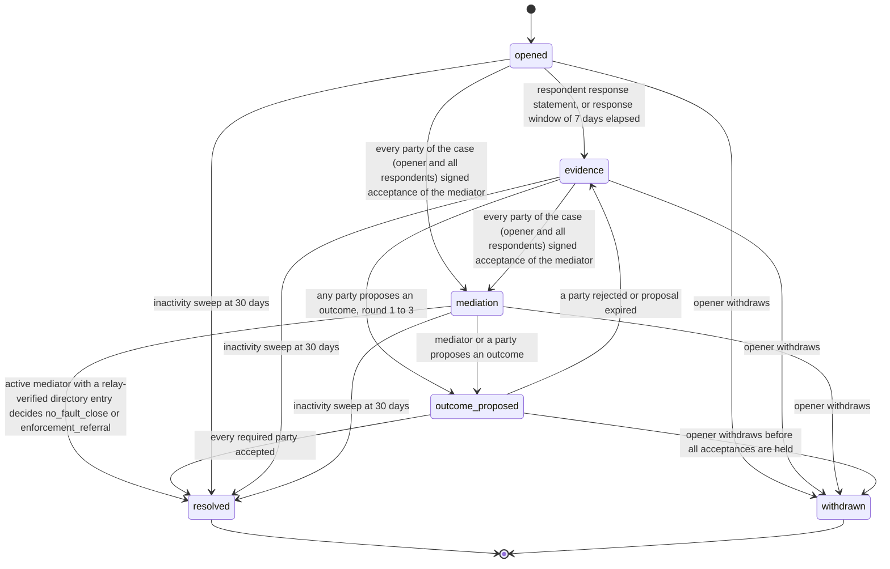

# PS-070-03 — Workflow state machine: Disputes

**Status:** SPECIFIED (Stage 3). **Module:** [F09.S02.M02 Disputes](SPEC.md) · **Scope:** MVP · **Code:** `packages/commerce/src/settlement/disputes` · **Contracts:** [CTR-COM-001](../../../planning/contracts/CTR-COM-001.md), [CTR-MNY-001](../../../planning/contracts/CTR-MNY-001.md), [CTR-ID-001](../../../planning/contracts/CTR-ID-001.md), [CTR-EVT-001](../../../planning/contracts/CTR-EVT-001.md), [CTR-ERR-001](../../../planning/contracts/CTR-ERR-001.md), [CTR-CAP-001](../../../planning/contracts/CTR-CAP-001.md), [CTR-IDM-001](../../../planning/contracts/CTR-IDM-001.md), [CTR-PRV-001](../../../planning/contracts/CTR-PRV-001.md), [CTR-FED-001](../../../planning/contracts/CTR-FED-001.md)

> Generated from `module.spec.yaml` by `tools/specgen`. Edit the YAML, then run `pnpm spec:render`.

## Requirements

- **PS-070-03.R01** Cases follow the declared lifecycle; any transition not listed is refused with CONFLICT_STATE.
- **PS-070-03.R02** Terminal states have no exits and no state change executes any money movement.
- **PS-070-03.R03** Conflicting signed outcomes freeze the case for renegotiation instead of choosing a winner.
- **PS-070-03.R04** The case clock is evaluated locally and every deadline is shown as a date.
- **PS-070-03.R05** The mediator becomes active only when acceptedBy equals the full party set of the case (opener and all respondents), and a self-declared mediator may propose outcomes but every outcome it proposes needs acceptance by every party.

## Specification

### DisputeCase lifecycle

Initial **opened**; terminal **resolved**, **withdrawn**.

| Transition | Trigger | Guard / effect |
|---|---|---|
| opened -> evidence | respondent response statement, or response window of 7 days elapsed | noResponseReceivedHere set when elapsed without any respondent statement received here |
| opened -> mediation | every party of the case (opener and all respondents) signed acceptance of the mediator | mediator status active |
| evidence -> mediation | every party of the case (opener and all respondents) signed acceptance of the mediator | evidence shared with the mediator only by explicit party action, per item |
| evidence -> outcome_proposed | any party proposes an outcome, round 1 to 3 | proposal valid for 7 days; emits commerce.dispute.outcome_proposed |
| mediation -> outcome_proposed | mediator or a party proposes an outcome | proposal valid for 7 days; emits commerce.dispute.outcome_proposed |
| mediation -> resolved | active mediator with a relay-verified directory entry decides no_fault_close or enforcement_referral | signed outcome statement; emits commerce.dispute.resolved |
| outcome_proposed -> resolved | every required party accepted | emits commerce.dispute.resolved; no money moves |
| outcome_proposed -> evidence | a party rejected or proposal expired | round incremented; case continues |
| opened -> withdrawn | opener withdraws | signed statement; emits commerce.dispute.withdrawn |
| evidence -> withdrawn | opener withdraws | signed statement; emits commerce.dispute.withdrawn |
| mediation -> withdrawn | opener withdraws | signed statement; emits commerce.dispute.withdrawn |
| outcome_proposed -> withdrawn | opener withdraws before all acceptances are held | signed statement; emits commerce.dispute.withdrawn |
| opened -> resolved | inactivity sweep at 30 days | resolution lapsed; emits commerce.dispute.resolved |
| evidence -> resolved | inactivity sweep at 30 days | resolution lapsed; emits commerce.dispute.resolved |
| mediation -> resolved | inactivity sweep at 30 days | resolution lapsed; emits commerce.dispute.resolved |

### Timeouts and scheduled transitions

- Response window 7 days from opening; evidence window 14 days from the first response; proposal validity 7 days; inactivity lapse 30 days.
- Sweep every 5 min in the open vault and at unlock.
- Statements waiting for their context are quarantined for 24 h then dropped with reason context_unknown; the quarantine holds at most 500 entries or 5 MiB with oldest-first eviction.
- A proposed mediator that has not been accepted by every party within 7 days returns to none; an active mediator unreachable for 7 days is marked unavailable.

## Verification

| Test | Level | Covers | Scenario | Expected |
|---|---|---|---|---|
| TEST-PS-070-09.T04 | property | PS-070-03.R01, PS-070-03.R02 | random command sequences | only declared transitions succeed; terminal states have no exits |
| TEST-PS-070-09.T05 | integration | PS-070-03.R04 | clock advanced 7, 14 and 30 days at the corresponding states | noResponseReceivedHere set, proposal expires back to evidence, case lapses with resolution lapsed |
| TEST-PS-070-09.T06 | integration | PS-070-03.R03, PS-070-06.R03 | two conflicting accepted outcomes delivered to vault B | case frozen with COMMERCE_DISPUTE_FORK, both retained, no auto-resolution |
| TEST-PS-070-09.T15 | e2e | PS-070-03.R04, PS-070-09.R03 | opener and respondent complete a return_agreed outcome on two devices | both screens show resolved with the no-money-movement note; axe zero serious issues |
| TEST-PS-070-09.T18 | integration | PS-070-03.R05, PS-070-01.R05 | 3-party cycle case; A selects mediator M and B accepts; then C accepts | M stays proposed and receives nothing after A and B; becomes active only when acceptedBy equals {A, B, C} |
| TEST-PS-070-09.T30 | contract | PS-070-04.R04, PS-070-03.R04 | a case resolved by accepted return_agreed and a case lapsed after 30 days | resolved payload carries caseCid, contextCid, the exact contextRef, parties, acceptedBy and outcomeCid for the first; the second carries resolution lapsed, documented as the FLOW-08 closed-unresolved outcome, with no outcomeCid |

## Dependencies

Module depends on: F09.S01.M01, F09.S02.M01, F09.S03.M01, F09.S03.M03, F07.S01.M01, F07.S02.M01, F07.S02.M02, F11.S01.M01, F11.S01.M03, F16.S02.M03, F15.S02.M03, F10.S02.M03, F10.S01.M02, F10.S01.M03, F10.S01.M04, F10.S02.M02, CTR-COM-001, CTR-MNY-001, CTR-ID-001, CTR-EVT-001, CTR-ERR-001, CTR-CAP-001, CTR-IDM-001, CTR-PRV-001, CTR-FED-001. Predecessor: [domain_schema.md](domain_schema.md).
