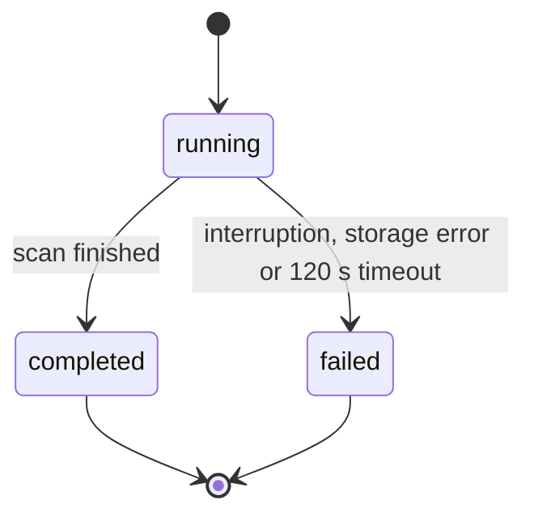

# PS-072-03 — Workflow state machine: Settlement reconciliation

**Status:** SPECIFIED (Stage 3). **Module:** [F09.S02.M03 Settlement reconciliation](SPEC.md) · **Scope:** MVP · **Code:** `packages/commerce/src/settlement/reconciliation` · **Contracts:** [CTR-COM-001](../../../planning/contracts/CTR-COM-001.md), [CTR-MNY-001](../../../planning/contracts/CTR-MNY-001.md), [CTR-ID-001](../../../planning/contracts/CTR-ID-001.md), [CTR-EVT-001](../../../planning/contracts/CTR-EVT-001.md), [CTR-ERR-001](../../../planning/contracts/CTR-ERR-001.md), [CTR-CAP-001](../../../planning/contracts/CTR-CAP-001.md), [CTR-IDM-001](../../../planning/contracts/CTR-IDM-001.md), [CTR-PRV-001](../../../planning/contracts/CTR-PRV-001.md), [CTR-OBS-001](../../../planning/contracts/CTR-OBS-001.md)

> Generated from `module.spec.yaml` by `tools/specgen`. Edit the YAML, then run `pnpm spec:render`.

## Requirements

- **PS-072-03.R01** A run is running until it completes or fails; reports are immutable after that except for dismiss marks.
- **PS-072-03.R02** The ten mismatch kinds and their rules are fixed by this spec and listed in the mismatch catalog below.
- **PS-072-03.R03** Runs are restartable; a failed run leaves no partial effects.

## Specification

### ReconciliationReport lifecycle

Initial **running**; terminal **completed**, **failed**.

| Transition | Trigger | Guard / effect |
|---|---|---|
| running -> completed | scan finished | counts and mismatches stored; emits commerce.reconciliation.mismatch_found for each new mismatch key |
| running -> failed | interruption, storage error or 120 s timeout | partial results discarded |

### Timeouts and scheduled transitions

- Daily run at the first vault unlock after 24 h since the last completed run; incremental runs 30 s after relevant events, coalesced; run timeout 120 s.
- Mismatch catalog. M01 deal_completed_without_settled_claim (action); M02 crypto_claim_final_without_observation (action); M03 observation_final_but_claim_not_final (action); M04 claim_acknowledged_without_ack_statement (warn); M05 stale_claim older than 10 days without progress (warn); M06 amount_or_currency_mismatch including overpayment (action); M07 receipt_without_matching_claim_state (warn); M08 statement_stuck prepared for over 24 h (info); M09 unresolved_fork (action); M10 crypto_claim_without_verifier older than 24 h (warn).

## Verification

| Test | Level | Covers | Scenario | Expected |
|---|---|---|---|---|
| TEST-PS-072-09.T02 | unit | PS-072-02.R02, PS-072-03.R02 | each kind fixture and its clean twin | mismatch present only for the triggering fixture |
| TEST-PS-072-09.T04 | unit | PS-072-01.R03, PS-072-03.R01, PS-072-03.R03 | interrupt a run at 40 percent and rerun | first report failed with no partial list; second identical to a fresh run |
| TEST-PS-072-09.T05 | integration | PS-072-03.R01 | complete a run twice with no changes | second run emits no new events; report keys identical |

## Dependencies

Module depends on: F09.S01.M01, F09.S01.M03, F09.S02.M01, F09.S03.M03, CTR-COM-001, CTR-MNY-001, CTR-ID-001, CTR-EVT-001, CTR-ERR-001, CTR-CAP-001, CTR-IDM-001, CTR-PRV-001, CTR-OBS-001. Predecessor: [domain_schema.md](domain_schema.md).
