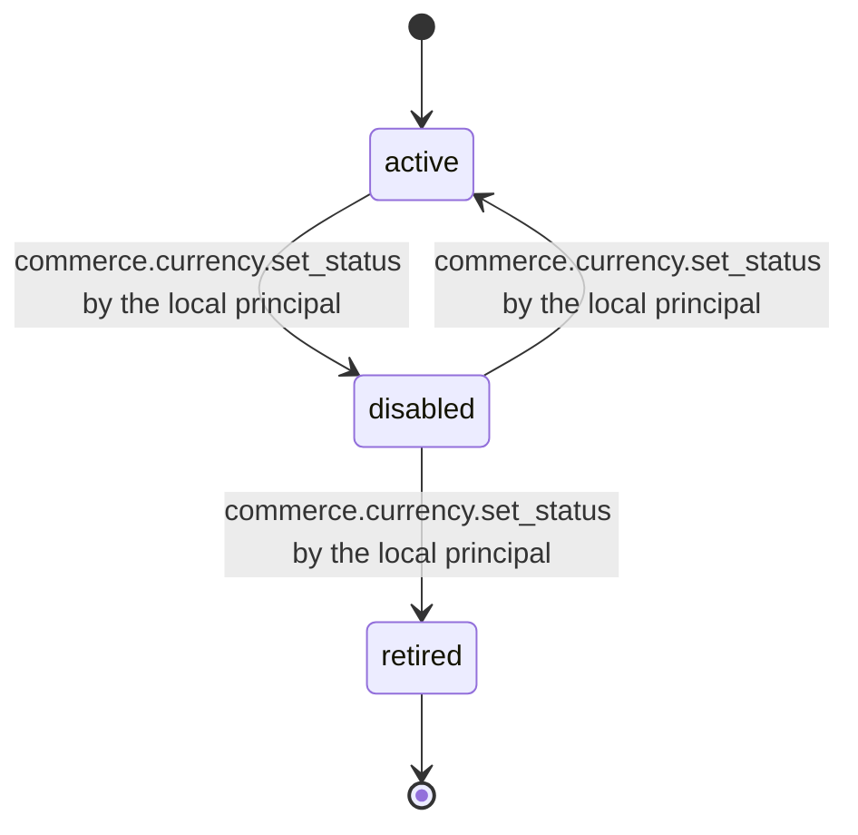

# PS-073-03 — Workflow state machine: Currency registry

**Status:** SPECIFIED (Stage 3). **Module:** [F09.S03.M01 Currency registry](SPEC.md) · **Scope:** MVP · **Code:** `packages/commerce/src/valuation/currency` · **Contracts:** [CTR-MNY-001](../../../planning/contracts/CTR-MNY-001.md), [CTR-ID-001](../../../planning/contracts/CTR-ID-001.md), [CTR-EVT-001](../../../planning/contracts/CTR-EVT-001.md), [CTR-ERR-001](../../../planning/contracts/CTR-ERR-001.md), [CTR-CAP-001](../../../planning/contracts/CTR-CAP-001.md), [CTR-IDM-001](../../../planning/contracts/CTR-IDM-001.md), [CTR-FLG-001](../../../planning/contracts/CTR-FLG-001.md)

> Generated from `module.spec.yaml` by `tools/specgen`. Edit the YAML, then run `pnpm spec:render`.

## Requirements

- **PS-073-03.R01** Currencies move between active and disabled freely; retirement is permanent.
- **PS-073-03.R02** Disabling never alters existing records; it only blocks new use.
- **PS-073-03.R03** Retirement requires the usage check to show zero open references.

## Specification

### CurrencyDef lifecycle

Initial **active**; terminal **retired**.

| Transition | Trigger | Guard / effect |
|---|---|---|
| active -> disabled | commerce.currency.set_status by the local principal | emits commerce.currency.status_changed |
| disabled -> active | commerce.currency.set_status by the local principal | emits commerce.currency.status_changed |
| disabled -> retired | commerce.currency.set_status by the local principal | CurrencyUsagePort reports zero open references; emits commerce.currency.status_changed |

### Timeouts and scheduled transitions

_None._

## Verification

| Test | Level | Covers | Scenario | Expected |
|---|---|---|---|---|
| TEST-PS-073-09.T04 | property | PS-073-03.R01, PS-073-03.R02 | random status transitions | only active, disabled, retired transitions succeed; retired is final; existing Money stays readable |
| TEST-PS-073-09.T05 | integration | PS-073-03.R03, PS-073-02.R03 | retire a currency referenced by an open offer | PRECONDITION_FAILED until references are closed |

## Dependencies

Module depends on: F09.S03.M03, CTR-MNY-001, CTR-ID-001, CTR-EVT-001, CTR-ERR-001, CTR-CAP-001, CTR-IDM-001, CTR-FLG-001. Predecessor: [domain_schema.md](domain_schema.md).
