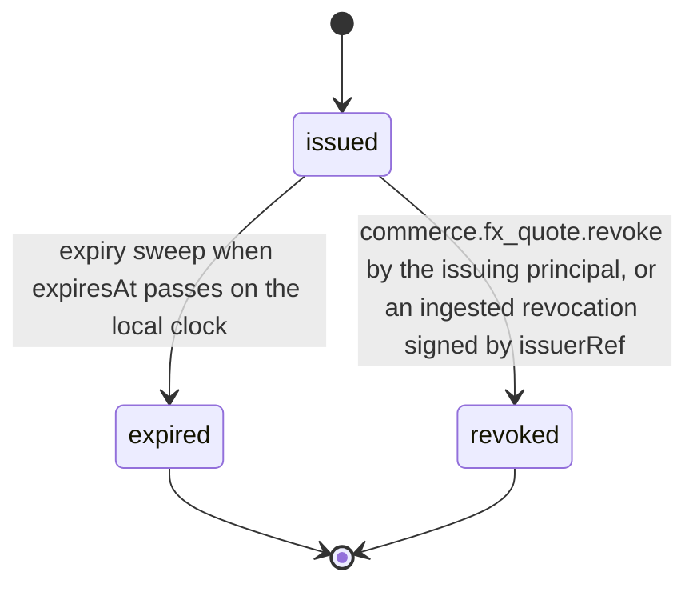

# PS-075-03 — Workflow state machine: FX rates and quotes

**Status:** SPECIFIED (Stage 3). **Module:** [F09.S03.M02 FX rates and quotes](SPEC.md) · **Scope:** MVP · **Code:** `packages/commerce/src/valuation/rates` · **Contracts:** [CTR-MNY-001](../../../planning/contracts/CTR-MNY-001.md), [CTR-ID-001](../../../planning/contracts/CTR-ID-001.md), [CTR-EVT-001](../../../planning/contracts/CTR-EVT-001.md), [CTR-ERR-001](../../../planning/contracts/CTR-ERR-001.md), [CTR-CAP-001](../../../planning/contracts/CTR-CAP-001.md), [CTR-IDM-001](../../../planning/contracts/CTR-IDM-001.md), [CTR-OBS-001](../../../planning/contracts/CTR-OBS-001.md), [CTR-FLG-001](../../../planning/contracts/CTR-FLG-001.md), [CTR-FED-001](../../../planning/contracts/CTR-FED-001.md), [CTR-PRV-001](../../../planning/contracts/CTR-PRV-001.md)

> Generated from `module.spec.yaml` by `tools/specgen`. Edit the YAML, then run `pnpm spec:render`.

## Requirements

- **PS-075-03.R01** A quote is issued once and ends as expired or revoked; it is never extended or edited.
- **PS-075-03.R02** Expiry is evaluated against the local clock of the vault doing the check; any relay-signed asOf or expiresAt is shown as that relay's claim, receivers check embedded quotes against their own clock with the 10-minute skew note used by F09.S01.M01, and consumers must call the validity check before using a pinned quote.
- **PS-075-03.R03** Revocation applies to manual quotes only; a revoked quote that was already embedded in a statement sent to a peer is superseded by a signed revocation statement and peers invalidate it at next sync.
- **PS-075-03.R04** A barter_normalization quote lives at most 24 h and is shown as 'pinned rate agreed by all parties'; it is never extended, and a deadline beyond its expiry needs a re-quote and fresh consent (N16, F02.S04.M02).

## Specification

### FxQuote lifecycle

Initial **issued**; terminal **expired**, **revoked**.

| Transition | Trigger | Guard / effect |
|---|---|---|
| issued -> expired | expiry sweep when expiresAt passes on the local clock | status flips lazily on read and by sweep every 60 s; relay clocks are never consulted |
| issued -> revoked | commerce.fx_quote.revoke by the issuing principal, or an ingested revocation signed by issuerRef | only for sourceKind manual; emits commerce.fx_quote.revoked and, for a local revoke, queues statement classrup.commerce.fx_quote_revocation/v1 |

### Timeouts and scheduled transitions

- Expiry sweep every 60 s on the local clock marks quotes with expiresAt ≤ local now as expired; default lifetime 15 min; barter_normalization quotes up to 24 h.
- Revocations naming an unknown quote are buffered 24 h (quote_unknown) and then dropped.

## Verification

| Test | Level | Covers | Scenario | Expected |
|---|---|---|---|---|
| TEST-PS-075-09.T04 | unit | PS-075-03.R01, PS-075-03.R02, PS-075-01.R03 | no relay configured; the vault clock is advanced to expiresAt and to one second before | check evaluates the local clock only - valid then EXPIRED - and the quote is never extended |
| TEST-PS-075-09.T05 | integration | PS-075-03.R03 | issuer revokes a manual quote already sent to a peer | local check shows revoked, revocation statement reaches prepared then peer_accepted, peer pin check reports invalid |
| TEST-PS-075-09.T15 | unit | PS-075-03.R02, PS-075-05.R04 | relay-signed quote from a relay whose clock is 20 minutes ahead, embedded in a statement received 12 minutes after its claimed signing time | expiry decided on vault B's clock; relay asOf and expiresAt shown as the relay's claim; skew note shown |
| TEST-PS-075-09.T16 | unit | PS-075-03.R04, PS-075-02.R01 | barter_normalization requests of 86 400 000 ms and 86 400 001 ms, a general provider request of 3 600 001 ms, and a 24 h quote checked 23 h 29 min after issue against F02.S04.M02's 30-minute remaining-life requirement | first accepted and labelled 'pinned rate agreed by all parties'; second and third VALIDATION_FAILED; the 24 h quote still has 31 minutes of life and passes |

## Dependencies

Module depends on: F09.S03.M01, F09.S03.M03, F11.S01.M01, F11.S01.M03, F07.S02.M01, F07.S02.M02, F10.S01.M02, F10.S01.M03, F10.S01.M04, F10.S02.M02, CTR-MNY-001, CTR-ID-001, CTR-EVT-001, CTR-ERR-001, CTR-CAP-001, CTR-IDM-001, CTR-OBS-001, CTR-FLG-001, CTR-FED-001, CTR-PRV-001. Predecessor: [domain_schema.md](domain_schema.md).
