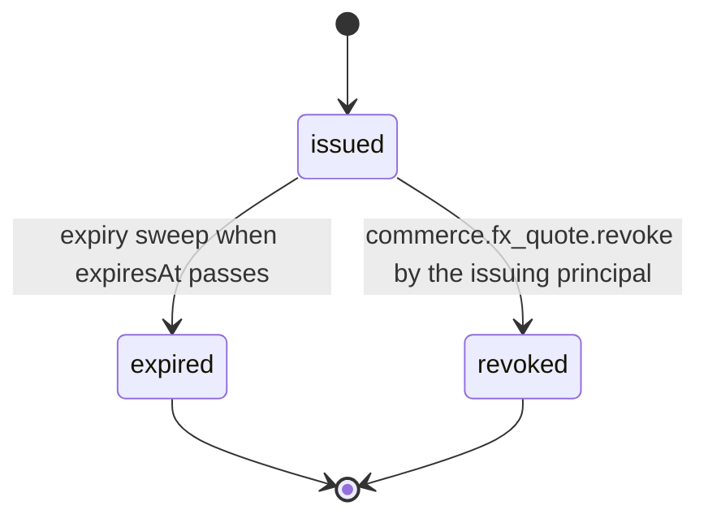

# PS-075-03 — Workflow state machine: FX rates and quotes

**Status:** SPECIFIED (Stage 3). **Module:** [F09.S03.M02 FX rates and quotes](SPEC.md) · **Scope:** MVP · **Code:** `packages/commerce/src/valuation/rates` · **Contracts:** [CTR-MNY-001](../../../planning/contracts/CTR-MNY-001.md), [CTR-ID-001](../../../planning/contracts/CTR-ID-001.md), [CTR-EVT-001](../../../planning/contracts/CTR-EVT-001.md), [CTR-ERR-001](../../../planning/contracts/CTR-ERR-001.md), [CTR-CAP-001](../../../planning/contracts/CTR-CAP-001.md), [CTR-IDM-001](../../../planning/contracts/CTR-IDM-001.md), [CTR-OBS-001](../../../planning/contracts/CTR-OBS-001.md), [CTR-FLG-001](../../../planning/contracts/CTR-FLG-001.md)

> Generated from `module.spec.yaml` by `tools/specgen`. Edit the YAML, then run `pnpm spec:render`.

## Requirements

- **PS-075-03.R01** A quote is issued once and ends as expired or revoked; it is never extended or edited.
- **PS-075-03.R02** Expiry is evaluated against the relay clock; consumers must call the validity check before using a pinned quote.
- **PS-075-03.R03** Revocation applies to manual quotes only; a revoked quote that was already embedded in a statement sent to a peer is superseded by a signed revocation statement and peers invalidate it at next sync.

## Specification

### FxQuote lifecycle

Initial **issued**; terminal **expired**, **revoked**.

| Transition | Trigger | Guard / effect |
|---|---|---|
| issued -> expired | expiry sweep when expiresAt passes | status flips lazily on read and by sweep every 60 s |
| issued -> revoked | commerce.fx_quote.revoke by the issuing principal | only for sourceKind manual; emits commerce.fx_quote.revoked and queues statement classrup.commerce.fx_quote_revocation/v1 |

### Timeouts and scheduled transitions

- Expiry sweep every 60 s marks quotes with expiresAt ≤ now as expired; quote default lifetime 15 min.

## Verification

| Test | Level | Covers | Scenario | Expected |
|---|---|---|---|---|
| TEST-PS-075-09.T04 | unit | PS-075-03.R01, PS-075-03.R02, PS-075-01.R03 | clock advanced to expiresAt and one second before | check returns valid then EXPIRED; quote never extended |
| TEST-PS-075-09.T05 | integration | PS-075-03.R03, PS-075-05.R03 | issuer revokes a manual quote already sent to a peer | local check shows revoked, revocation statement reaches prepared then peer_accepted, peer pin check reports invalid |

## Dependencies

Module depends on: F09.S03.M01, F09.S03.M03, CTR-MNY-001, CTR-ID-001, CTR-EVT-001, CTR-ERR-001, CTR-CAP-001, CTR-IDM-001, CTR-OBS-001, CTR-FLG-001. Predecessor: [domain_schema.md](domain_schema.md).
