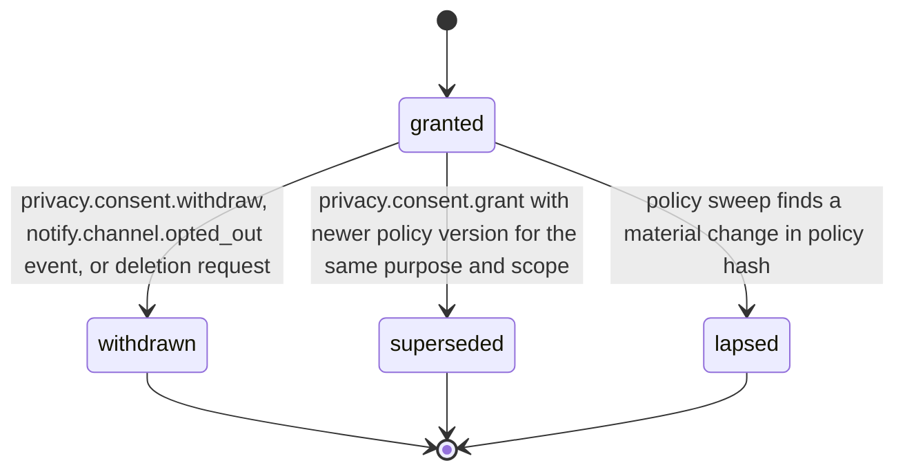

# PS-076-03 — Workflow state machine: Privacy consent

**Status:** SPECIFIED (Stage 3). **Module:** [F10.S01.M01 Privacy consent](SPEC.md) · **Scope:** MVP · **Code:** `packages/privacy/src/data_controls/consent` · **Contracts:** [CTR-PRV-001](../../../planning/contracts/CTR-PRV-001.md), [CTR-ID-001](../../../planning/contracts/CTR-ID-001.md), [CTR-EVT-001](../../../planning/contracts/CTR-EVT-001.md), [CTR-ERR-001](../../../planning/contracts/CTR-ERR-001.md), [CTR-CAP-001](../../../planning/contracts/CTR-CAP-001.md), [CTR-IDM-001](../../../planning/contracts/CTR-IDM-001.md), [CTR-FED-001](../../../planning/contracts/CTR-FED-001.md), [CTR-OBS-001](../../../planning/contracts/CTR-OBS-001.md)

> Generated from `module.spec.yaml` by `tools/specgen`. Edit the YAML, then run `pnpm spec:render`.

## Requirements

- **PS-076-03.R01** A consent is granted until it is withdrawn, superseded by a newer grant or lapsed by a material policy change.
- **PS-076-03.R02** Withdrawal takes effect in the same local transaction and is final for that row; consent again means a new grant.
- **PS-076-03.R03** Lapse is evaluated at unlock and daily against the bundled policy versions.

## Specification

### PrivacyConsent lifecycle

Initial **granted**; terminal **withdrawn**, **superseded**, **lapsed**.

| Transition | Trigger | Guard / effect |
|---|---|---|
| granted -> withdrawn | privacy.consent.withdraw, notify.channel.opted_out event, or deletion request | emits privacy.consent.withdrawn and queues signed withdrawal statement for relay-scoped purposes |
| granted -> superseded | privacy.consent.grant with newer policy version for the same purpose and scope | no event for the superseded row; the new row emits privacy.consent.granted |
| granted -> lapsed | policy sweep finds a material change in policy hash | emits privacy.consent.withdrawn with reason policy_changed |

### Timeouts and scheduled transitions

- Policy sweep at vault unlock and every 24 h while open.

## Verification

| Test | Level | Covers | Scenario | Expected |
|---|---|---|---|---|
| TEST-PS-076-09.T02 | unit | PS-076-01.R02, PS-076-03.R01 | grant, regrant with new version, withdraw | history keeps three rows with statuses superseded, then withdrawn; none edited |
| TEST-PS-076-09.T05 | property | PS-076-03.R01, PS-076-03.R02 | random grant and withdraw sequences | at most one granted row per purpose and relay; withdrawn rows never return to granted |
| TEST-PS-076-09.T06 | integration | PS-076-03.R03 | change policy hash with materialChange | consent lapses at unlock, privacy.consent.withdrawn emitted with reason policy_changed, check returns false |
| TEST-PS-076-09.T09 | integration | PS-076-04.R03, PS-076-03.R01 | notify.channel.opted_out and privacy.deletion.requested delivered | matching consents withdrawn with the right source; replay is a no-op |

## Dependencies

Module depends on: F07.S01.M01, CTR-PRV-001, CTR-ID-001, CTR-EVT-001, CTR-ERR-001, CTR-CAP-001, CTR-IDM-001, CTR-FED-001, CTR-OBS-001. Predecessor: [domain_schema.md](domain_schema.md).
